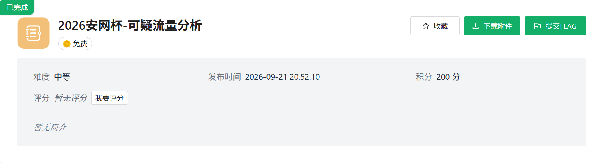
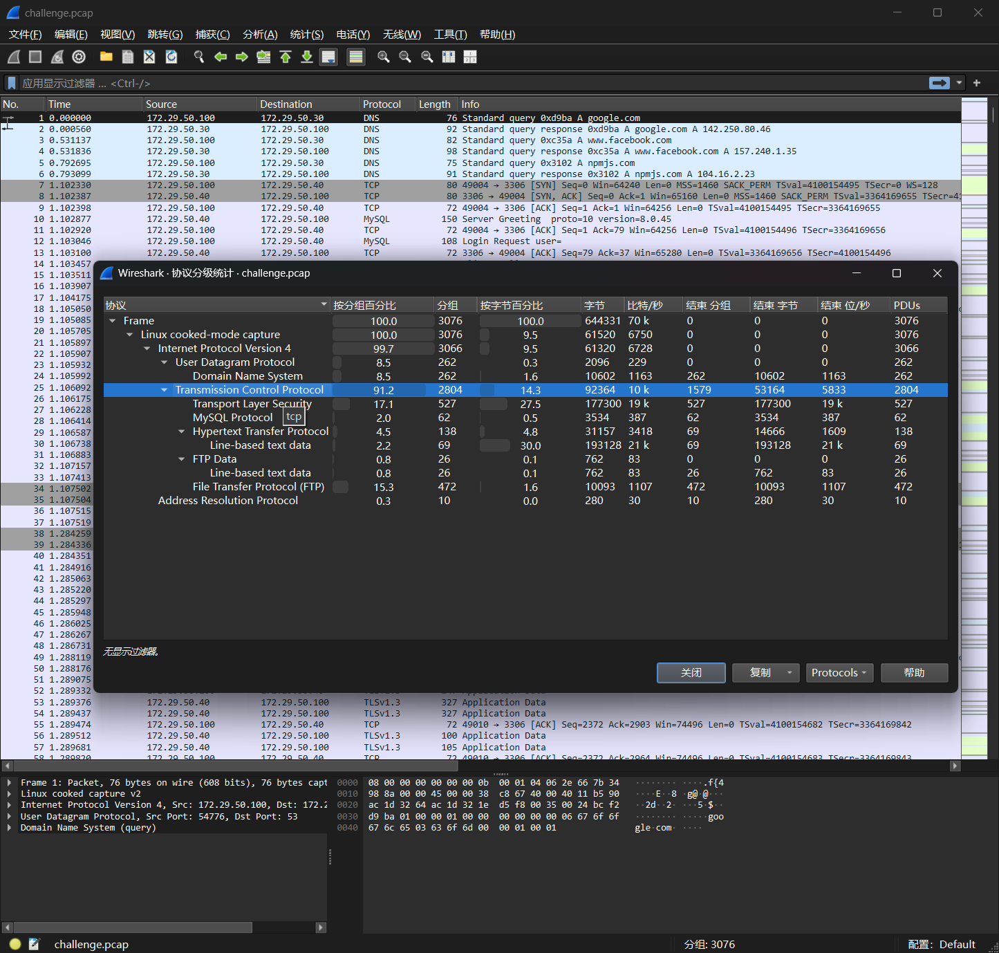
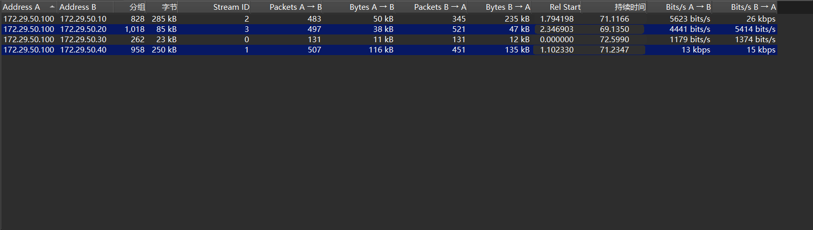
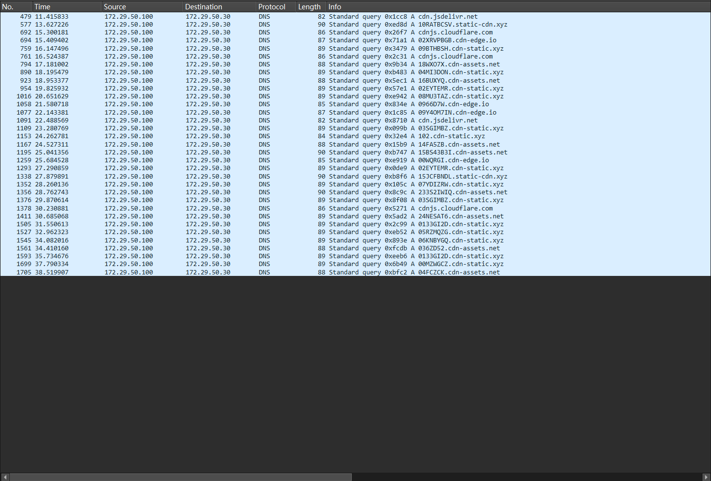
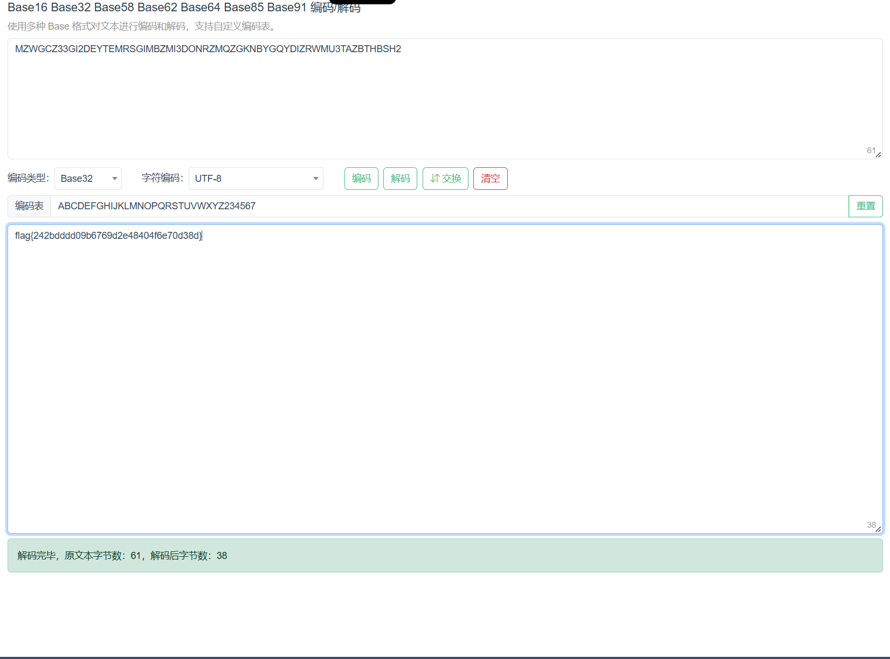

+++
title = "2026 安网杯：可疑流量分析"
date = 2026-11-07T15:55:00+08:00
draft = false
featuredImage = "images/cover.png"
summary = "协议分级和会话统计定位受害主机，HTTP、FTP、MySQL 都是噪音，真正的可疑点是 cdn-static.xyz 的 DNS 查询——2 位序号加 Base32 分块外传，拼起来解码就是 flag。"
tags = ["CTF", "流量分析", "Wireshark"]
categories = ["WP"]
slug = "2026-an-wang-bei-ke-yi-liu-liang-fen-xi"
+++



用 Wireshark 打开 附件`challenge.pcap`

统计-协议分级 发现TCP最多



统计-会话-IPV4



分析可得172.29.50.100为受害主机，与另外4台主机都有通信，分析流量包可以发现:

```text
.10 HTTP

.20 FTP

.30 DNS服务器

.40 MySQL
```

依次用 `http`、`ftp`、`mysql`、`dns` 过滤器快速过一遍：FTP 是明文登录 + 传 readme.txt；MySQL 是 TLS 加密；HTTP 只有 index/about 两页。三条都是噪音，唯一可疑的是 DNS。

子域结构中有例如 `10RATBCSV`、`02XRVPBGB` 都是2位数字+base32的字符串，这是典型的DNS分块外传。

过滤器过滤

```text
dns.flags.response == 0 && dns.qry.name contains "cdn"
```



发现里面有重复和乱序，直接取cdn-static.xyz的11条，按序号排序，去掉前两位序号拼接Base32

```text
00 MZWGCZ      → MZWGCZ
01 33GI2D      → 33GI2D
02 EYTEMR      → EYTEMR
03 SGIMBZ      → SGIMBZ
04 MI3DON      → MI3DON
05 RZMQZG      → RZMQZG
06 KNBYGQ      → KNBYGQ
07 YDIZRW      → YDIZRW
08 MU3TAZ      → MU3TAZ
09 BTHBSH      → BTHBSH
10 2           → 2
```

得到61个字符：

```text
MZWGCZ33GI2DEYTEMRSGIMBZMI3DONRZMQZGKNBYGQYDIZRWMU3TAZBTHBSH2
```

解码得到flag



```text
flag{242bdddd09b6769d2e48404f6e70d38d}
```
