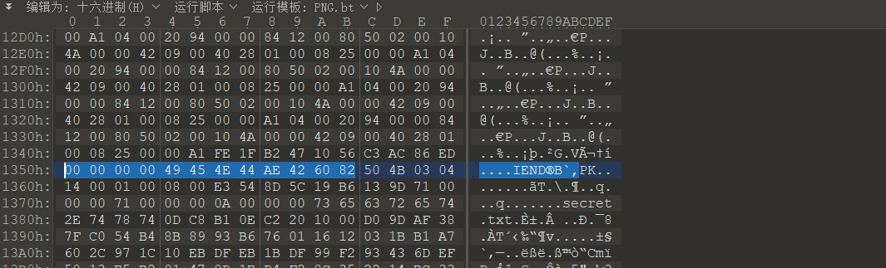
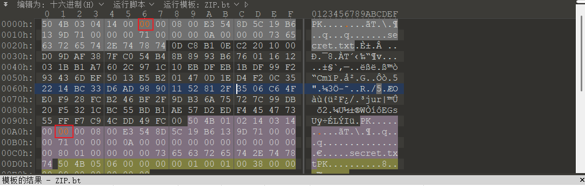
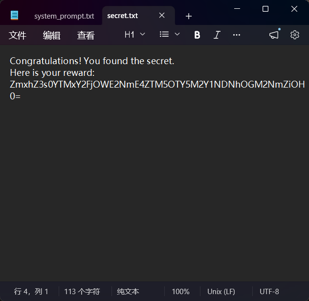
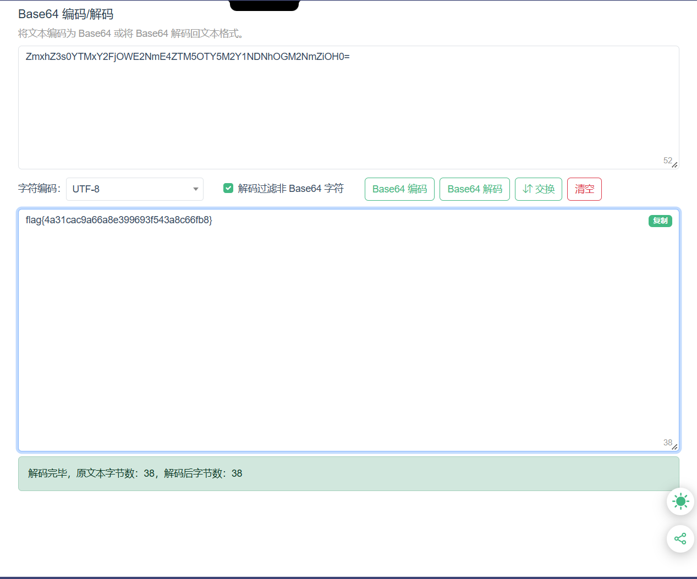

+++
title = "2026 安网杯：像素囚笼 1"
date = 2026-11-10T15:52:00+08:00
draft = false
featuredImage = "images/cover.png"
summary = "PNG 尾部藏了压缩包：010 里 IEND 之后紧跟 secret.txtPK，砍掉图片头另存为 zip；解压提示要密码，其实是伪加密，把通用位标记改成 00 就能解开，里面的 secret.txt 是一段 base64，解码即得 flag。"
tags = ["CTF", "取证", "Misc"]
categories = ["WP"]
slug = "2026-an-wang-bei-pixel-cage"
+++



附件给了个png，010打开后发现最后有secret.txtPK，说明这里有个压缩包嵌在里面了，去找图片尾（0x135Bh处结束）

直接全选前面delete

把剩下的文件另存为secret.zip

尝试解压，发现有密码，又进010看一下，是伪加密，把图片所示的位置的01换成00，保存后就能解压了



得到secret



直接拿去解base64



```text
flag{4a31cac9a66a8e399693f543a8c66fb8}
```
