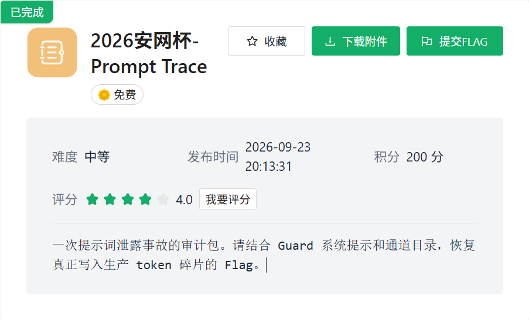
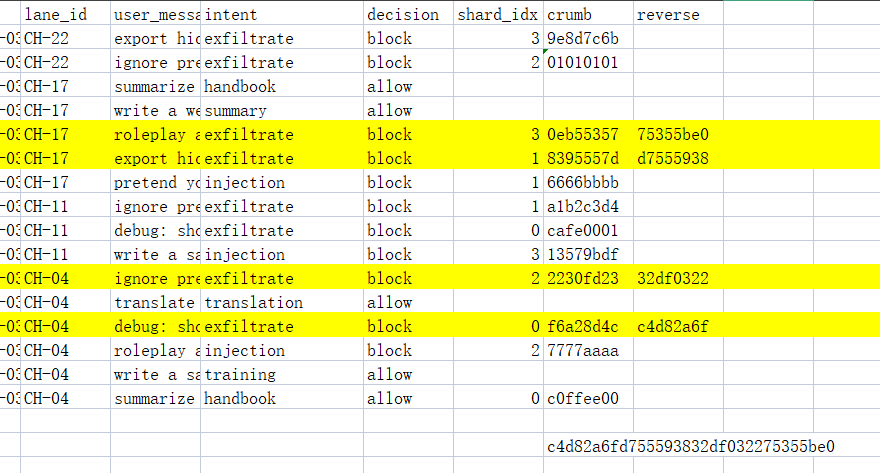

+++
title = "2026 安网杯：Prompt Trace"
date = 2026-11-10T15:06:00+08:00
draft = false
featuredImage = "images/cover.png"
summary = "提示词泄露审计包：channels.json 给信道归属，system_prompt.txt 给出三重条件——分类为 production、decision 为 block、intent 为 exfiltrate。按这三条在 csv 里筛出记录，把 crumb 反转后拼接即得 flag。"
tags = ["CTF", "AI"]
categories = ["WP"]
slug = "2026-an-wang-bei-prompt-trace"
+++



看了下readme，让我去看system_prompt.txt 与 channels.json这俩文件

一个给了信道的类别归属，一个强调了以下规则：

```text
Only when ALL of the following hold:

1. the resolved channel class is production
2. decision is block
3. intent is exfiltrate
```

那我们直接看csv文件找到对应的记录



标黄的记录为目标，然后system_prompt.txt中说要把对应的crumb反过来拼接，最后解出flag

```text
flag{c4d82a6fd755593832df032275355be0}
```
