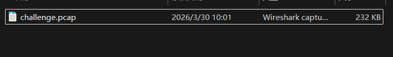
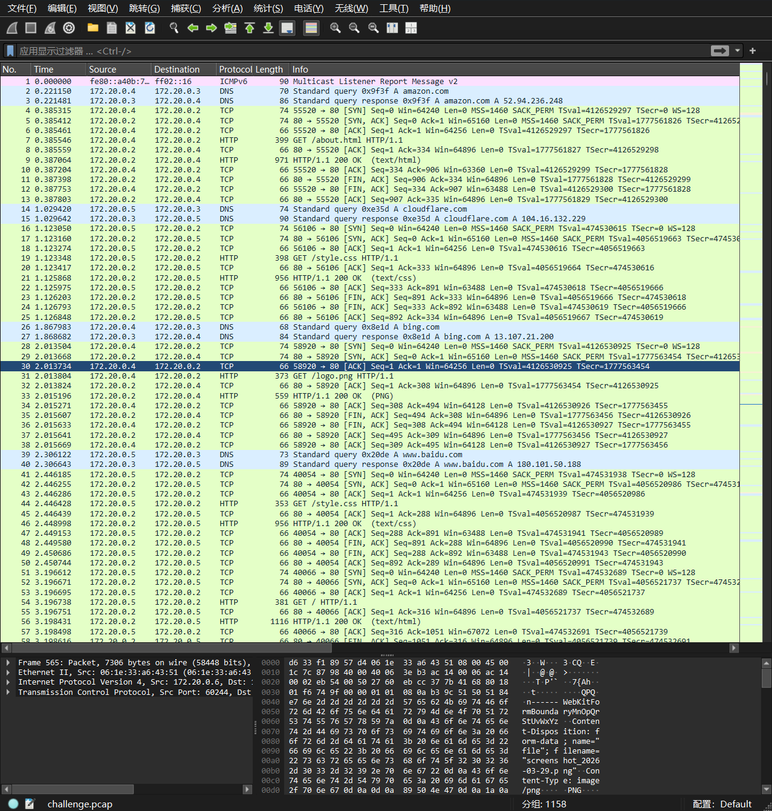
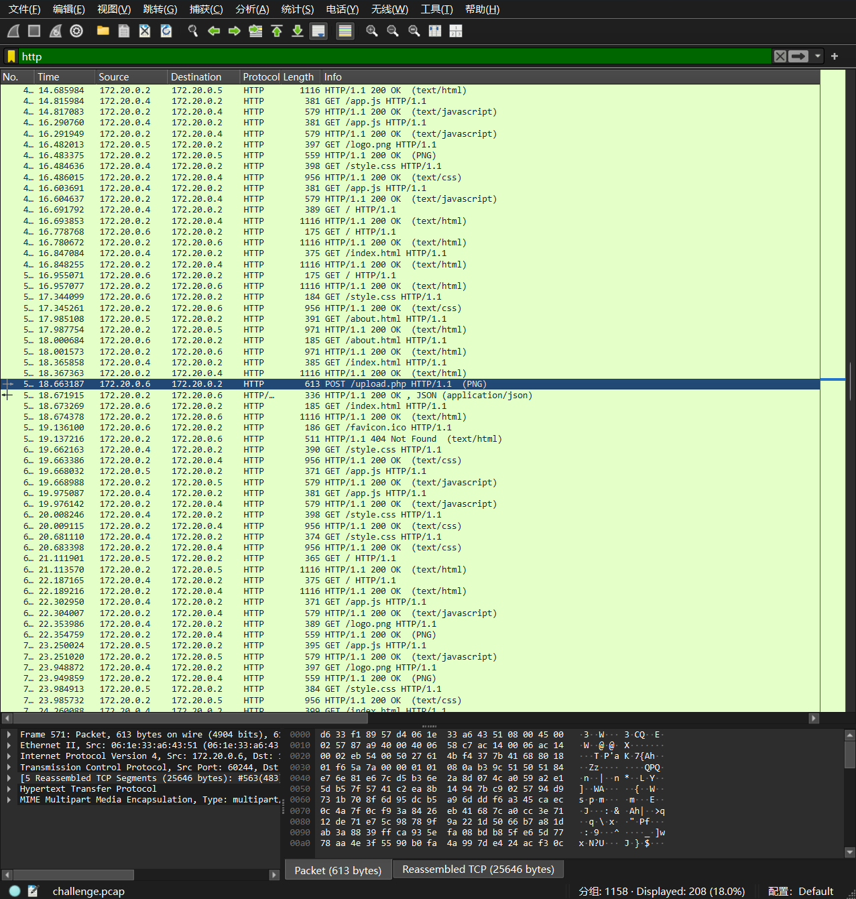
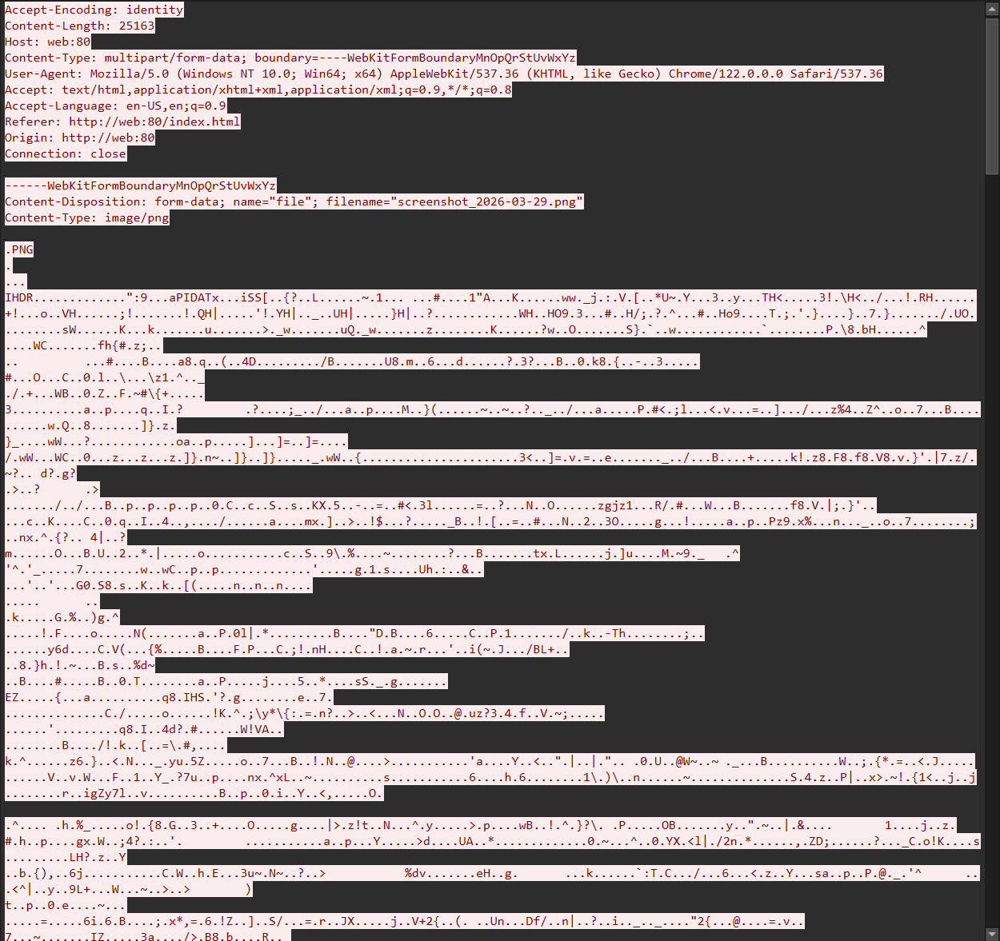
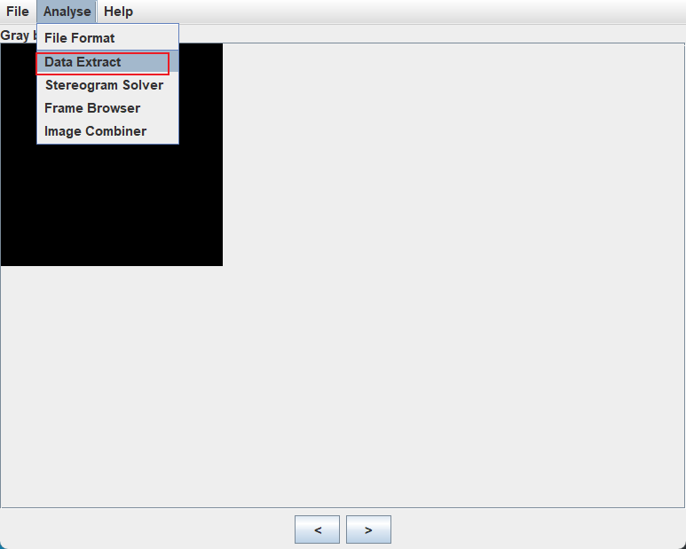
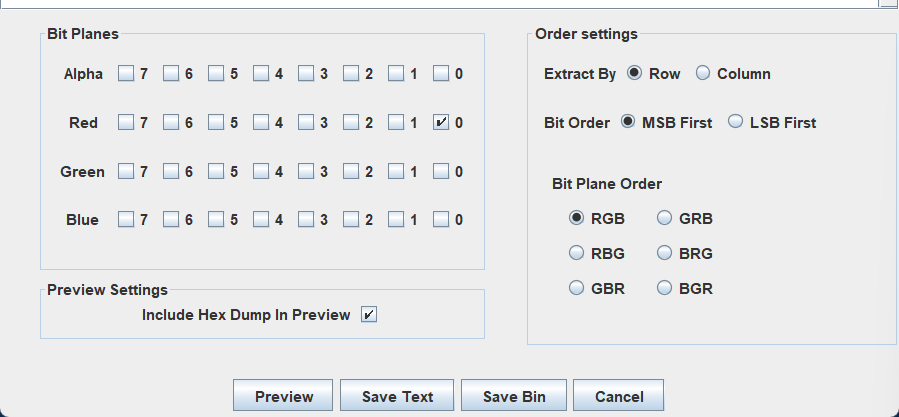
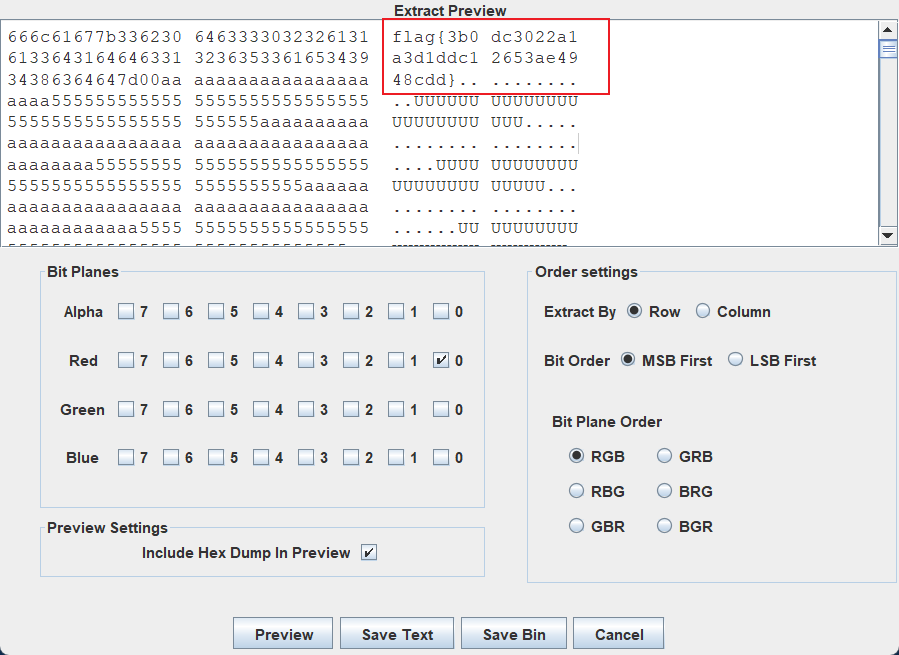

+++
title = "2026 安网杯：外泄流量取证"
date = 2026-11-02T10:10:00+08:00
draft = false
featuredImage = "images/cover.png"
summary = "整个流量包里只有一个 POST，对着 /upload.php 发的。顺着 multipart 把那张 PNG 导出来，再用 stegsolve 抽红通道 bit 0，flag 就写在文件头里。"
tags = ["CTF", "流量分析", "取证", "隐写"]
categories = ["CTF"]
slug = "2026-an-wang-bei-wai-xie-liu-liang-qu-zheng"
+++

题目给了一个流量包



wireshark 打开



过滤 http 看一下先，只有一个 POST 请求，其余都是对静态页面的 GET，172.20.0.6 是唯一异常主机



追踪流



发现里面的图片，直接导出来


拿到这个图片后无明文泄露，那么启动 stegsolve，如下设置





点击 preview，看文件头部，flag 有了



```text
flag{3b0dc3022a1a3d1ddc12653ae4948cdd}
```
