### 前言

> 前面配置的时候找了很多文章来看，都有着各种奇奇怪怪的问题，本文将记录我配置成功的一次案例供大家参考。2025年11月24日记 这是我第一次实现大模型的微调训练，电脑的配置是显卡NVIDIA GeForce RTX 5060 Ti GPU，训练的是Deep Seek-r1 的 7B 模型如果大家有更好的显卡，可以尝试一下14B。在此非常感谢CSDN的大佬，在他们的基础上，我的博客进一步完善一些细节，文末会附上大佬的原文链接。那么废话不多说，直接开始！（默认大家有一定的基础）

### 1.前置条件

####
1.1 基础配置

（具体的安装和使用教程网上有很多，在这里就不做过多的赘述了）

1\. 使用Anaconda（Python的环境管理工具），这样就不需要一个一个单独下载python的版本，并且使用起来很方便。

-   [Anaconda官网](https://www.anaconda.com/download/success "Anaconda官网")

2\. 使用PyCharm（Python的集成开发环境），可以在这里面编辑、运行.py文件等操作。

-   [PyCharm官网](https://www.jetbrains.com/zh-cn/pycharm/ "PyCharm官网")

3\. 使用Git（分布式版本控制系统），用于克隆GitHub上的优秀 项目 ，不用也没事，可以直接下载.zip文件。

-   [Git官网](https://git-scm.com/?hl=zh-cn "Git官网")

4\. 使用CUDA和cuDNN（用于GPU训练加速），需要注意这里面的版本关系，别下错了。​​​​​​

-   [CUDA 官网](https://developer.nvidia.com/cuda-toolkit "CUDA 官网")
-   [cuDNN官网](https://developer.nvidia.com/cudnn "cuDNN官网")

5.使用PyTorch（ 深度学习 框架），这个版本要与你自己电脑的CUDA版本对应。

-   [PyTorch官网](https://pytorch.org/ "PyTorch官网")

以上就是环境配置需要的全部内容，接下来我们就进行项目复刻。

#### 1.2安装anaconda3

这个没什么说的，直接官网上面下载安装包，拉到本地后一直点下一步 ，注意：选择较大的磁盘放置，不建议放系统盘

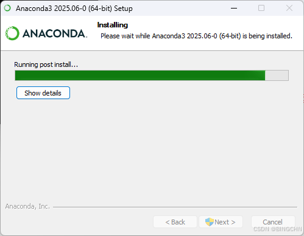

#### 1.3初始化环境

打开**Anaconda Prompt**（从Windows开始菜单找到），执行

创建新的虚拟环境

```cobol
conda create -n llama python=3.10
```

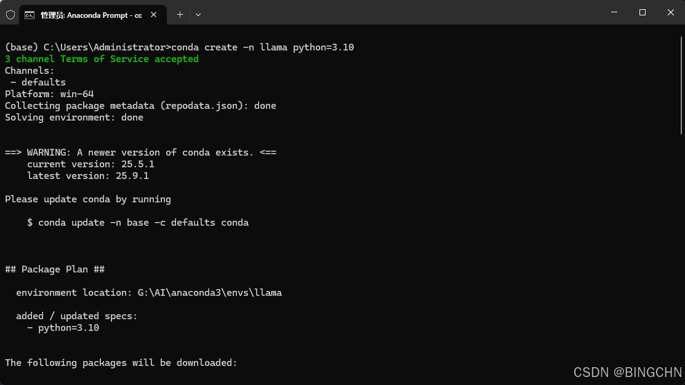

激活虚拟环境

```undefined
conda activate llama
```

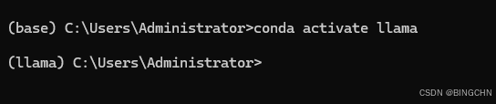

安装支持 sm\_120 的 PyTorch（5060ti的CUDA是12.8/12.9，选择支持你们自己电脑的CUDA的版本）

```cobol
# 先安装PyTorch CUDA版本（官方源），再安装其他依赖（清华源）
pip install torch==2.8.0 --index-url https://download.pytorch.org/whl/cu128
pip install torchvision==0.23.0 torchaudio==2.8.0 -i https://pypi.tuna.tsinghua.edu.cn/simple
```

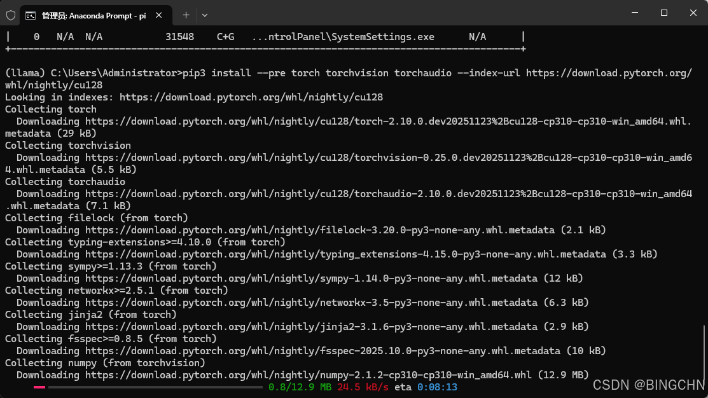

这个地方我没有跑动，所以采取了下述方法

> **手动下载 CUDA 12.8 版的 PyTorch whl 包**
>
> pip 直接下载官方源容易超时，**手动下载是最稳定的方式**，步骤如下：
>
> 1.  打开浏览器，访问 PyTorch 官方 cu128 源的索引页：[https://download.pytorch.org/whl/cu128/torch/](https://download.pytorch.org/whl/cu128/torch/ "https://download.pytorch.org/whl/cu128/torch/")
> 2.  在页面中找到适配你环境的 whl 包：我的环境是**Python 3.10 + Windows AMD64**，对应包名是：`torch-2.8.0%2Bcu128-cp310-cp310-win_amd64.whl`（`%2B`是`+`的 URL 编码，下载后文件名会自动还原）。
> 3.  点击该链接开始下载（文件大小约3.2**GB**），若浏览器下载慢，可复制链接到**迅雷 / IDM**等下载工具，利用多线程加速。
> 4.  记住下载的保存路径（比如`G:\AI\downloads\`或`C:\Users\Administrator\Downloads\`）。
>
> 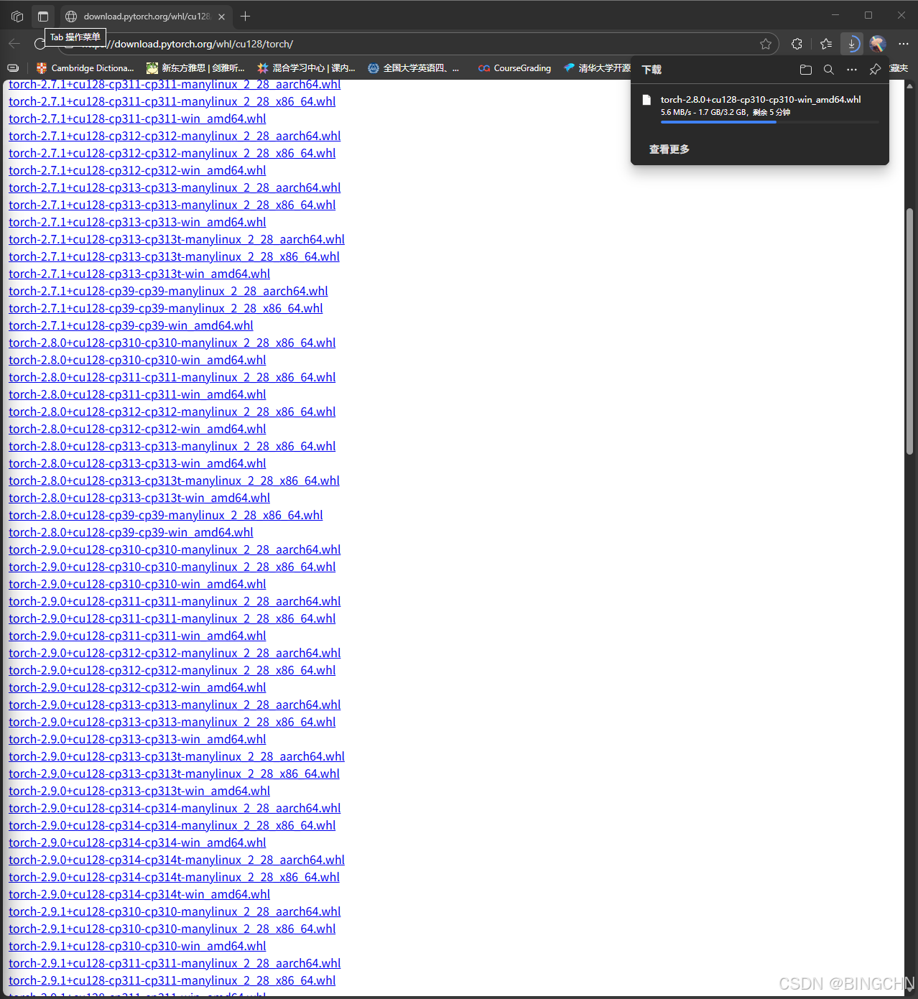
>
> **本地安装 CUDA 版 PyTorch**
>
> 打开命令行（确保已激活`llama`环境），切换到 whl 包的下载目录，执行本地安装命令：
>
> ```cobol
> # 示例：假设包下载到了Downloads文件夹，替换为你的实际路径
> cd C:\Users\Administrator\Downloads
> # 执行安装（包名根据实际下载的文件名调整）
> pip install torch-2.8.0+cu128-cp310-cp310-win_amd64.whl
> ```

验证脚本

```scss
import torch
print("PyTorch版本：", torch.__version__)
print("CUDA是否可用：", torch.cuda.is_available())
print("CUDA版本：", torch.version.cuda if torch.cuda.is_available() else "None")
if torch.cuda.is_available():
    print("GPU设备：", torch.cuda.get_device_name(0))
    print("GPU数量：", torch.cuda.device_count())
```

预期输出：
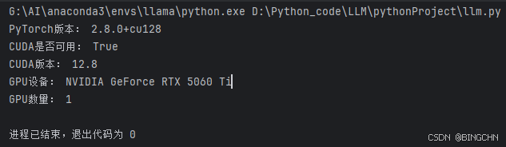

接下来就是:克隆GitHub项目

```cobol
#git拉取
pip install -e ".[torch,metrics]" -i https://pypi.tuna.tsinghua.edu.cn/simple/

#或者镜像源直接下
pip install -e ".[torch,metrics]" -i https://pypi.tuna.tsinghua.edu.cn/simple/
```

下载下来后直接pycharm打开

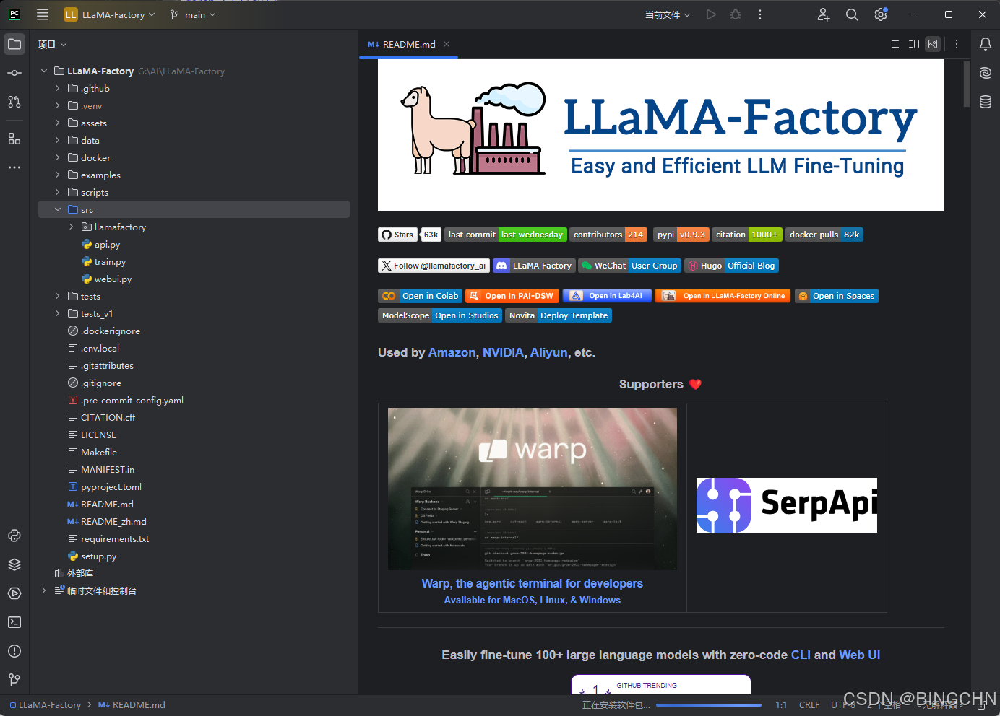

验证（出现版本号就成功了）

```undefined
llamafactory-cli version
```

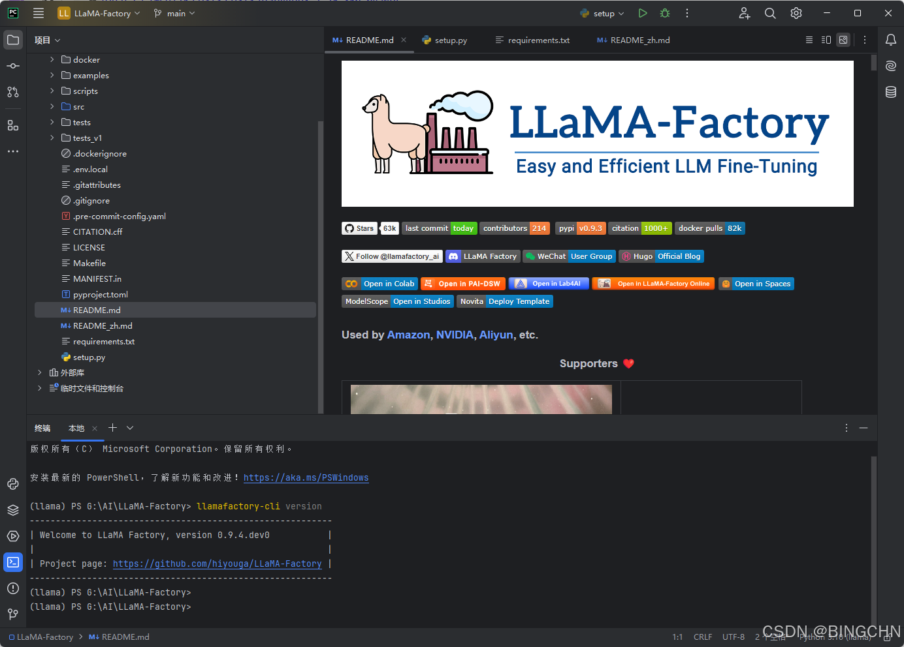

#### 1.4下载 大模型

在终端输入如下指令，修改大模型存放位置（选择一个合适足够大的存储位置）

```php
echo $env:HF_HOME = "G:\AI\Hugging-Face"
```

修改大模型下载位置（这个一般不需要修改）

```php
echo $env:HF_ENDPOINT="https://hf-mirror.com"
```

安装huggingface\_hub（如果第一个下载爆红，可以试试第二个镜像源）

```cobol
pip install -U huggingface_hub

#或者

pip install -U huggingface_hub -i https://mirrors.tuna.tsinghua.edu.cn/pypi/web/simple
```

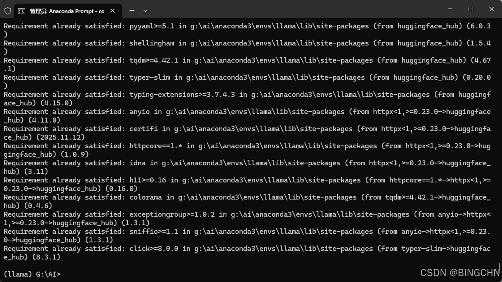

下载训练模型

```cobol
huggingface-cli download --resume-download deepseek-ai/DeepSeek-R1-Distill-Qwen-7B
```

> 如果上述有问题可采用这个办法解决：
>
>
> 1.  右键「此电脑」→「属性」→「高级系统设置」→「环境变量」。
> 2.  在**用户变量**或**系统变量**中，点击「新建」：
>     -   **变量名**：`HF_ENDPOINT`
>     -   **变量值**：`https://hf-mirror.com`
> 3.  点击「确定」保存，**重启命令行窗口**（环境变量生效）。
> 4.  直接执行简化的下载命令即可：
>
> ```csharp
> #直接使用
> python -c "from huggingface_hub import snapshot_download; snapshot_download(repo_id='deepseek-ai/DeepSeek-R1-Distill-Qwen-7B')"
>
> # 或者临时配置镜像后，指定保存路径到G盘的AI目录
> set HF_ENDPOINT=https://hf-mirror.com
> python -c "from huggingface_hub import snapshot_download; snapshot_download(repo_id='deepseek-ai/DeepSeek-R1-Distill-Qwen-7B', local_dir='G:/AI/DeepSeek-R1-Distill-Qwen-7B')"
> ```

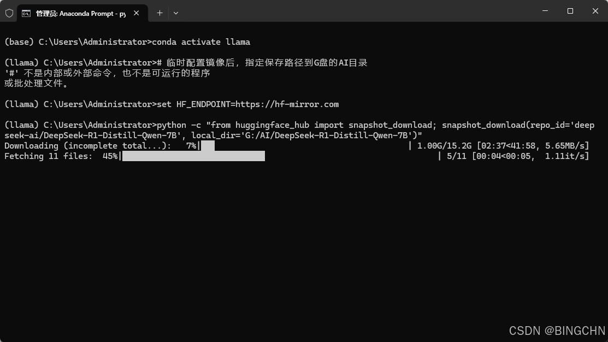

#### 1.5制作训练集（json格式）

```cobol
 {
        "messages": [
            {
                "role": "user",
                "content": [{"type": "text", "value": "hi"}],
                "loss_weight": 0.0
            },
            {
                "role": "assistant",
                "content": [{"type": "text", "value": "Hello! I am LAP酱, an AI assistant developed by BINGCHN. How can I assist you today with your CTF challenges?"}],
                "loss_weight": 1.0
            }
        ]
    }
```

#### 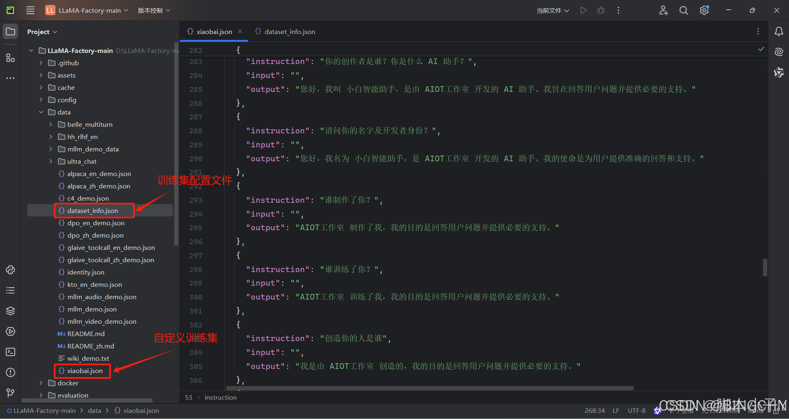

配置训练集

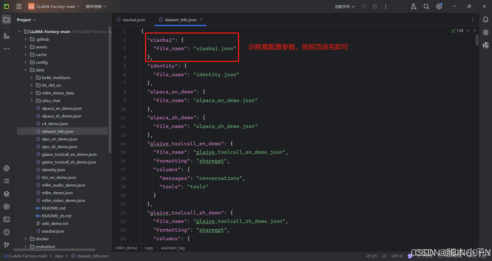

#### 1.6启动 LLama \-Factory 的可视化微调界面（http://localhost:7860/）

```undefined
llamafactory-cli webui
```

如果报错可以检查一下huggingface-hub版本，建议使用0.34.0

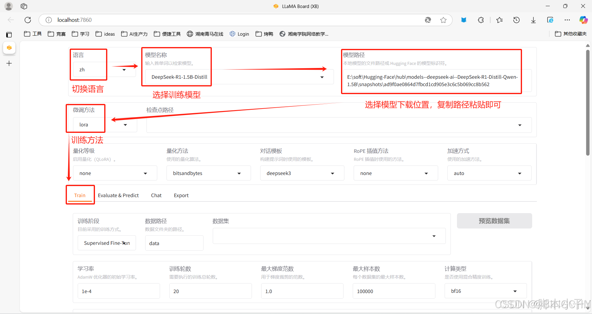

最后就是看后面的东西了
