**免责声明：本文章发布于比赛正式结束后，不存在提前泄露比赛信息及违规泄露wp的情况，****作者不对读者基于本文内容而产生的任何行为或后果承担责任。如有任何侵权问题，请联系作者删除。**

### **WEB5**

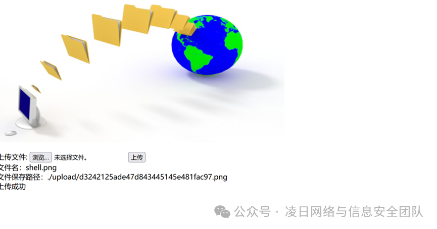

传一句话木马，dirsearch扫出来有个www.zip。得到源码：

<table><tbody><tr><td>
<code>&lt;?php</code>

<code>error_reporting(</code><code>0</code><code>);</code>

<code>if</code><code>($_GET[</code><code>'file'</code><code>]) {</code>

<code>&nbsp; &nbsp;&nbsp;</code><code>$</code><code>file</code><code>=</code><code>$_GET[</code><code>'file'</code><code>];</code>

<code>&nbsp; &nbsp;&nbsp;</code><code>$</code><code>file</code><code>=</code><code>base64_decode($</code><code>file</code><code>);</code>

<code>&nbsp; &nbsp;&nbsp;</code><code>if</code><code>(strstr($</code><code>file</code><code>,</code><code>'./'</code><code>)){</code>

<code>&nbsp; &nbsp; &nbsp; &nbsp;&nbsp;</code><code>die('');</code>

<code>&nbsp; &nbsp;&nbsp;</code><code>}</code>

<code>&nbsp; &nbsp;&nbsp;</code><code>include&nbsp;</code><code>'upload/'</code><code>.$</code><code>file</code><code>.</code><code>'.png'</code><code>;</code>

<code>}</code>

<code>?&gt;</code>
</td></tr></tbody></table>

说明在include.php目录下有个 GET 传参，传入file然后进行文件包含。

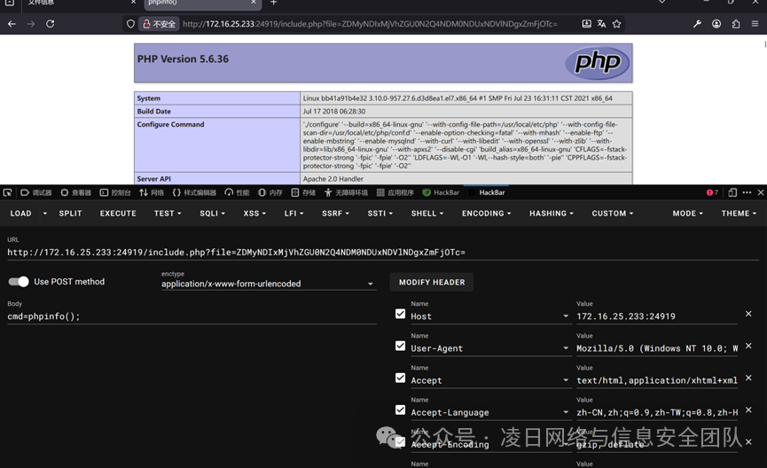

可以看到成功包含然后蚂蚁的剑直接连

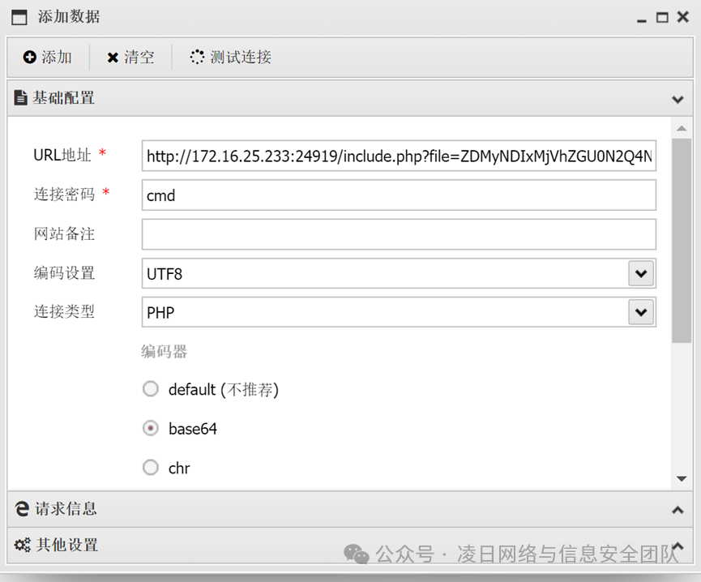

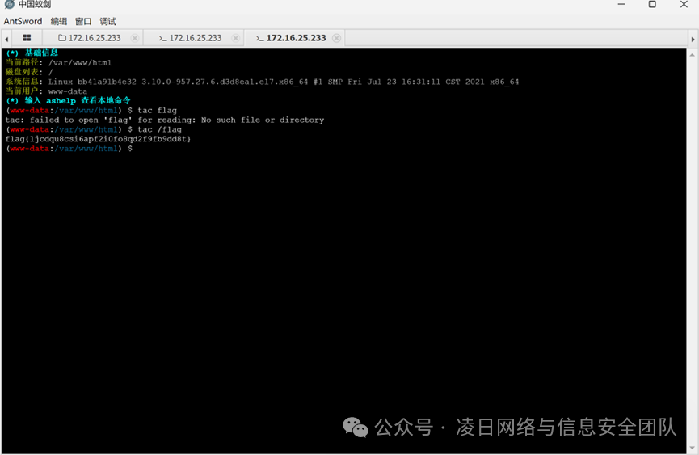

Tac /flag

### **Telnet用户密码抓取**

进去之后追踪TCP流发现login passwd，根据后面指令发现login可能为双写

包上flag直接交

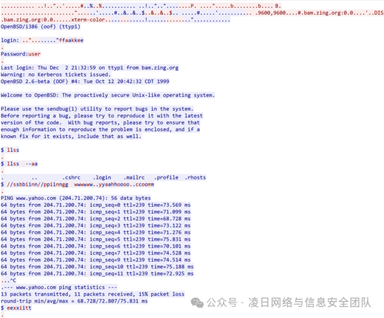

flag{login:fake&password:user}

### **HTTP**

打开追踪http流，第19个就是

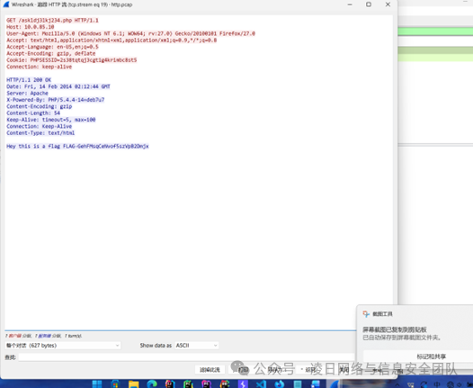

拼接上flag直接交flag{GehFMsqCeNvof5szVpB2Dmjx}

### **Webshell**

打开后看了下流量包发现有secret，然后继续追踪发现有个s3c3r3t.txt然后直接追踪该流如图中z2的值拿去解base64

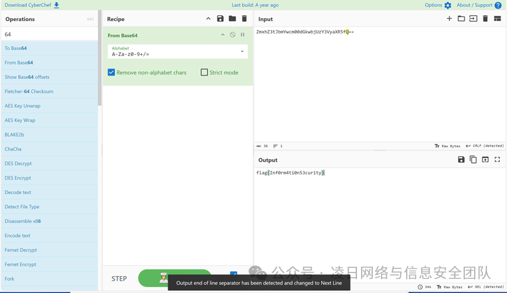

Flag{Inf0rm4ti0n53}

### **tribalwars账户密码**

进去直接搜user

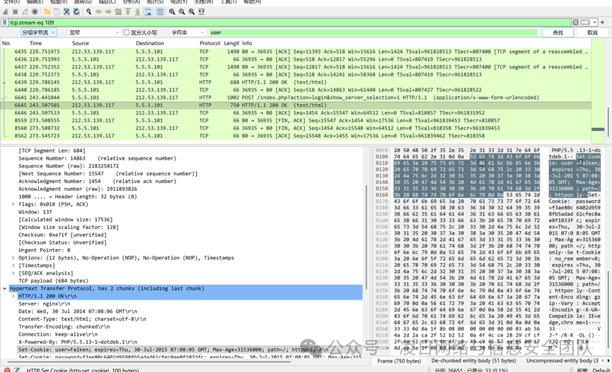

Flag{username=Falken&password=Joshua}

### **Hand**

改宽高直接出

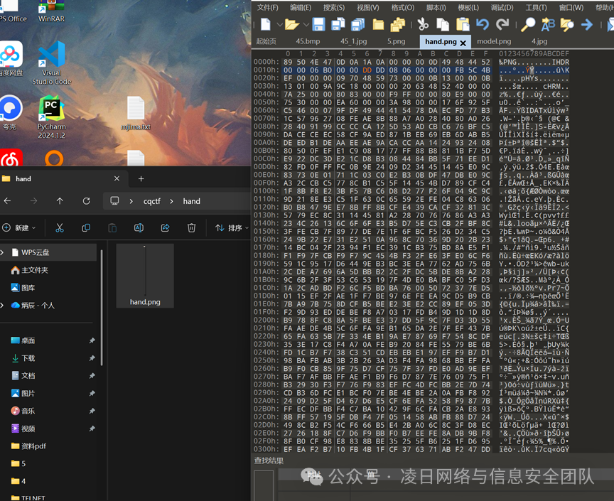

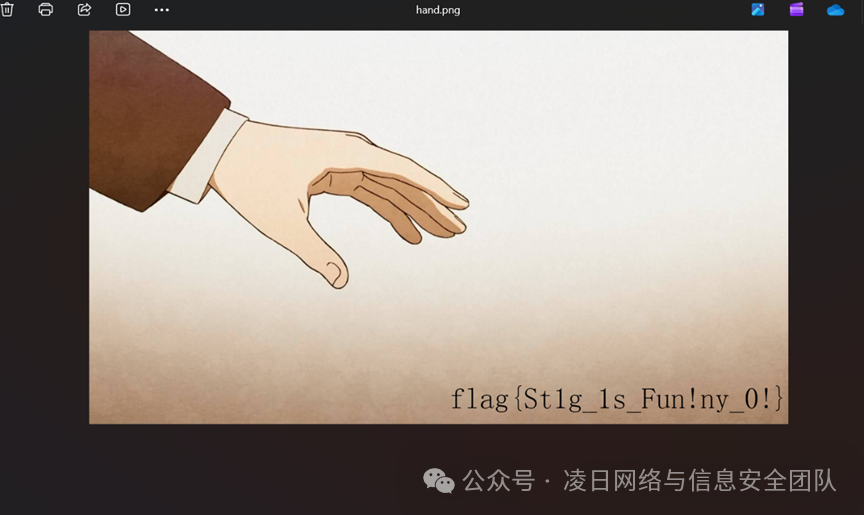

Flag{St1g\_1s\_Fun!ny\_0!}

### **手下留情**

打开文件，是一个png图片，根据题目，更改图片高度得flag.

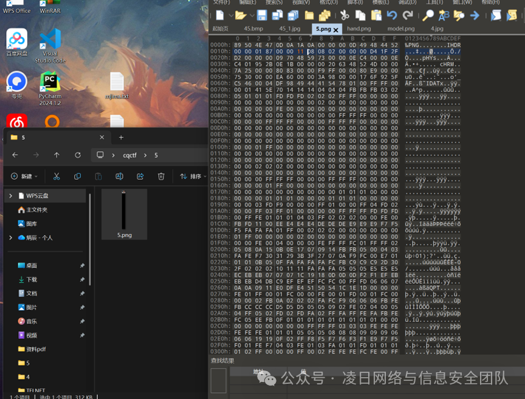

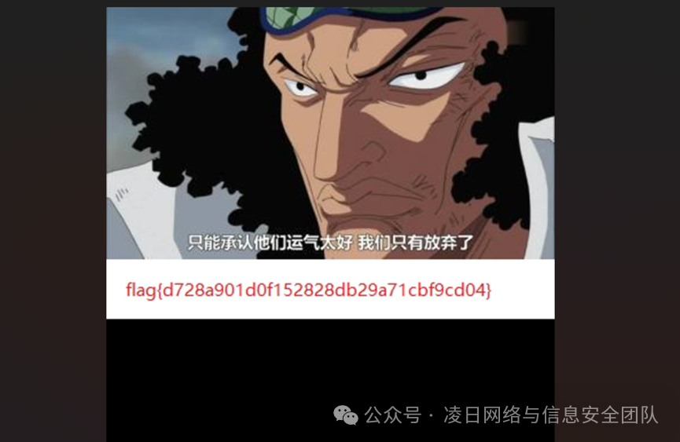

Flag{d728a901d0f152828db29a71cbf9cd04}

### **Networking**

    进去直接搜flag

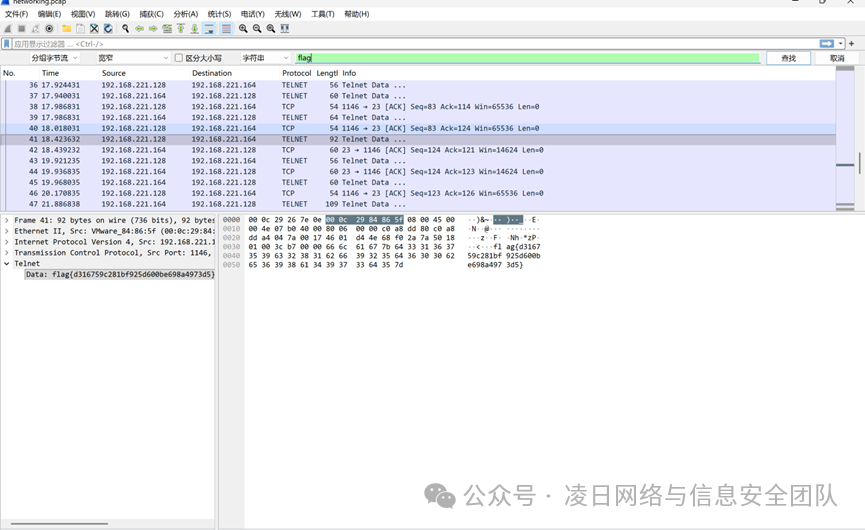

flag{d316759c281bf925d600be698a4973d5}

### **Upx**

看题目名去upx壳，拖入IDA中找到加密函数，一个简单的加密对比，写脚本即可

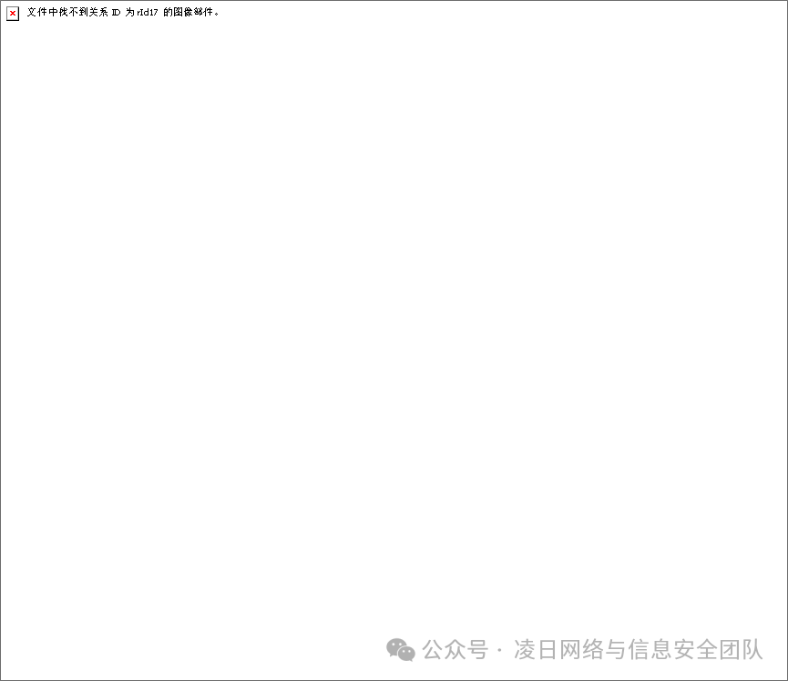

flag{th1s1sf14g}

Exp :

<table><tbody><tr><td>
<code>#include&lt;stdio.h&gt;</code>

<code>int&nbsp;</code><code>main()</code>

<code>{</code>

<code>&nbsp; &nbsp;&nbsp;</code><code>char b[]</code><code>=</code><code>"cjfor~c=~?|v &amp;ti"</code><code>;</code>

<code>&nbsp; &nbsp;&nbsp;</code><code>char a[</code><code>16</code><code>];</code>

<code>&nbsp; &nbsp;&nbsp;</code><code>int</code><code>i;</code>

<code>&nbsp; &nbsp;&nbsp;</code><code>for</code><code>(i</code><code>=</code><code>0</code><code>;i&lt;</code><code>15</code><code>;i</code><code>+</code><code>+</code><code>)</code>

<code>&nbsp; &nbsp;&nbsp;</code><code>{</code>

<code>&nbsp; &nbsp; &nbsp; &nbsp;&nbsp;</code><code>a[i]</code><code>=</code><code>b[i]^(i</code><code>+</code><code>5</code><code>);</code>

<code>&nbsp; &nbsp;&nbsp;</code><code>}</code>

<code>&nbsp; &nbsp;&nbsp;</code><code>puts(a);</code>

<code>&nbsp; &nbsp;&nbsp;</code><code>return</code><code>0</code><code>;</code>

<code>}</code>
</td></tr></tbody></table>

### **no\_tell**

还是简单的加密字符串对比，flag长度18，提取出flag【index】中保存的字符串，最后逆向脚本即可

102,108,97,103,123,103,101,109,102,105,72,104,76,86,76,70,102,125

flag{gemfiHhLVLFf}

### PrivateChannel（G3）

在唯一的一个数据包中发现了一串字符串

<table><tbody><tr><td><code>CDAISIWillWin</code></td></tr></tbody></table>

但是并提交后发现并不是Flag

继续观察发现，STP 数据包都是一样的，DNS 也没有任何特别之处

但是 ICMP 类型的 ping 数据包很奇怪，这里先对ping的数据包进行提取

<table><tbody><tr><td><code>tshark -r PrivateChannel.pcap.pcapng -Y "icmp.type==8 or icmp.type==0"</code></td></tr></tbody></table>

得到的结果如下

<table><tbody><tr><td><code>376 616.966522 192.168.50.10 → 192.168.0.50 ICMP 98 Echo (ping) request id=0x06ef, seq=1/256, ttl=64</code></td></tr><tr><td><code>378 617.965929 192.168.50.10 → 192.168.0.50 ICMP 98 Echo (ping) request id=0x06ef, seq=2/512, ttl=64</code></td></tr><tr><td><code>379 617.990279 192.168.0.50 → 192.168.50.10 ICMP 98 Echo (ping) reply id=0x06ef, seq=2/512, ttl=41</code></td></tr><tr><td><code>395 641.491491 192.168.0.50 → 192.168.50.10 ICMP 98 Echo (ping) request id=0x152c, seq=1/256, ttl=41</code></td></tr><tr><td><code>396 641.492213 192.168.50.10 → 192.168.0.50 ICMP 98 Echo (ping) reply id=0x152c, seq=1/256, ttl=64</code></td></tr><tr><td><code>479 796.186499 192.168.50.10 → 192.168.0.50 ICMP 42 Echo (ping) request id=0x0000, seq=0/0, ttl=64</code></td></tr><tr><td><code>480 796.205229 192.168.0.50 → 192.168.50.10 ICMP 42 Echo (ping) reply id=0x0000, seq=0/0, ttl=41</code></td></tr><tr><td><code>481 796.297219 192.168.50.10 → 192.168.0.50 ICMP 42 Echo (ping) request id=0x0000, seq=0/0, ttl=64</code></td></tr><tr><td><code>482 796.316115 192.168.0.50 → 192.168.50.10 ICMP 42 Echo (ping) reply id=0x0000, seq=0/0, ttl=41</code></td></tr><tr><td><code>483 796.408717 192.168.50.10 → 192.168.0.50 ICMP 42 Echo (ping) request id=0x0000, seq=0/0, ttl=64</code></td></tr><tr><td><code>484 796.427036 192.168.0.50 → 192.168.50.10 ICMP 42 Echo (ping) reply id=0x0000, seq=0/0, ttl=41</code></td></tr><tr><td><code>485 796.516729 192.168.50.10 → 192.168.0.50 ICMP 42 Echo (ping) request id=0x0000, seq=0/0, ttl=64</code></td></tr><tr><td><code>486 796.527942 192.168.0.50 → 192.168.50.10 ICMP 42 Echo (ping) reply id=0x0000, seq=0/0, ttl=41</code></td></tr></tbody></table>

发现只有前 5 个数据包的字段都填写了(id=)，其他的都是0x0000，我们对0填充的ping流量包进行查看，发现不同的地方是 Identification ，过滤值为 ip.id

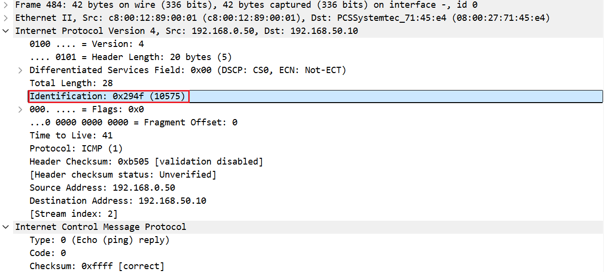

tshark进行筛取

<table><tbody><tr><td><code>tshark -r PrivateChannel.pcap.pcapng -Y "icmp.type==0 or icmp.type==8" -T fields -e ip.id &gt; output.txt</code></td></tr></tbody></table>

进行From Hex后，发现中间带有部分杂糅字符

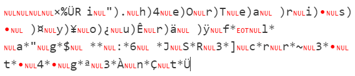

研究后发现，icmp.type\==0 即reply的 Identification ，只对 icmp.type==8 进行筛取

<table><tbody><tr><td><code>tshark -r PrivateChannel.pcap.pcapng -Y "icmp.type==8" -T fields -e ip.id &gt; output.txt</code></td></tr></tbody></table>

进行 From Hex 后，得到

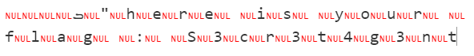

整理一下

<table><tbody><tr><td><code>"here is your flag : S3cr3t4g3nt</code></td></tr></tbody></table>

### DNS(G3)

先通过tshark把DNS提取出来

<table><tbody><tr><td><code>shark.exe -r dns.pcap -T fields -e dns.qry.name | sed '/^\s*$/d' | uniq &gt; output.txt</code></td></tr></tbody></table>

前几条是这样的

<table><tbody><tr><td><code>5647687063794270.192.168.191.129</code></td></tr><tr><td><code>6379426849484e6c.192.168.191.129</code></td></tr><tr><td><code>google.ca</code></td></tr><tr><td><code>88.46.194.173.in-addr.arpa</code></td></tr><tr><td><code>6379426849484e6c.192.168.191.129</code></td></tr><tr><td><code>88.46.194.173.in-addr.arpa</code></td></tr><tr><td><code>59334a6c64434230.192.168.191.129</code></td></tr><tr><td><code>128.191.168.192.in-addr.arpa</code></td></tr><tr><td><code>2.191.168.192.in-addr.arpa</code></td></tr><tr><td><code>……</code></td></tr></tbody></table>

可以看到有一些奇怪的Hex数据，全部筛出来，并且将重复行删除

<table><tbody><tr><td><code>56476870637942706379426849484e6c59334a6c64434230636d4675633231706448526c5a43423061484a766457646f494752756379427864575679655341364b534247544546484c555a554e44646a545667794e6e425865555a5453545a53554664685533493157564a330a</code></td></tr></tbody></table>

From Hex ---> From Base64

<table><tbody><tr><td><code>This is a secret transmitted through dns query :) FLAG-FT47cMX26pWyFSI6RPWaSr5YRw</code></td></tr></tbody></table>

### Transfer(G3)

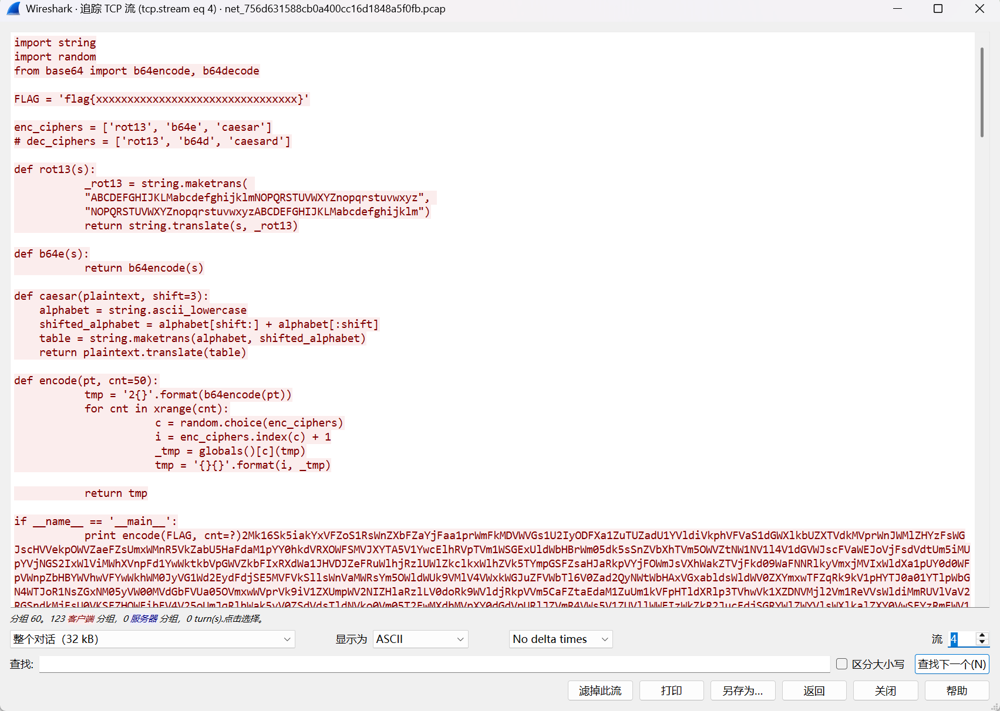

在流4中找到一个代码以及密文

<table><tbody><tr><td><code>import string</code></td></tr><tr><td><code>import random</code></td></tr><tr><td><code>from base64 import b64encode, b64decode</code></td></tr><tr><td></td></tr><tr><td><code>FLAG = 'flag{xxxxxxxxxxxxxxxxxxxxxxxxxxxxxxxx}'</code></td></tr><tr><td></td></tr><tr><td><code>enc_ciphers = ['rot13', 'b64e', 'caesar']</code></td></tr><tr><td><code># dec_ciphers = ['rot13', 'b64d', 'caesard']</code></td></tr><tr><td></td></tr><tr><td><code>def rot13(s):</code></td></tr><tr><td><code>_rot13 = string.maketrans(</code></td></tr><tr><td><code>"ABCDEFGHIJKLMabcdefghijklmNOPQRSTUVWXYZnopqrstuvwxyz",</code></td></tr><tr><td><code>"NOPQRSTUVWXYZnopqrstuvwxyzABCDEFGHIJKLMabcdefghijklm")</code></td></tr><tr><td><code>return string.translate(s, _rot13)</code></td></tr><tr><td></td></tr><tr><td><code>def b64e(s):</code></td></tr><tr><td><code>return b64encode(s)</code></td></tr><tr><td></td></tr><tr><td><code>def caesar(plaintext, shift=3):</code></td></tr><tr><td><code>alphabet = string.ascii_lowercase</code></td></tr><tr><td><code>shifted_alphabet = alphabet[shift:] + alphabet[:shift]</code></td></tr><tr><td><code>table = string.maketrans(alphabet, shifted_alphabet)</code></td></tr><tr><td><code>return plaintext.translate(table)</code></td></tr><tr><td></td></tr><tr><td><code>def encode(pt, cnt=50):</code></td></tr><tr><td><code>tmp = '2{}'.format(b64encode(pt))</code></td></tr><tr><td><code>for cnt in xrange(cnt):</code></td></tr><tr><td><code>c = random.choice(enc_ciphers)</code></td></tr><tr><td><code>i = enc_ciphers.index(c) + 1</code></td></tr><tr><td><code>_tmp = globals()[c](tmp)</code></td></tr><tr><td><code>tmp = '{}{}'.format(i, _tmp)</code></td></tr><tr><td></td></tr><tr><td><code>return tmp</code></td></tr><tr><td></td></tr><tr><td><code>if __name__ == '__main__':</code></td></tr><tr><td><code>print encode(FLAG, cnt=?)</code></td></tr></tbody></table>

大致逻辑如下，根据密文的第一位数字判断解密方式

<table><tbody><tr><td><code>'2' ----&gt; b64encode(flag)</code></td></tr><tr><td><code>'1' ----&gt; rot13(tmp1)</code></td></tr><tr><td><code>'3' ----&gt; caesar(tmp2)</code></td></tr></tbody></table>

手搓可以实现，也可以代码实现

<table><tbody><tr><td><code>from string import *</code></td></tr><tr><td><code>from base64 import *</code></td></tr><tr><td></td></tr><tr><td><code>def rot13(s):</code></td></tr><tr><td><code>_rot13 = str.maketrans(</code></td></tr><tr><td><code>"ABCDEFGHIJKLMabcdefghijklmNOPQRSTUVWXYZnopqrstuvwxyz",</code></td></tr><tr><td><code>"NOPQRSTUVWXYZnopqrstuvwxyzABCDEFGHIJKLMabcdefghijklm")</code></td></tr><tr><td><code>return s.translate(_rot13)</code></td></tr><tr><td></td></tr><tr><td><code>def b64d(s):</code></td></tr><tr><td><code>return b64decode(s.encode()).decode()</code></td></tr><tr><td></td></tr><tr><td><code>def caesar(s):</code></td></tr><tr><td><code>shifted_alphabet = ascii_lowercase[3:] + ascii_lowercase[:3]</code></td></tr><tr><td><code>table = str.maketrans(shifted_alphabet, ascii_lowercase)</code></td></tr><tr><td><code>return s.translate(table)</code></td></tr><tr><td></td></tr><tr><td><code>def decrypt(s):</code></td></tr><tr><td><code>n, s = int(s[0]) - 1, s[1:]</code></td></tr><tr><td><code>return [rot13, b64d, caesar][n](s)</code></td></tr><tr><td></td></tr><tr><td><code>s = '[这里填写密文，太多了就不放上去了]'</code></td></tr><tr><td><code>while s[0] in '123':</code></td></tr><tr><td><code>s = decrypt(s)</code></td></tr><tr><td><code>print(s)</code></td></tr></tbody></table>

解密得到Flag

<table><tbody><tr><td><code>flag{li0ns_and_tig3rs_4nd_b34rs_0h_mi}</code></td></tr></tbody></table>

**免责声明：****本Write-up仅供教育和学习目的使用**

**部分博客摘自：**[https://g3rling.top/595](https://g3rling.top/595 "https://g3rling.top/595")
