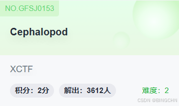

CTF（ Capture The Flag）流量分析题是网络安全竞赛中的重要环节，参赛者需要通过分析网络数据包来解决问题。以下是一些常见的CTF流量分析题型及其解决方法。

图片提取题型

## **题目：Cephalopod (图片提取)**



题目来源：XCTF 3rd-HITB CTF-2017

考点：图片提取

题目信息：Cephalopod.pcapng

步骤：

1.  打开数据包，查找是否有flag字符串。

2.  在分组字符流中找到flag.png的字符串。

3.  追踪数据流，导出原始数据。

4.  使用010editor打开保存的文件，删除png前面的字符后导出为png。

5.  打开图片即可看到flag。


ICMP协议信息传输题型

## **题目：特殊后门 (icmp协议 信息传输)**

题目来源：第七届山东省大学生网络安全技能大赛$\]

考点：字符串搜索，icmp协议信息传输

题目信息：backdoor++.pcapng

步骤：

1.  打开数据包，搜索flag字符串。

2.  在分组数据流中找到flagishere字符串。

3.  查看连续的icmp包，提取每个包中的字符，组合得到flag。


蓝牙传输协议数据提取题型

选出`ICMP` 包之后跟着找每一个包里面有一个flag的字符

`flag{Icmp_backdoor_can_transfer-some_infomation}`

## **题目：手机热点 (蓝牙传输协议obex, 数据提取)**

题目来源：第七季极客大挑战

考点：蓝牙传输协议obex,数据提取

题目信息：Blatand\_1.pcapng

步骤：

1.  打开数据包，查找flag字符串。

2.  发现flag.gif，导出为.rar格式。

3.  解压后得到flag.png，打开即可拿到flag。


无线密码破解题型

搜索发现有一个rar压缩包

导出

## **题目：想蹭网先解开密码 (无线密码破解)**

题目来源：bugku

考点：无线密码破解

题目信息：wifi.cap

步骤：

1.  打开数据包，查找flag字符串。

2.  过滤WPA的四次握手包（eapol协议）。

3.  使用aircrack-ng进行密码爆破，成功得到flag。


数据包筛选与提取题型

`WIFI认证存在四次握手包eapol协议的数据包`

使用kali的`Crunch`生成字典

语法：


```cobol
crunch <min> <max> [options]
```

参数：


```cobol
     min    设定最小字符串长度（必选）
     max    设定最大字符串长度（必选）

     oprions
     -b     指定文件输出的大小，避免字典文件过大
     -c     指定文件输出的行数，即包含密码的个数
     -d     限制相同元素出现的次数
     -e     定义停止字符，即到该字符串就停止生成
     -f     调用库文件（/etc/share/crunch/charset.lst）
     -i     改变输出格式，即aaa,aab -> aaa,baa
     -I     通常与-t联合使用，表明该字符为实义字符
     -m     通常与-p搭配
     -o     将密码保存到指定文件
     -p     指定元素以组合的方式进行
     -q     读取密码文件，即读取pass.txt
     -r     定义重某一字符串重新开始
     -s     指定一个开始的字符，即从自己定义的密码xxxx开始
     -t     指定密码输出的格式
     -u     禁止打印百分比（必须为最后一个选项）
     -z     压缩生成的字典文件，支持gzip,bzip2,lzma,7z
```

特殊字符

```erlang

     %      代表数字
     ^      代表特殊符号
     @      代表小写字母
     ,      代表大写字符
```

使用`aircrack-ng` 对数据包进行密码爆破

使用教程： [https://www.jianshu.com/p/fd16236057df](https://www.jianshu.com/p/fd16236057df "https://www.jianshu.com/p/fd16236057df")

## **题目：抓到一只苍蝇 (数据包筛选,数据提取)**

题目来源：bugku

考点：数据包筛选,数据提取

题目信息：misc\_fly.pcapng

步骤：

1.  打开数据包，搜索flag。

2.  筛选出可疑的数据包，分析其内容。

3.  导出原始数据，去掉文件头，合并成一个文件，解压得到flag。


-   先搜索flag

发现一个flag.txt文件

该数据包是通过qq邮箱传的一些文件

然后搜索关键字

`通过POST传入了一个rar文件`

筛选`POST` 协议

 这里调用了2个函数，中间应该是传输的过程发送的数据包

`CreateFile`

`CheckFile`

两个文件的md5值一样然后从中间的数据包大小可以看出来

 几个数据包加起来

> 131436\*4+1777=527,521减去压缩包的大小为1820 这1820 是5个数据包头的大小364

使用 Linux 可以把五个数据包包头去掉然后合成一个rar文件

具体命令dd:

```cobol

dd if=1 bs=1 skip=364 of=1.1

dd命令语法：
if 输入文件名
bs 设置每次读写块的大小为1字节
skip 指定从输入文件开头跳过多少个块后再开始复制
of 输出文件名
```

然后导出对应的文件（看分组序号） 然后倒入kali

```cobol

┌──(root㉿kali)-[/home/kali/test]
└─# dd if=1 bs=1 skip=364 of=11
131072+0 records in
131072+0 records out
131072 bytes (131 kB, 128 KiB) copied, 2.06969 s, 63.3 kB/s

┌──(root㉿kali)-[/home/kali/test]
└─# dd if=2 bs=1 skip=364 of=22
131072+0 records in
131072+0 records out
131072 bytes (131 kB, 128 KiB) copied, 2.03437 s, 64.4 kB/s

┌──(root㉿kali)-[/home/kali/test]
└─# dd if=3 bs=1 skip=364 of=33
131072+0 records in
131072+0 records out
131072 bytes (131 kB, 128 KiB) copied, 2.08859 s, 62.8 kB/s

┌──(root㉿kali)-[/home/kali/test]
└─# dd if=4 bs=1 skip=364 of=44
131072+0 records in
131072+0 records out
131072 bytes (131 kB, 128 KiB) copied, 2.04758 s, 64.0 kB/s

┌──(root㉿kali)-[/home/kali/test]
└─# dd if=5 bs=1 skip=364 of=55
1413+0 records in
1413+0 records out
1413 bytes (1.4 kB, 1.4 KiB) copied, 0.0234734 s, 60.2 kB/s

┌──(root㉿kali)-[/home/kali/test]
└─# ls
1  11  2  22  3  33  4  44  5  55
┌──(root㉿kali)-[/home/kali/test]
└─# cat 11 22 33 44 55 > flag.rar

┌──(root㉿kali)-[/home/kali/test]
└─# ls
1  11  2  22  3  33  4  44  5  55  flag.rar
```

然后打开压缩包发现文件头损坏

84改为80

这是个exe可执行文件

... 脏东西

binwalk 提取下

 一堆png文件

然后用`formost` 提取出来

扫描二维码获取flag

```cobol
https://online-barcode-reader.inliteresearch.com

flag{m1Sc_oxO2_Fly}
```

详情可查看：

[流量分析入门 - SuperWinner - 博客园](https://www.cnblogs.com/superwinner/p/17260969.html)


