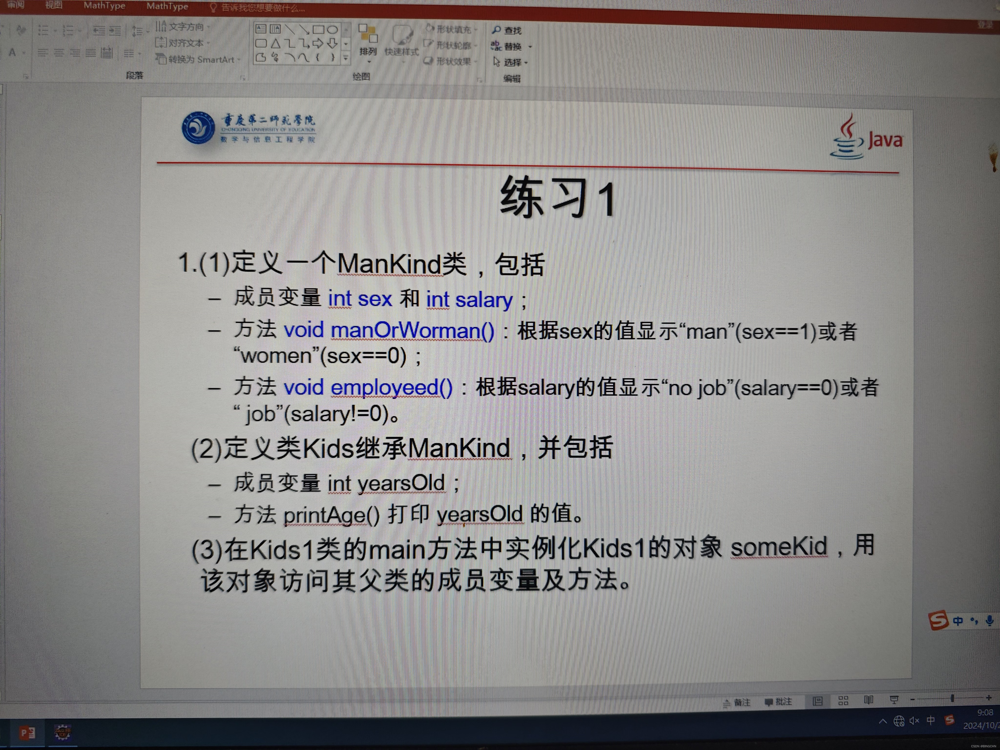

// 定义ManKind 类
class ManKind {
    // 成员变量
    int sex; // 1表示男性，0表示女性
    int salary; // 工资

    // 方法：根据sex的值显示"man"或"woman"
    void manOrWoman() {
        if (sex == 1) {
            System .out.println("man");
        } else if (sex == 0) {
            System.out.println("woman");
        } else {
            System.out.println("未知性别");
        }
    }

    // 方法：根据salary的值显示"no job"或"job"
    void employed() {
        if (salary == 0) {
            System.out.println("no job");
        } else {
            System.out.println("job");
        }
    }
}

// 定义Kids类，继承自ManKind
class Kids extends ManKind {
    // 成员变量
    int yearsOld; // 年龄

    // 方法：打印yearsOld的值
    void printAge() {
        System.out.println(" Age : " + yearsOld);
    }
}

// 定义Kids1类的 main 方法
public class Kids1 {
    public static void main(String\[\] args) {
        // 实例化Kids1的对象someKid
        Kids someKid = new Kids();

        // 设置父类的成员变量sex和salary
        someKid.sex = 1; // 1表示男性
        someKid.salary = 0; // 0表示无工作
        someKid.yearsOld = 12; // 设置年龄

        // 调用父类和子类的方法
        someKid.manOrWoman(); // 显示性别
        someKid.employed(); // 显示工作状态
        someKid.printAge(); // 显示年龄
    }
}
