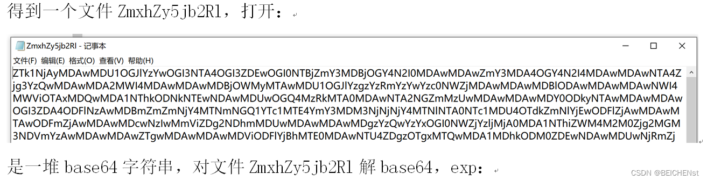
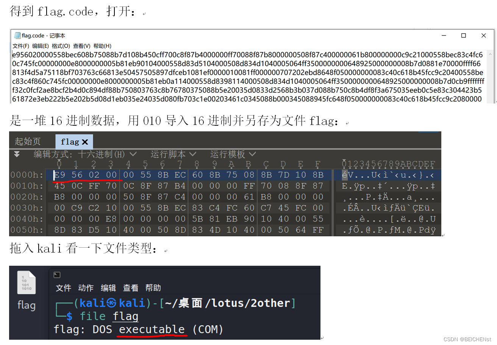
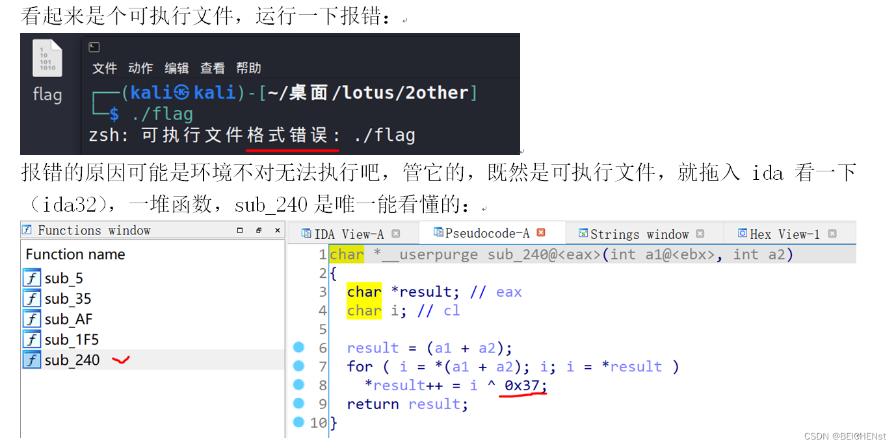
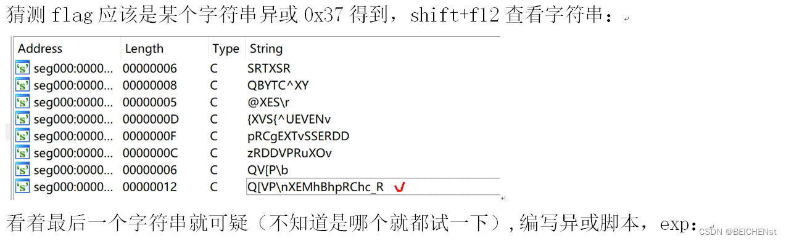
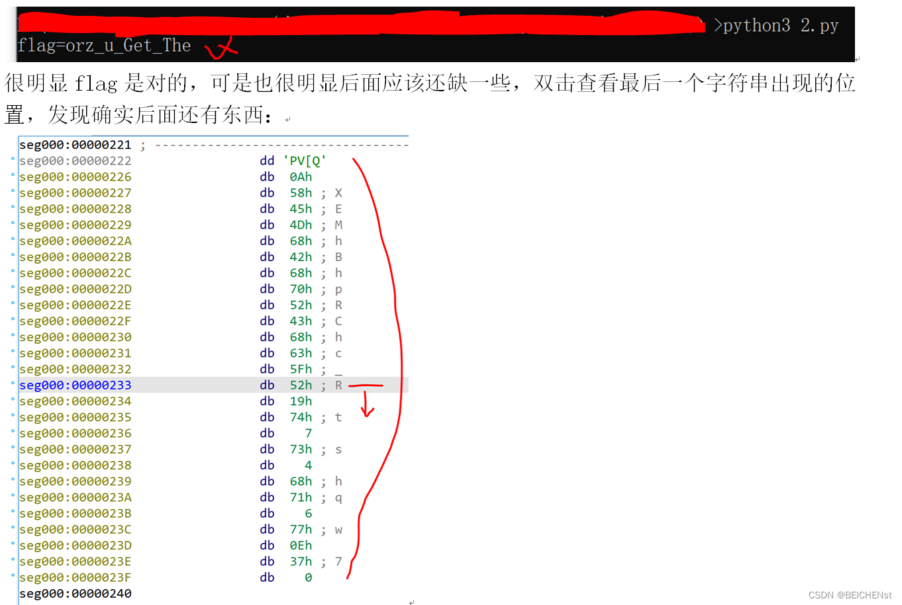
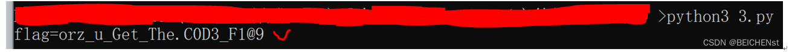

```python
import base64

f = open("ZmxhZy5jb2Rl", "rb")
data = f.read()
f.close()

file_name = base64.b64decode("ZmxhZy5jb2Rl")
f = open(file_name, "wb")
f.write(base64.b64decode(data))
f.close()
```

 运行后

 



```python
s = 'Q[VP\nXEMhBhpRChc_R'
flag = ''
for i in s:
    flag += chr(ord(i) ^ 0x37)

print(flag)
```

 

```python
s = [0x51, 0x5B, 0x56, 0x50, 0x0A, 0x58, 0x45, 0x4D, 0x68, 0x42,
  0x68, 0x70, 0x52, 0x43, 0x68, 0x63, 0x5F, 0x52, 0x19, 0x74,
  0x07, 0x73, 0x04, 0x68, 0x71, 0x06, 0x77, 0x0E, 0x37]
flag = ''
for i in s:
    flag += chr(i ^ 0x37)

print(flag)
```

得到flag为:RCTF{orz\_u\_Get\_The.C0D3\_F1@9}
