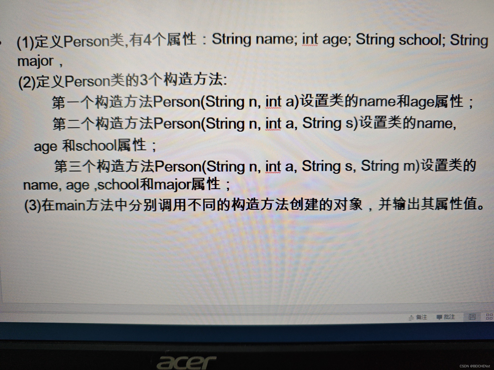

class Person {

    String name;

    int age;

    String school;

    String major;

    // First constructor: sets name and age

    public Person(String n, int a) {

        this.name = n;

        this.age = a;

    }

    // Second constructor: sets name, age, and school

    public Person(String n, int a, String s) {

        this.name = n;

        this.age = a;

        this.school = s;

    }

    // Third constructor: sets name, a
