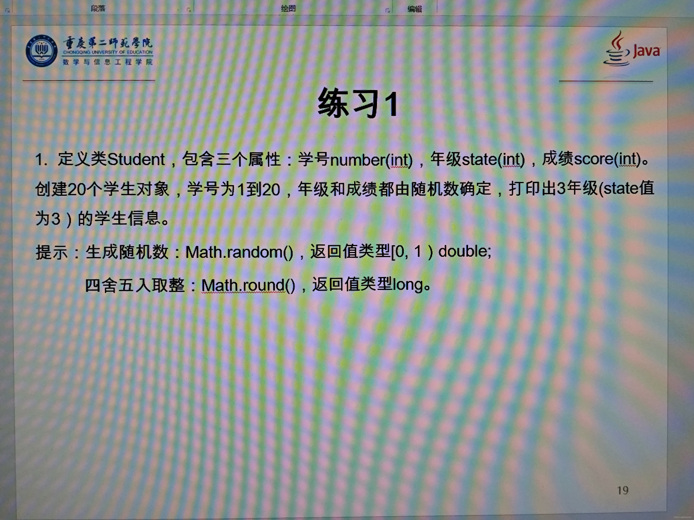

public class Main {

    public static void main(String\[\] args) {

        class Student {

            private int number;

            private int state;

            private int score;

            public Student(int number, int state, int score) {

                this.number = number;

                this.state = checkGrade(state);

                this.score = generateScore();

            }

            private int checkGrade(int stateCandidate) {

                Random random = new Random();

                double randomValue = random.nextDouble() \* 5.0; // 生成1到5之间的随机浮点数

                return Math. round (randomValue >= 3 ? stateCandidate : 1); // 四舍五入后判断是否等于或大于3

            }

            private int generateScore() {

                return randomInt(1, 100);

            }

            private int randomInt(int min, int max) {

                return (int) ((max - min) \* random.nextDouble() + min);

            }

            @Override

            public String toString() {

                return "学生信息: 学号=" + number + ", 年级=" + state + ", 成绩=" + score;

            }

        }

        // 创建并打印三年级的学生

        Student\[\] students = new Student\[20\];

        for (int i = 0; i < 20; i++) {

            students\[i\] = new Student(i + 1, 1, 0); // 初始化学号和最低分数

            students\[i\].state = students\[i\].checkGrade(3); // 判断并设置年级

        }

        System.out.println("三年级（state值为3）的学生信息:");

        for (Student student : students) {

            if (student.state == 3) {

                System.out.println(student);

            }

        }

    }

}
