## 前言

看了上一篇，你会发现周末的RCTF还是很好玩儿的，所以这篇博客我们带来了第二个流量分析的题目，这道题还是结合了比较多的东西的，适合拿来练习并且吃透。

```cobol
附件链接: https://pan.baidu.com/s/1fZUH90VjtX-d57xTqc4VFw?pwd=LRTC 提取码: LRTC
```

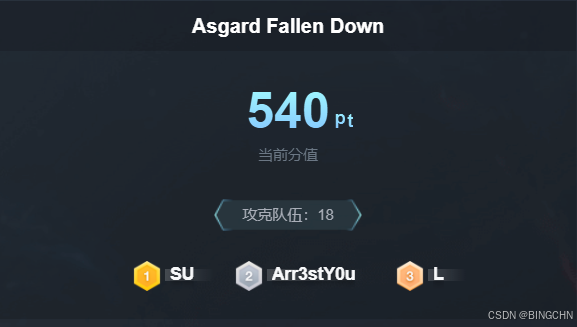

## Asgard Fallen Down

##### 第一问：**The First Command**

问的是确切命令，干扰的流量太多，不太好找，流程就是从头分析，应该是用了什么工具，疯狂在打 cve ，这里定位到**eq207**

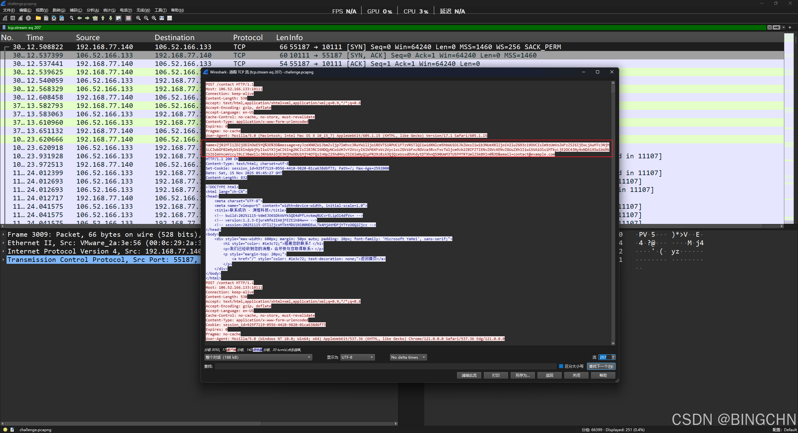

解码后发现了熟悉的进程

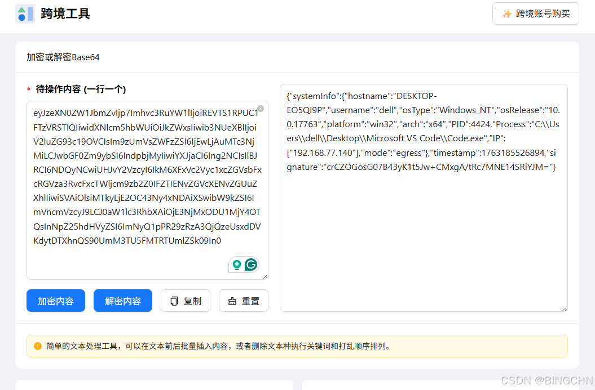

这里也有，解密看看，解密后发现和上一题很像，发现第一个长度是32，第二个是16，猜测为 AES 的key和iv，

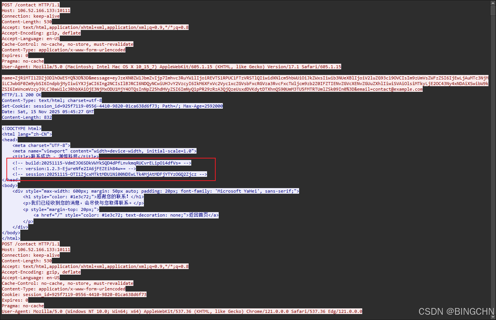

继续往后看，在之后紧跟着的包中看到，一串神秘的 base64

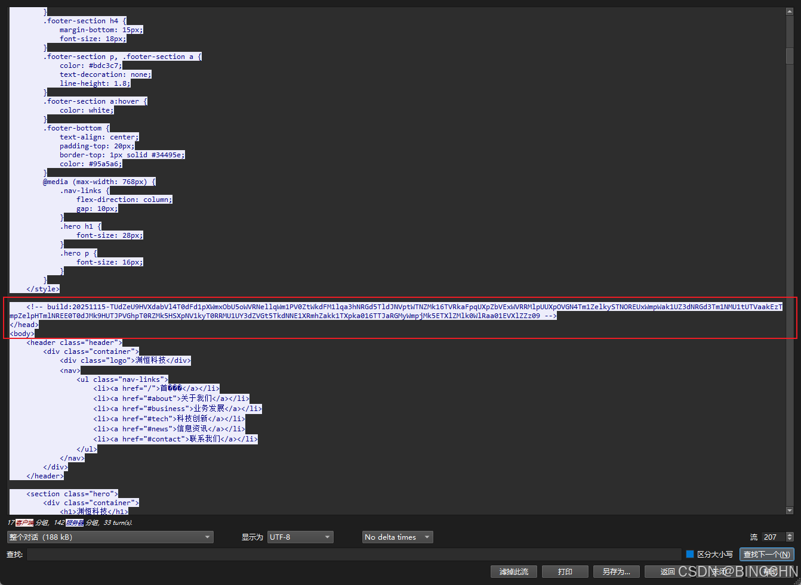

使用之前得到的 密钥 和iv可以成功解密，

```cobol
import base64
from Crypto.Cipher import AES
from Crypto.Util.Padding import unpad

key = base64.b64decode("VdmEJO6SDkVWYkSQD4dPfLnvkmqRUCvrELipO14dfVs=")
iv = base64.b64decode("EjureNfe2IA6jFEZEih84w==")

# 第一次Base64解码
cipher_b64 = "TUdZeU9HVXdabVl4T0dFd1pXWmxObU5oWVRNellqWm1PV0ZtWkdFM1lqa3hNRGd5TldJNVptWTNZMk16TVRkaFpqUXpZbVExWVRRMlpUUXpOVGN4Tm1ZelkySTNOREUxWmpWak1UZ3dNRGd3Tm1NMU1tUTVaakEzTmpZelpHTmlNREE0T0dJMk9HUTJPVGhpT0RZMk5HSXpNV1kyT0RRMU1UY3dZVGt5TkdNNE1XRmhZakk1TXpka016TTJaRGMyWmpjMk5ETXlZMlk0WlRaa01EVXlZZz09"
hex_str = base64.b64decode(cipher_b64).decode()

# 第二次Base64解码得到hex
ciphertext = bytes.fromhex(base64.b64decode(hex_str).decode())

# AES解密
cipher = AES.new(key, AES.MODE_CBC, iv)
plaintext = unpad(cipher.decrypt(ciphertext), AES.block_size)
print(plaintext.decode('utf-8'))
```

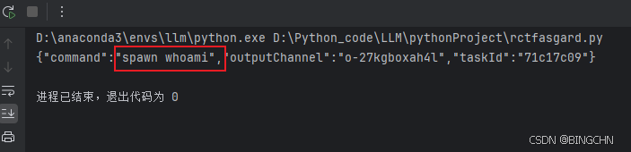

##### 第二问：**The Heartbeat**

顶针发现是10s了然后是问型号，往下翻看到有一串特别长的

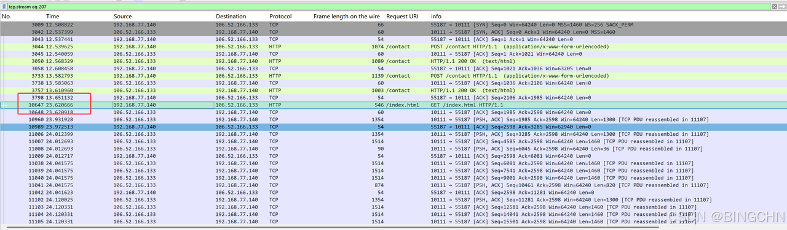

##### **第三问: The Heart of Iron**

往下翻先解密，看到有一串特别长的，继续解密即可

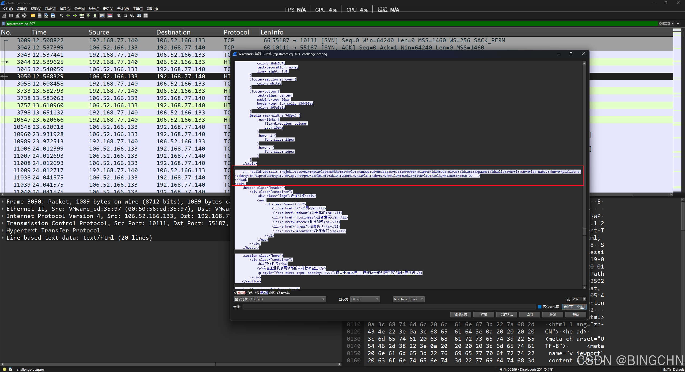

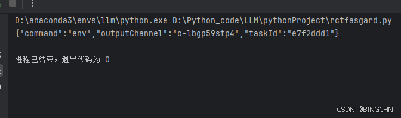

看到有一串特别长的，继续解密即可

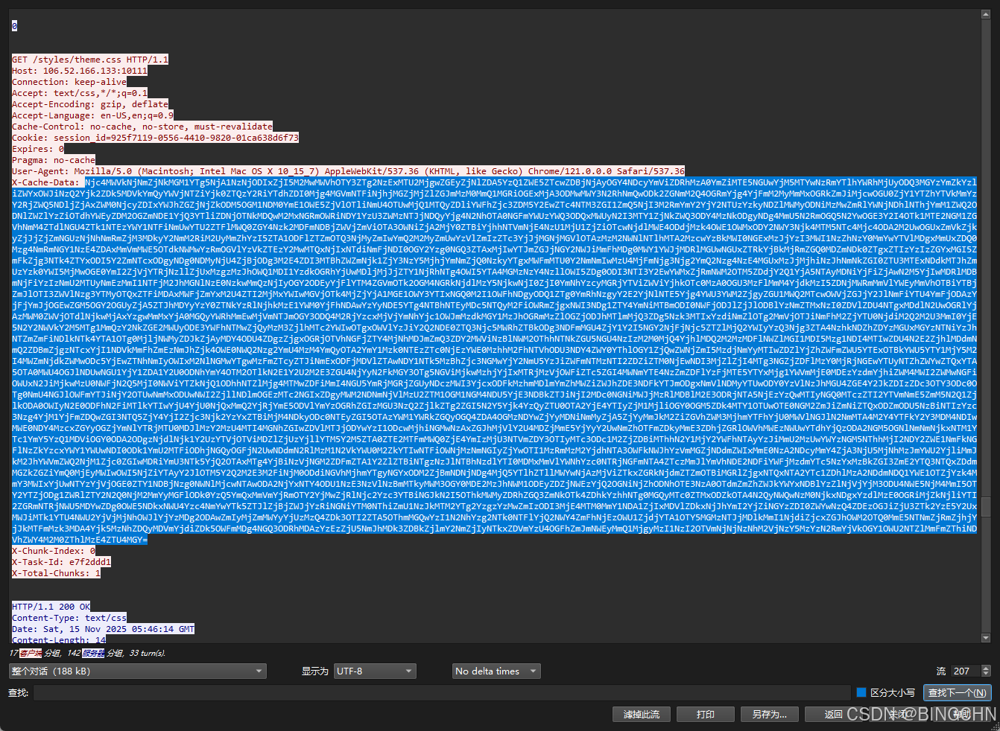

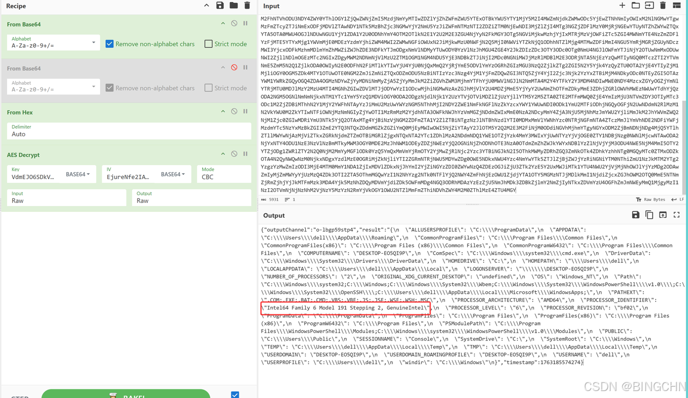

得到答案

```cobol
Intel64 Family 6 Model 191 Stepping 2, GenuineIntel
```

##### **第四问: Odin’s Eye**

最后一问里面提到图片，这题定位到eq2787

搜索关键词`build:20251115`可在2787流中找到本题的执行命令

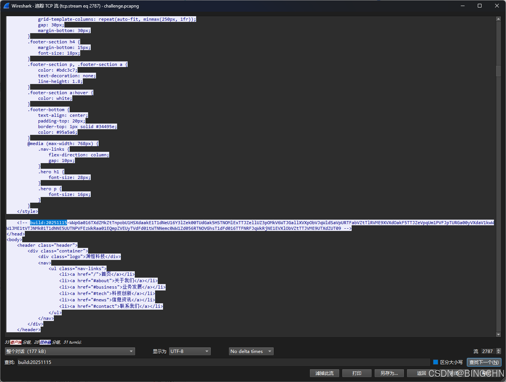

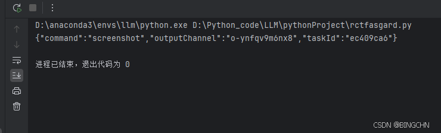

发现之后有很多大块的响应包，猜测是可能图片base64后太大一次不好传输于是分段传输

正则匹配 ，解密

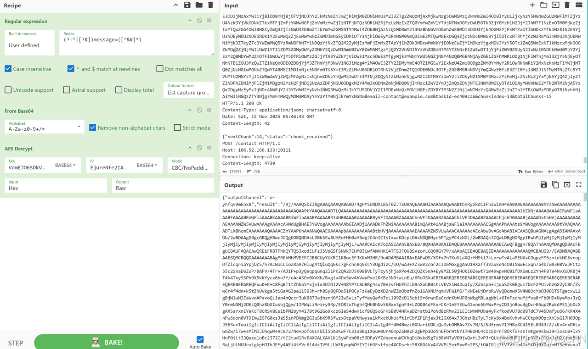


看到chunk自然联想到图片被分块传输了，都cv到厨子里
result里面的再进行base解码是一个 jpg图片

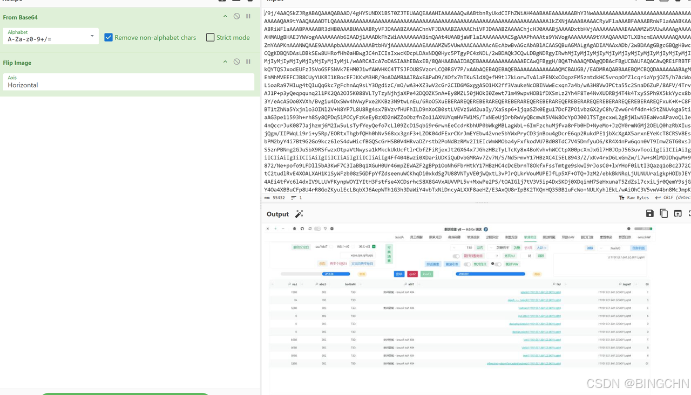

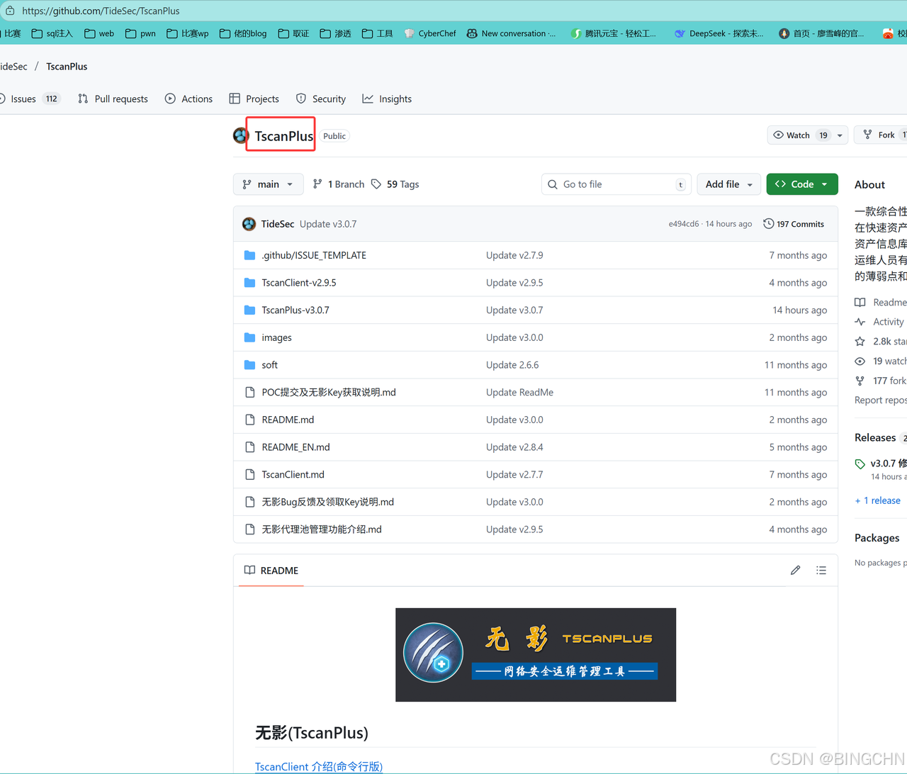

所以得到使用的工具是：

```undefined
TscanPlus
```

最后给到flag

```cobol
RCTF{Wh1l3_Th0r_Struck_L1ghtn1ng_L0k1_St0l3_Th3_Thr0n3}
```

本文部分解法参考SU team [2025 RCTF SU WriteUp - su-team](https://su-team.cn/posts/63a9ee12.html " 2025 RCTF SU WriteUp - su-team")
