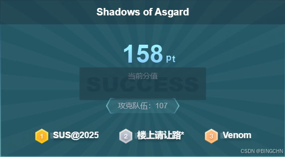
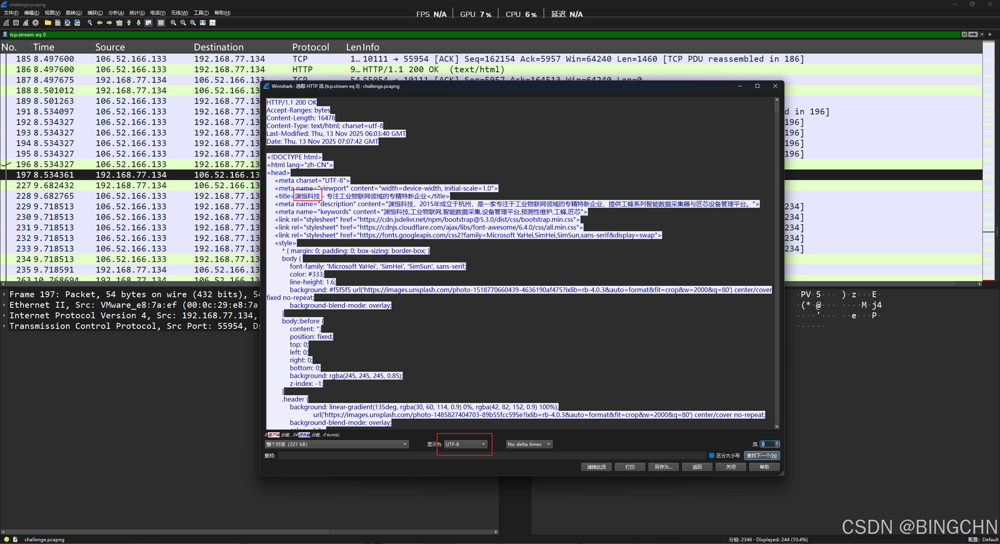
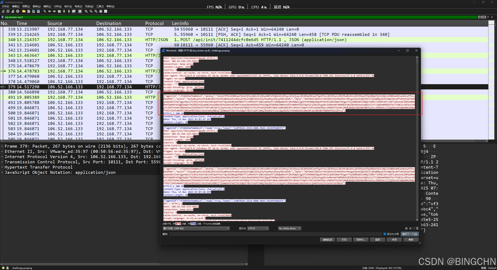
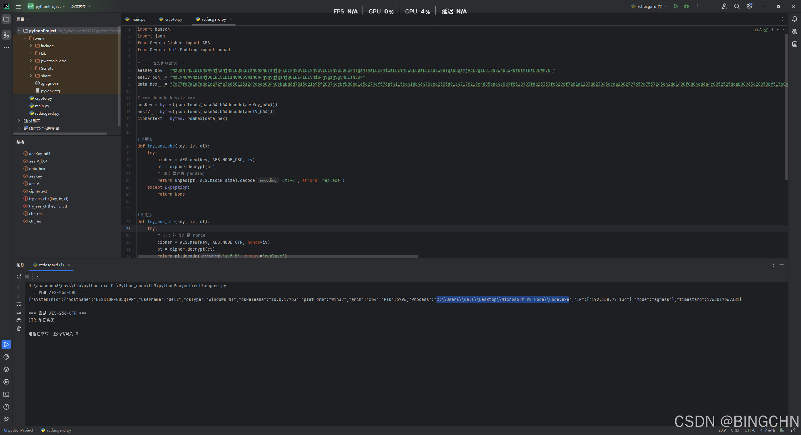
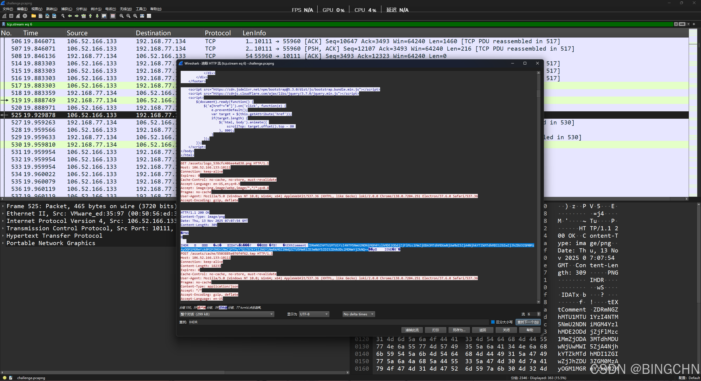
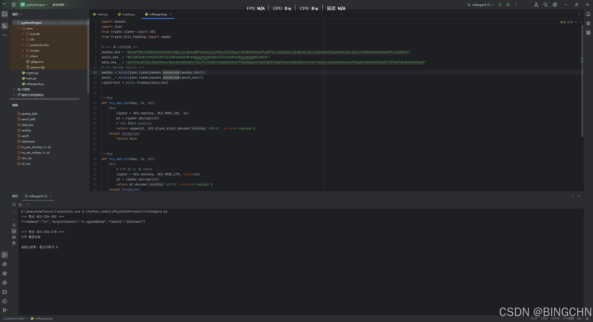
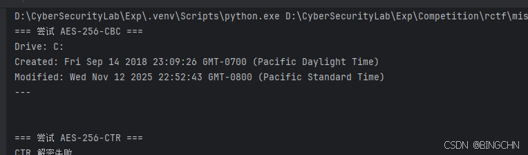

## 前言

在上个周末打了一下RCTF国际赛，感觉流量分析的题目还是很有趣的，这里做一个分享。

Shadows of Asgard附件：
链接 : https://pan.baidu.com/s/1ACIHqT3aZHeB1T2ub-VdvA?pwd=LRTC 提取码: LRTC

## Shadows of Asgard



##### 第一问公司名

跟踪 第一个http流就看见了



##### 第二问找恶意路径

往后分析，发现这里传了aeskey和iv还有 data ，说明是aes加密了数据 并且key一直没变



ai 搞了个脚本来解密

```python
import base64
import json
from Crypto.Cipher import AES
from Crypto.Util.Padding import unpad

# === 填入你的数据 ===
aesKey_b64 = "WzUsMTM5LDI0NSwyMjAsMjMxLDQ2LDIzNCwxNDYsMjQ4LDIxMSwyLDIxMywyLDE2NSw5OCwxMTgsMTAzLDE2MiwzLDE1MCw0LDUzLDE3OSwxOTQsODQsMjA3LDQ1LDI0NSw4OCwxNzksMTkzLDEwMV0="
aesIV_b64  = "WzEyNCwyMzIsMjU0LDE5LDI1MCw0OSw1MCw4MywyMjksMjQ0LDI4LDIyMiw4MywzMywyMDIsNl0="
data_hex   = "7c77fe7a1a7adc1ca72fa368381251249d6eb00440ebabd6d7815d21695f20074dcbfb80ba1e5c279ef576a541156a41db46470cea2305d91e4717c219c4d05bab4e0d9f8510903fdd25353fc8296f7281a1283d823045ccda2802797659c7537243e42da1480f8d84ed6a4c0052525dcab00963c28050bf51360673a87b93bd8553d5e7433297bdd54b94222cd533877202f055403b24e859790cd939ba6c4ef03c193a54f77552cc2c2a98e2b748feebdf4d79a39c0ddaef5235ff68af13f461ba9310028a8675a38cb4e7174bf5cd0c68c7b8a96730ce1120bc5dc5d7d3b4f45913750db72bf47759ad04db9d1a0eb9a34f8fe46f0398b5ab9ac300be9d6e5108e35ed6a4ba0512f62d235a75c421bae8a2ce7b06b4b0540493f4ea3fc176"

# === decode key/iv ===
aesKey = bytes(json.loads(base64.b64decode(aesKey_b64)))
aesIV  = bytes(json.loads(base64.b64decode(aesIV_b64)))
ciphertext = bytes.fromhex(data_hex)

def try_aes_cbc(key, iv, ct):
    try:
        cipher = AES.new(key, AES.MODE_CBC, iv)
        pt = cipher.decrypt(ct)
        # CBC 需要去 padding
        return unpad(pt, AES.block_size).decode('utf-8', errors='replace')
    except Exception:
        return None

def try_aes_ctr(key, iv, ct):
    try:
        # CTR 的 iv 是 nonce
        cipher = AES.new(key, AES.MODE_CTR, nonce=iv)
        pt = cipher.decrypt(ct)
        return pt.decode('utf-8', errors='replace')
    except Exception:
        return None

# === 尝试解密 ===
print("=== 尝试 AES-256-CBC ===")
cbc_res = try_aes_cbc(aesKey, aesIV, ciphertext)
print(cbc_res if cbc_res else "CBC 解密失败")

print("\n=== 尝试 AES-256-CTR ===")
ctr_res = try_aes_ctr(aesKey, aesIV, ciphertext)
print(ctr_res if ctr_res else "CTR 解密失败")
```

得到路径



##### 第三问找pwd命令的taskID

一样的解数据，根据描述藏了隐写，同一个流里发现png图片内有base数据



提出来解密就行，得到id



##### 第四问是要找C盘创建日期

同样的找数据然后放进去解密



##### 第五问

还是post解密流量中有 filePath: C:\\Users\\dell\\ Desktop \\Microsoft VS Code\\fllllag.txt

最后交完了给到flag

fileData (b64): UkNURnt0aGV5IGFsd2F5cyBzYXkgUmF2ZW4gaXMgaW5hdXNwaWNpb3VzfQ==

```csharp
RCTF{they always say Raven is inauspicious}
```
