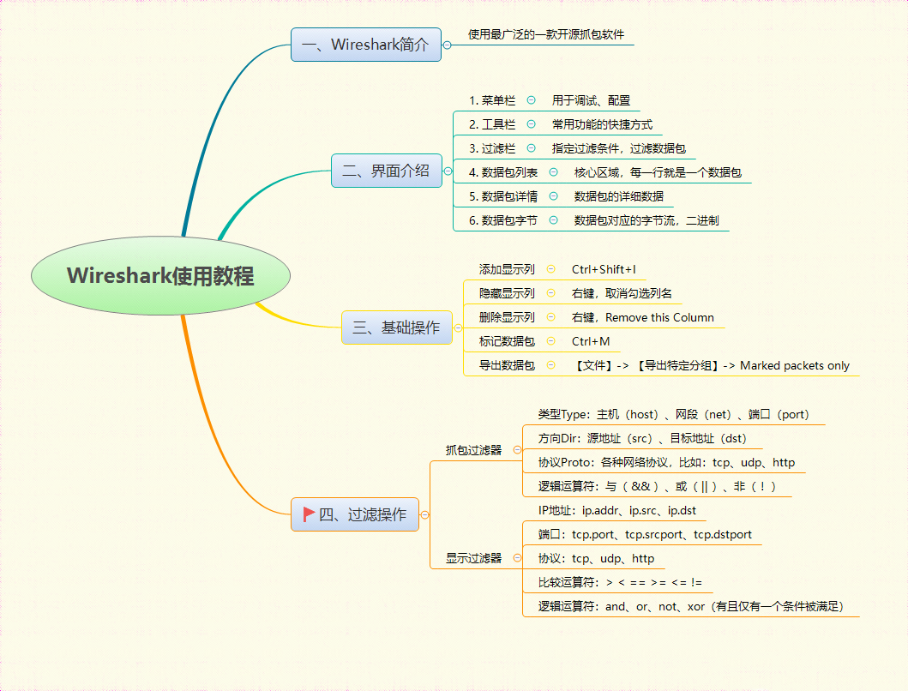
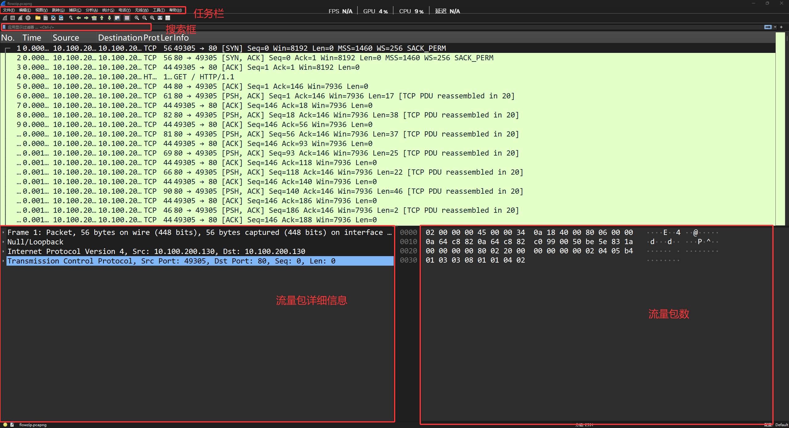
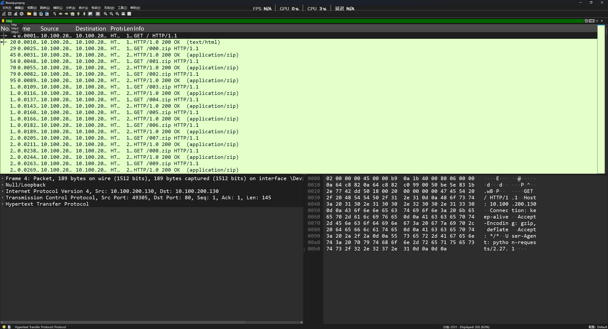
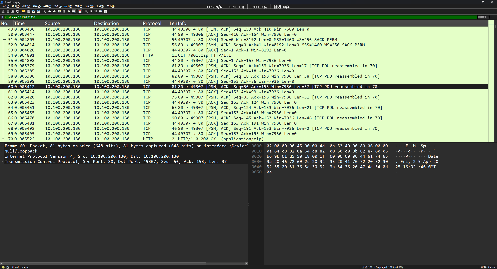
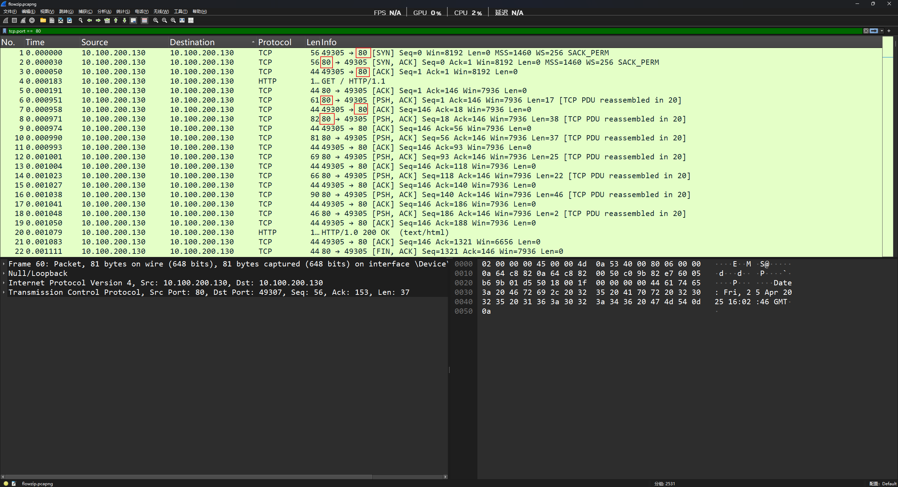
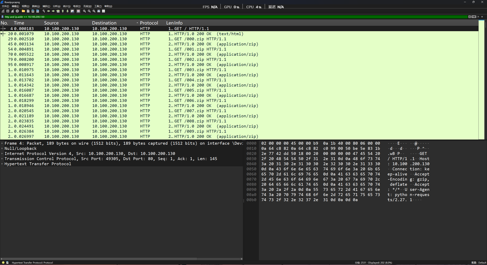
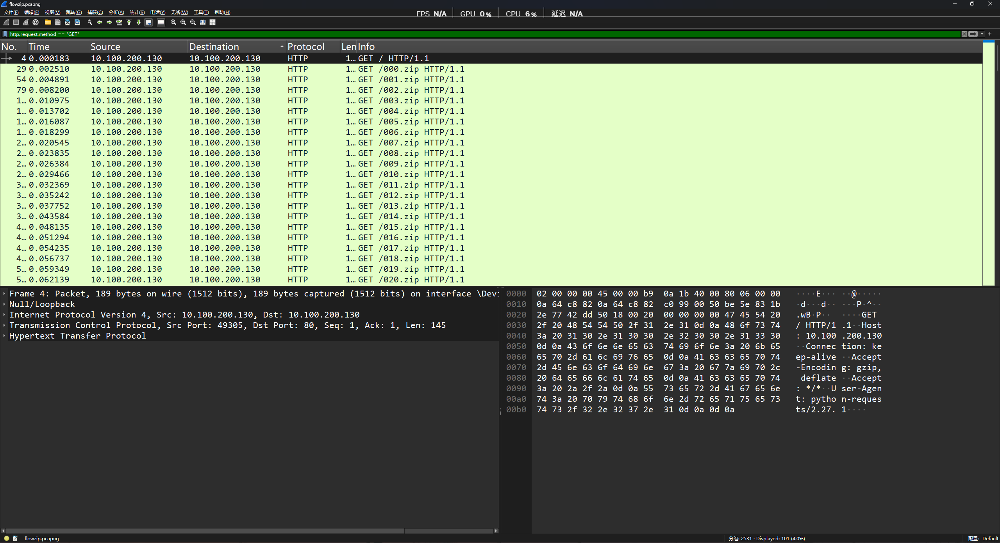
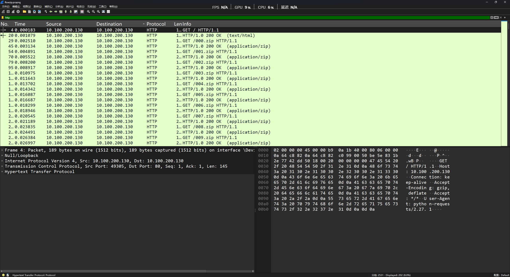
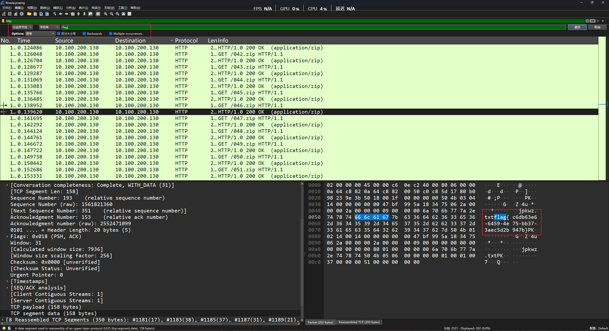

## 前言

我们先通过其他up主总结的图片先简单看一下wireshark的使用



## 工具使用介绍

#### 查看捕获到的数据包列表

> 以真题为例（蓝桥杯2025年网络安全赛道初赛flowzip）**访问链接下载即可**
> 链接: https://pan.baidu.com/s/12yOjftrXEa137ymuHGy3oA?pwd=LRTC 提取码: LRTC


这是流量包的文件格式

```undefined
.pcapng
```

安装好wireshark后，双击打开这个文件

最上方的一栏是任务栏，下面是搜索框，最下面的是数据包的详细信息和数据包的数据



#### 常用过滤器命令和语法

##### 协议 筛选：

```undefined
tcp：显示所有TCP协议的数据包
udp：显示所有UDP协议的数据包
http：显示所有HTTP协议的数据包
dns：显示所有DNS协议的数据包
icmp：显示所有ICMP协议的数据包
```



在搜索框里输入 http 就能看到所有的http流量，其他同理

##### IP地址筛选：

```cobol
ip.addr == 192.168.0.1：显示与指定IP地址相关的所有数据包
src host 192.168.0.1：显示源IP地址为指定地址的数据包
dst host 192.168.0.1：显示目标IP地址为指定地址的数据包
```

这里我们筛选10.100.200.130ip相关的数据包

```cobol
ip.addr == 10.100.200.130
```



筛选过后就是都关于这个ip的数据包流量

##### 端口筛选：

```cobol
tcp.port ==  80：显示使用指定TCP端口的数据包
udp.port == 53：显示使用指定UDP端口的数据包
port 80：显示源或目标端口为指定端口的数据包
```

筛选tcp 80端口的流量



##### 逻辑运算符：

```cobol
and：使用AND逻辑运算符连接多个条件，例如 tcp and ip.addr == 192.168.0.1
or：使用OR逻辑运算符连接多个条件，例如 tcp or udp
not：使用NOT逻辑运算符排除满足条件的数据包，例如 not tcp
```

筛选http流量和ip地址为10.100.200.130的流量包http and ip.addr == 10.100.200.130



##### 比较运算符：

```cobol
==：等于，例如 http.request.method == "POST"
!=：不等于，例如 ip.addr != 192.168.0.1
<、>：小于、大于，例如 tcp.len > 100
```

筛选http的get请求流量包http.request.method == "GET"



##### 复杂筛选：

```cobol
使用括号 () 来组合多个条件，例如 (tcp and port 80) or (udp and port 53)
使用复合条件进行筛选，例如 (tcp.flags.syn == 1 or tcp.flags.ack == 1) and ip.addr == 192.168.0.1
```

#### **本题做法**

> There are many zip files.

打开过滤HTTP请求，发现有100个压缩包，本来以为需要全部提取后分卷解压：



但是发现直接搜索flag 字符串 ，可以找到flag：


