## 前言

看完前两章节后，你应该对流量分析有所了解了，那么这一篇，我们就通过一些实战来看看吧！

## wire1

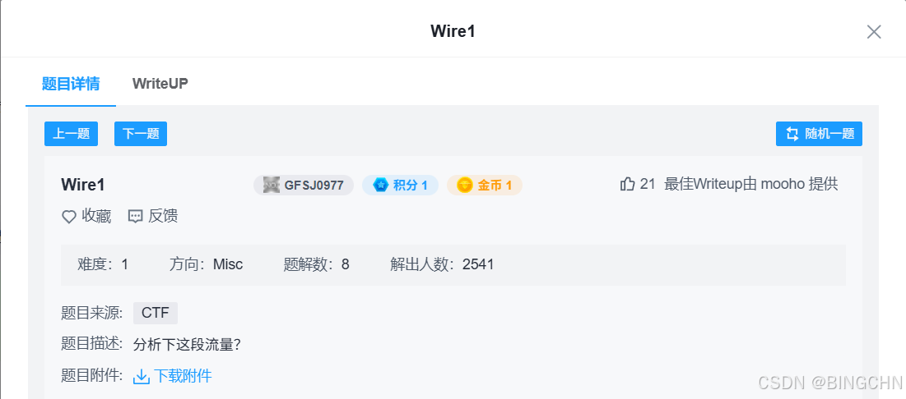

打开题目附件是，是一个抓取的流量包

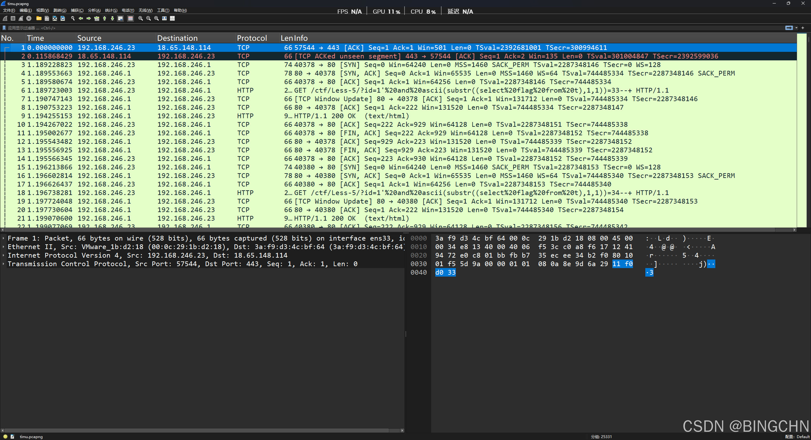

大致分析一下可以得出，本流量包是关于http 协议 的流量包，可以通过wireshark的文件->导出对象->http，可以得出http的包的信息

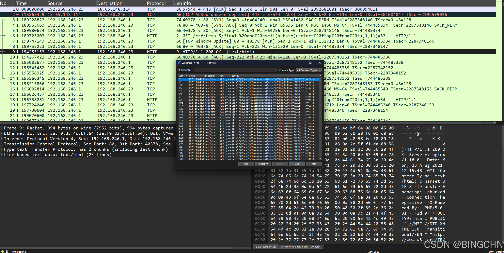

分析一下 文件名 ：

```text
？id=1 and ascii(substr((select flag from t),1,1))=33–+
```

很明显是注入的语句，通过观察，ASCII码的值是逐个增加的，说明这是盲注，在猜解flag的ASCII码。分析文件大小，只有两种大小，一种是720，一种是704，而704bytes长度的是少数，说明704bytes长度的是注入成功的。

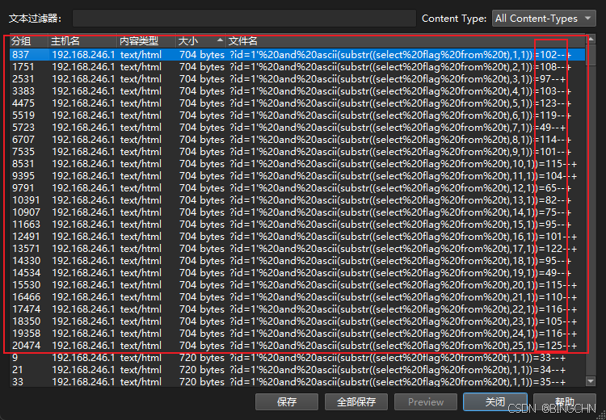

把704bytes长度的注入请求对应的ASCII码复制出来，进行ASCII码匹配，最后得到

```text
flag{w1reshARK_ez_1sntit}
```

## Wireshark

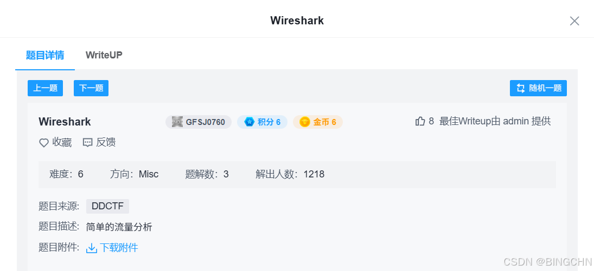

得到一个流量包，打开后分析

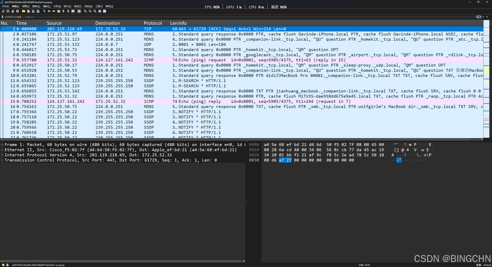

拿到题目后，想着先看一下http流量，直接过滤

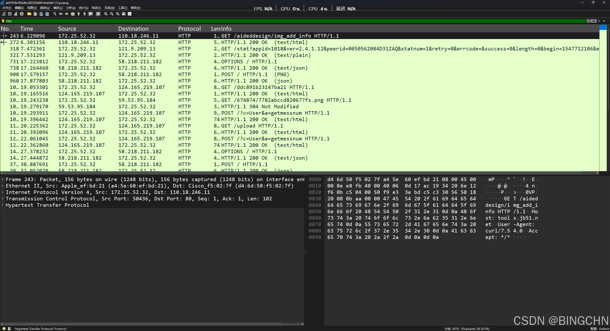

一个个追踪，先看到一个网站`tools.jb51.net/aideddesign/img_add_info`

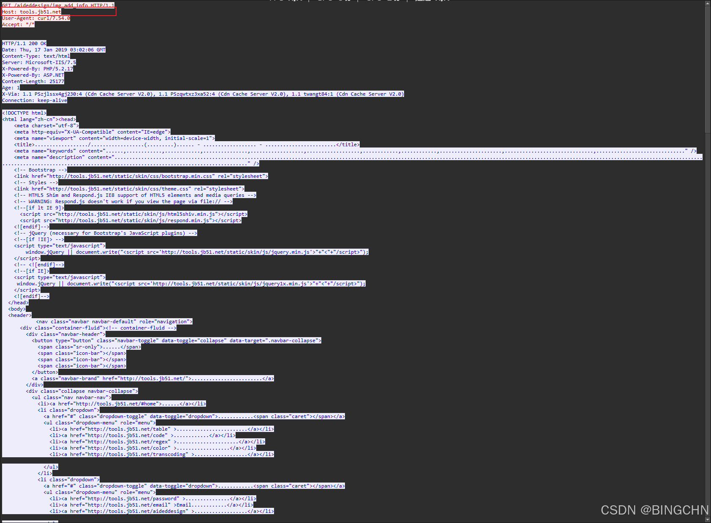

打开之后发现是一个图片加密解密的网站，


导出全部http对象，保存出来。

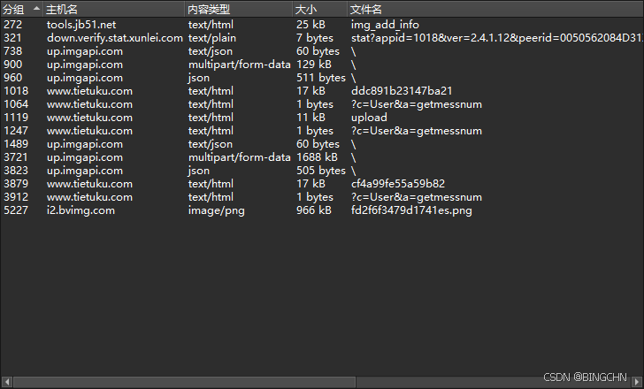

全部导出之后，发现一个png格式的风景照，和两个较大的文件


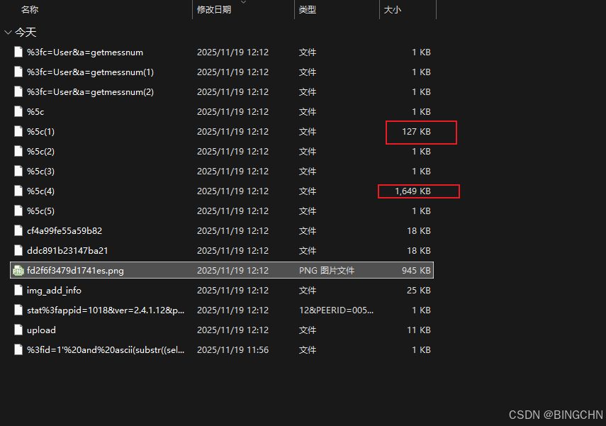

 因为png格式的风景照没有更多线索，猜测可能和png格式有关，将两个较大文件改成png格式。

 将文件拖进hex editor中Ctrl+F搜索，需要将搜索方式改为hex搜索

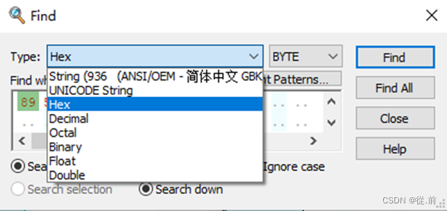

```text
PNG图片固定以 89 50 4E 47 0D 0A 1A 0A （4个字节）开头49 45 4E 44--IEND结尾
```

查询16进制8950 搜索到png头，将之前没用的数据删除；再查询png结尾49 45 4e 44删除多余部分另存为.png。

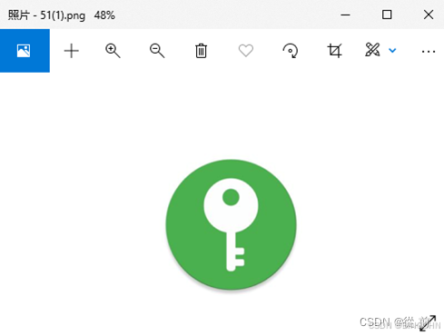

 是一个钥匙图片，将第二个文件也使用hex editor更改为png格式，转化之后查看也是一个风景照图片，而转化后的图片比另一个一样的风景照文件大小大了很多，而且之前发现一个图片加解密的网站，所以这个转化后的风景照应该是有加密的信息。


 将图片文件放入解密网站发现需要key才能解密,再次将钥匙图片拖进hex editor中仔细查看

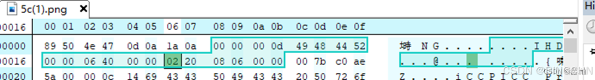

```text
00 00 00 0D 说明IHDR头块长为13
49 48 44 52 IHDR标识
00 00 06 40 图像的宽，1600像素
00 00 02 20 图像的高，544像素
```

 发现高小于宽很多,更改图像的高，将02更改为04保存文件

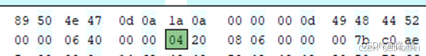

 发现钥匙图片已经出现key了：key:57pmYyWt

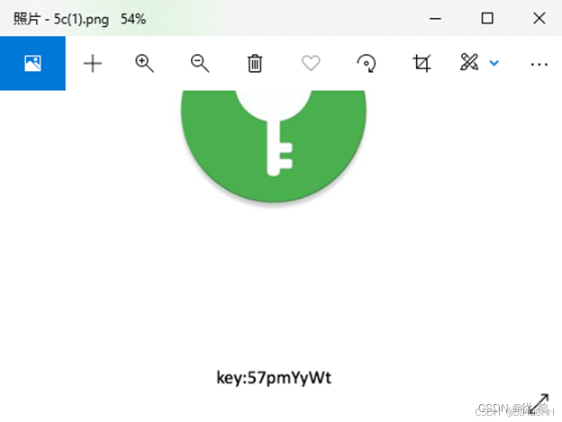

再次将风景照放入工具中，解密出来flag信息

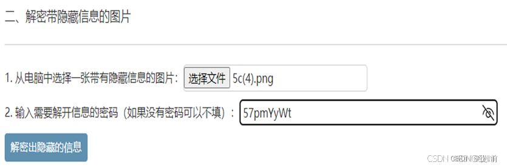

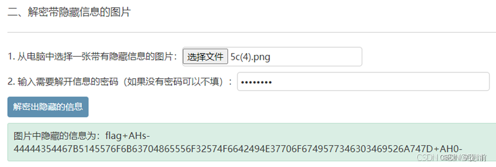

看到所给出的信息包含0、1、2、3、4、5、6、7、8、9、A、B、C、D、E、F所以判断可能是base16，使用在线解密获得flag

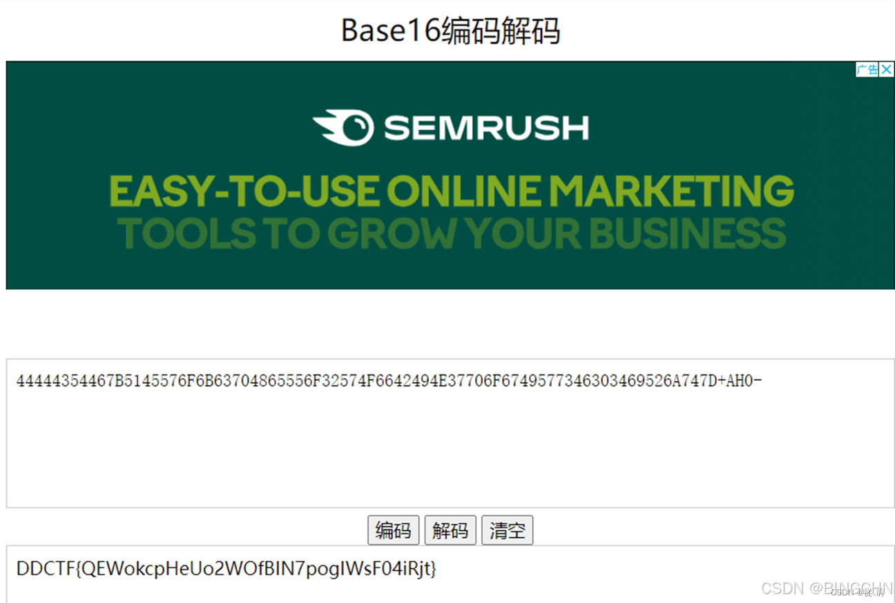

```text
DDCTF{QEWokcpHeUo2WOfBIN7pogIWsF04iRjt}
```

## 结语

好了，本文到这里就结束了，接下来你可以去找一找其他相关的题目继续联手，相信你会在流量分析中获得更多的快乐

参考文章：[CTF攻防世界 Misc高手进阶区 6分题 Wireshark（详细解析）\_wireshark flag-CSDN博客](https://blog.csdn.net/weixin_66146598/article/details/125160266?ops_request_misc=%257B%2522request%255Fid%2522%253A%2522d6059e38f38f5e23edb5cb45771da149%2522%252C%2522scm%2522%253A%252220140713.130102334..%2522%257D&request_id=d6059e38f38f5e23edb5cb45771da149&biz_id=0&utm_medium=distribute.pc_search_result.none-task-blog-2~all~baidu_landing_v2~default-2-125160266-null-null.142^v102^pc_search_result_base1&utm_term=xctf%20misc%20Wireshark&spm=1018.2226.3001.4187 "CTF攻防世界 Misc高手进阶区 6分题 Wireshark（详细解析）_wireshark flag-CSDN博客")
