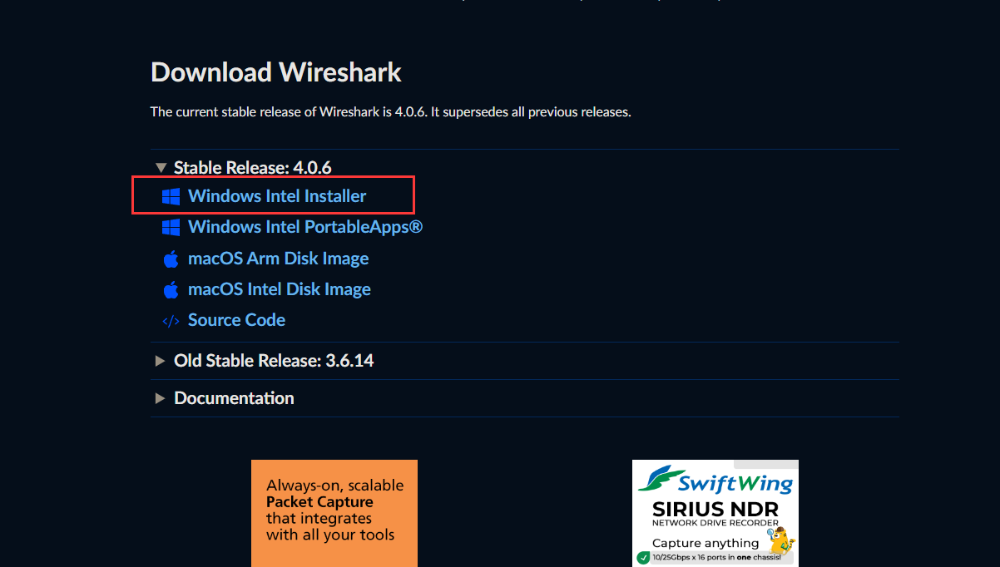

## 前言

流量分析是一种对网络、网站或应用程序中的流量数据进行收集、整理、评估和解读的过程。它旨在深入了解流量的来源（如直接访问、搜索引擎、社交媒体等）、流量的规模（访问量、独立访客数量等）、流量的特征（用户的地理位置、设备类型、访问时间等）以及流量在各个页面或功能模块之间的流动情况。通过流量分析，企业、组织或个人能够洞察用户行为模式，评估营销活动效果，发现网站或应用的优缺点，进而优化用户体验、调整营销策略、提高 转化率 、合理分配资源，以在竞争激烈的数字环境中实现业务目标并提升竞争力。

## 工具推荐

（本部分仅推荐不同的工具，工具安装请看后文，CTF主流推荐使用wireshark）

#### Wireshark

-   **功能**：Wireshark 是一个开源的网络协议分析工具，可以捕获和分析网络流量，提供详细的数据包信息。

-   [适用场景：适合需要深入分析网络流量的用户，尤其是网络管理员和安全专家。](https://www.cnblogs.com/suv789/p/18772798 "适用场景：适合需要深入分析网络流量的用户，尤其是网络管理员和安全专家。")


#### nethogs

-   **功能**：轻量级的Linux命令行工具，监控每个进程的网络带宽使用情况。

-   [适用场景：适合开发者和系统管理员，能够快速识别哪些进程占用网络带宽。](https://www.landui.com/docs-12397 "适用场景：适合开发者和系统管理员，能够快速识别哪些进程占用网络带宽。 ")

#### ManageEngine NetFlow Analyzer

-   **功能**：支持多种流协议，能够全面收集流量数据，适合异构网络环境。

-   [适用场景：适合大型企业，能够在不更换现有网络设备的情况下实现流量可视化。](https://zhuanlan.zhihu.com/p/1954903665161774072 "适用场景：适合大型企业，能够在不更换现有网络设备的情况下实现流量可视化。")


## 工具安装

本文将以wireshark为例，指引你继续学习流量分析

Wireshark是一款开源的网络[数据包分析](https://so.csdn.net/so/search?q=%E6%95%B0%E6%8D%AE%E5%8C%85%E5%88%86%E6%9E%90&spm=1001.2101.3001.7020 "数据包分析")工具，用于捕获、分析和可视化网络流量。它在多个平台上可用，包括Windows、Mac和Linux，工具下载地址

```cobol
https://www.wireshark.org/download.html
```



默认安装即可，推荐安装到非系统运行盘
