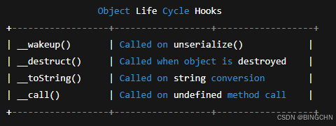

### 1\. 什么是 反序列化 （Unserialize）？

在 PHP 中，**序列化（serialize）** 是将 PHP 对象/ 数组 转换成字符串，便于：

-   存储
-   传输
-   Cookie 保存用户状态
-   缓存

相应地，**反序列化（unserialize）** 则是把这个 字符串 还原为 PHP 可用的数据结构。

#### 👉 一个简单示例

```php
class User {
    public $name = "alice";
}

$u = new User();
$s = serialize($u);
echo $s;
```

输出 类 似：

```text
O:4:"User":1:{s:4:"name";s:5:"alice";}
```

反序列化：

```php
$u2 = unserialize($s);
echo $u2->name;
```

---

### 2\. 为什么 unserialize 会导致漏洞？

如果程序 **反序列化了用户可控的数据**，攻击者就可以：

-   构造任意对象
-   触发对象的魔术方法执行（`__wakeup`、`__destruct` 等）
-   利用类中的危险操作（删除文件、命令执行等）
-   形成 **POP 链（Property-Oriented Programming Chain）**

#### 🎯 漏洞产生的核心逻辑：

> **用户控制 → PHP 反序列化 → 调用类中的危险代码 → 任意代码执行/文件删除/数据库注入**

---

### 3\. PHP 反序列化 结构图 （图示）

```text
               +-------------------------+
               |  User controlled input  |
               +-----------+-------------+
                           |
                           v
                +----------+-----------+
                | unserialize()        |
                +----------+-----------+
                           |
                           v
             +-------------+----------------+
             | Create Object (any class)    |
             +-------------+----------------+
                           |
           +-------------------------------+
           | Auto-call magic methods       |
           | __wakeup / __destruct / ...   |
           +-------------------------------+
                           |
                           v
           +---------------------------------+
           | Dangerous function triggered    |
           | unlink / system / exec / eval  |
           +---------------------------------+
                           |
                           v
                   **Vulnerability**
```

---

### 4\. 魔术方法与利用方式



---

### 5\. 最经典的反序列化漏洞例子：文件删除

```php
class LogCleaner {
    public $file;

    function __destruct() {
        unlink($this->file);
    }
}

$data = $_GET["data"];
$obj = unserialize($data);
```

Payload :

```text
O:10:"LogCleaner":1:{s:4:"file";s:12:"/var/www/1";}
```

---

### 6\. 进阶：POP 链（Property Oriented Programming）

```text
Attacker Payload
       |
       v
[Class_A::__wakeup]
       |
       v
[Class_B::__destruct]
       |
       v
[Dangerous Function]
(system, exec, eval)
```

---

### 7\. CTF 常见利用链模式

| 魔术方法 | 触发时机 | 常见利用方式 |
| --- | --- | --- |
| `__wakeup` | 反序列化后立即运行 | 文件包含、SSRF |
| `__destruct` | 脚本结束时调用 | 删除文件 / RCE |
| `__toString` | 强制转换为字符串 | 传给危险函数 |
| `__call` | 调用未定义方法 | 注入参数 |

---

### 8\. 示例 POP 链

```php
class FileWriter {
    public $filename;
    public $content;
    function write() { file_put_contents($this->filename, $this->content); }
}

class Logger {
    public $logger;
    function __toString() { $this->logger->write(); return "done"; }
}

class Trigger {
    public $obj;
    function __destruct() { echo $this->obj; }
}
```

---

### 9\. 防御方式

-   禁用 unserialize()
-   仅允许安全类：`unserialize($data, ["allowed_classes"=>["SafeClass"]]);`
-   禁止危险魔术方法
-   Sandbox 运行
-   PHP.ini 禁用危险函数

```text
disable_functions = exec,system,passthru,shell_exec,popen,proc_open
```

---

### 10\. 漏洞审计 Checklist

```text
[ ] 是否反序列化用户输入？
[ ] 是否存在 __wakeup？
[ ] 是否存在 __destruct？
[ ] 是否存在 __toString？
[ ] 是否存在文件包含/写入？
[ ] 属性是否可控？
[ ] 是否使用危险函数？
```

---

### 11\. 调试技巧：PHPGGC

```text
phpggc Laravel/RCE3 system id
```

---

### 12\. 总结

PHP 反序列化漏洞本质是：

> 用户可控数据 → 反序列化 → 魔术方法触发 → 危险操作 → RCE

---


