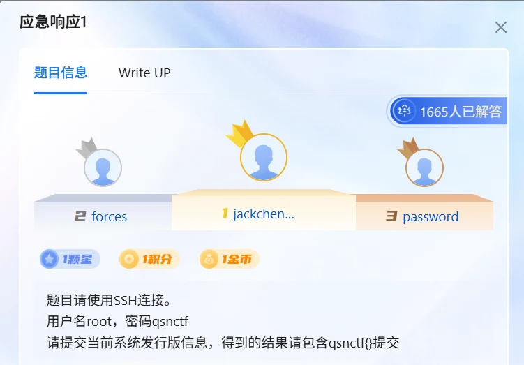
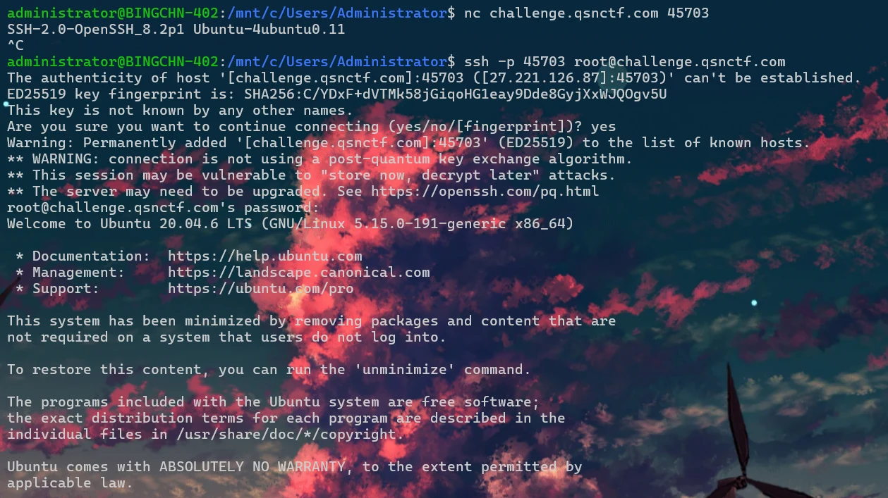
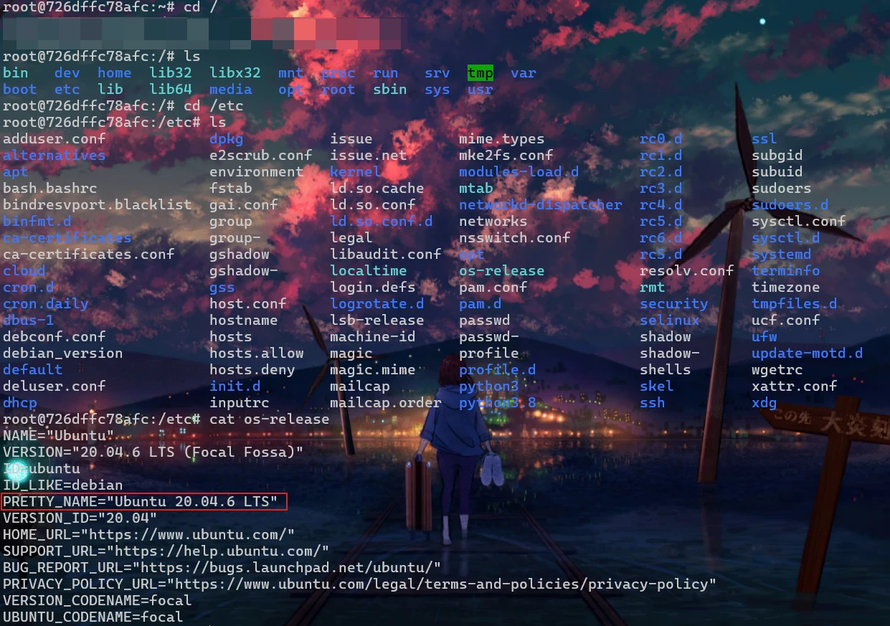
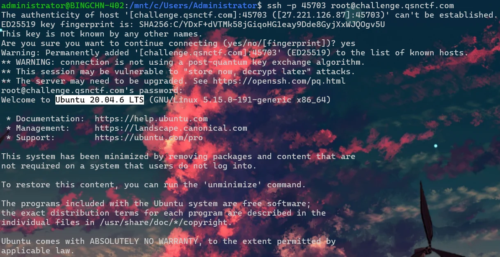
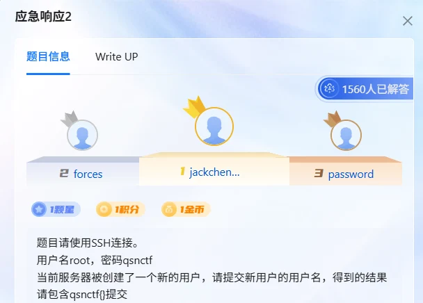
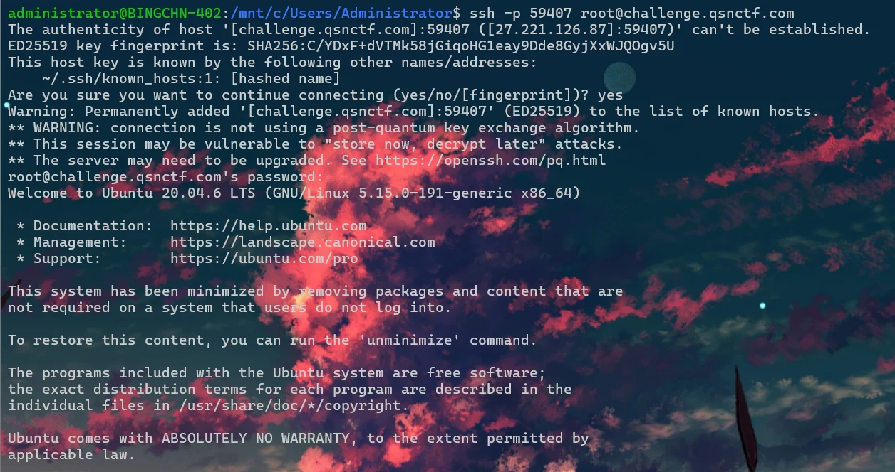
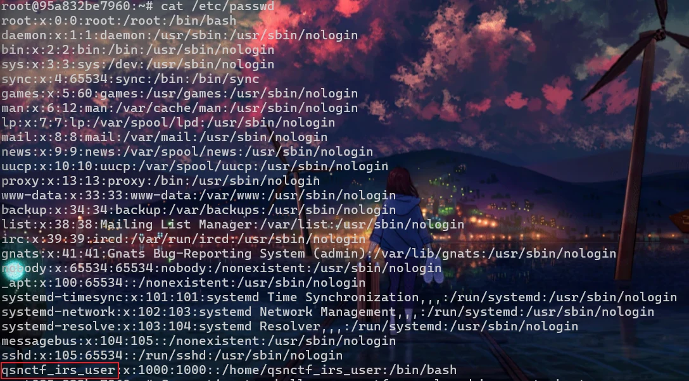

+++
title = "青少年 CTF 应急响应：应急响应 1 & 2"
date = 2026-10-29T20:20:00+08:00
draft = false
summary = "青少年 CTF 应急响应前两题：SSH 连上去之后，一题查系统发行版，一题从 /etc/passwd 里翻出那个不该存在的账号。"
tags = ["CTF", "应急响应", "Linux"]
categories = ["CTF"]
slug = "qing-shao-nian-ctf-ying-ji-xiang-ying-1-2"
+++

青少年 CTF 的应急响应题，前两题都属于“连上机器自己看”的类型，不需要取证工具链，考的是对 Linux 常见文件位置的熟悉程度。

## 应急响应 1

题目要求提交当前系统的发行版信息。



第一步，SSH 连接靶机：

```bash
ssh -p [port] root@challenge.qsnctf.com
```



第二步，去到根目录，进入 etc 找到并打开 os-release 文件查看（默认存在这个位置）：

```bash
cat /etc/os-release
```



最后把信息包上 `qsnctf{}` 提交：

```text
qsnctf{Ubuntu 20.04.6 LTS}
```

AND... One more thing...

其实连上去的那一刻，登录横幅里就已经写着系统版本了：



## 应急响应 2

这题要提交新用户的用户名。



第一步，连接靶机（和前面一样）：

```bash
ssh -p [port] root@challenge.qsnctf.com
```



然后查看用户列表：

```bash
cat /etc/passwd
```



翻一遍就能发现一个和系统默认账号明显不同的用户：`qsnctf_irs_user`，名字里还带着“irs”（incident response）的痕迹。

带上头直接交：

```text
qsnctf{qsnctf_irs_user}
```
