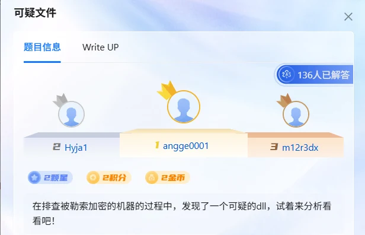
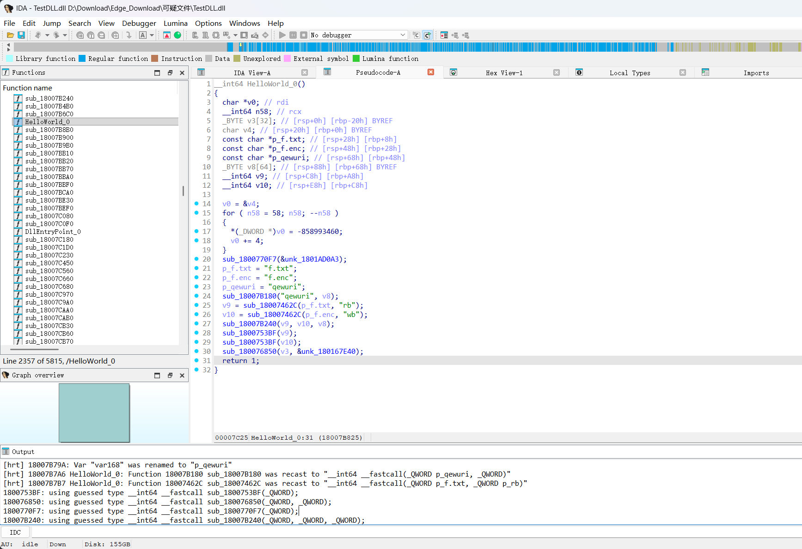
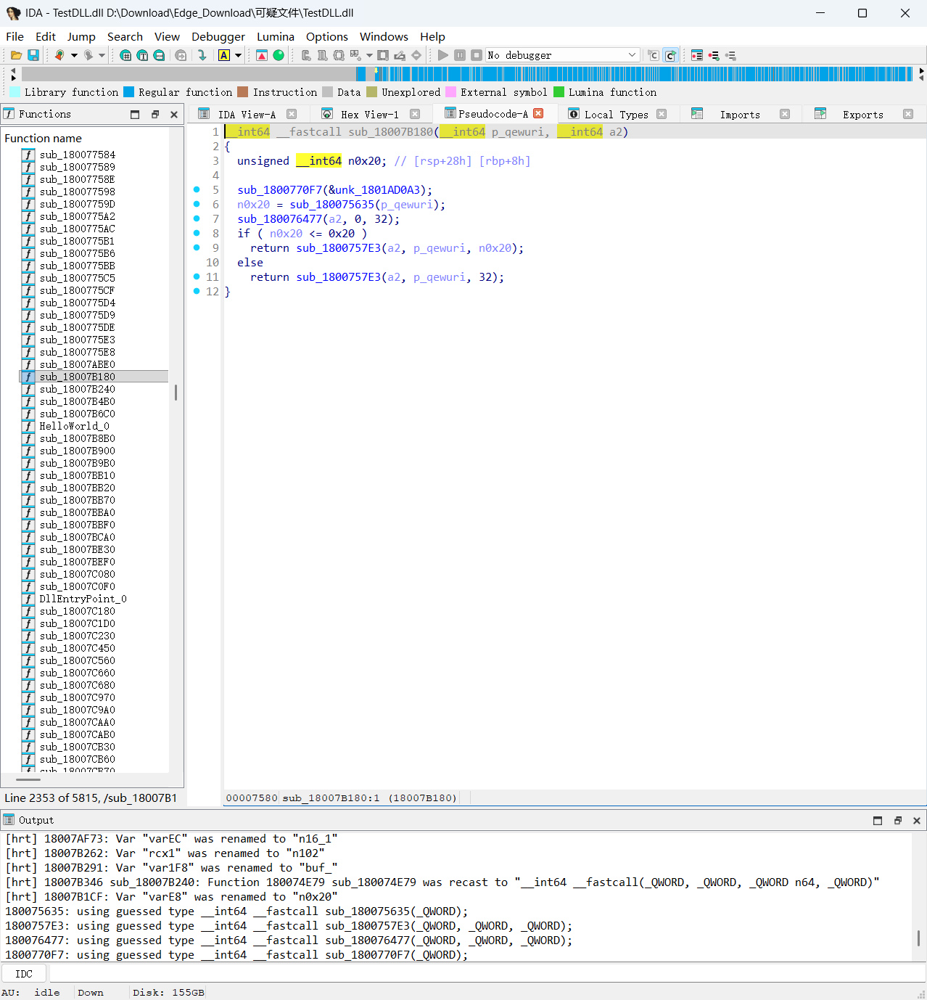

+++
title = "青少年 CTF 应急响应：可疑文件"
date = 2026-10-29T21:10:00+08:00
draft = false
summary = "一个只导出了 HelloWorld 的 DLL，用 IDA 顺着跳板摸到 ChaCha20，再从异或之后多加的那 1 逆回去，拿到 flag。"
tags = ["CTF", "应急响应", "逆向", "ChaCha20"]
categories = ["CTF"]
slug = "qing-shao-nian-ctf-ying-ji-xiang-ying-ke-yi-wen-jian"
+++

拿到样本，题目要求分析 dll 文件。



附件里还给了个 `flag.enc`。

## 需要先理解的基础概念

动手之前先补一点背景，后面看伪代码会轻松很多。

### PE 文件

Windows 的 `.exe` 和 `.dll` 都使用 PE 格式。PE 文件里包含：

- 机器架构
- 代码段
- 数据段
- 导入函数
- 导出函数
- 调试信息
- 重定位信息

### DLL 和导出函数

普通程序通常从 `main` 或 `WinMain` 开始执行。

DLL 会被别的程序加载，通过导出函数来调用，例如先 `LoadLibraryA("TestDLL.dll")`，再 `GetProcAddress("HelloWorld")`。

本样本只有一个导出函数：`HelloWorld`。

这就是第一个可疑点：名字看起来像演示函数，实际行为不一定是演示。

### RVA 和 VA

PE 文件内部通常使用 RVA，也就是相对于映像基址的偏移。

本样本的映像基址是 `ImageBase = 0x180000000`，导出函数 `HelloWorld` 的 RVA 是 `0x7402D`，所以它在反汇编里的虚拟地址是：

```text
0x180000000 + 0x7402D = 0x18007402D
```

### x64 函数调用参数

Windows x64 常见的参数寄存器顺序：

```text
第 1 个参数：RCX
第 2 个参数：RDX
第 3 个参数：R8
第 4 个参数：R9
```

读反汇编时，看到这些寄存器之间搬数据，就能大致判断函数的参数是什么。

## 正式开始

用 IDA Pro 打开 `TestDLL.dll`，按 F5 看函数，会发现有个 `HelloWorld`，但它只是一个跳板：

```text
0x18007402D  jmp 0x18007B750
```

所以真实入口是 `0x18007B750`。

### HelloWorld 主函数



精简之后是这样：

```c
__int64 HelloWorld_0()
{
  _BYTE v8[64];
  __int64 input;
  __int64 output;

  sub_18007B180("qewuri", v8);

  input  = sub_18007462C("f.txt", "rb");
  output = sub_18007462C("f.enc", "wb");

  sub_18007B240(input, output, v8);

  sub_1800753BF(input);
  sub_1800753BF(output);
  return 1;
}
```

IDA 自动识别出的字符串：

```text
f.txt   -> 输入文件
f.enc   -> 输出文件
qewuri  -> 硬编码密钥材料
rb      -> 二进制读取
wb      -> 二进制写入
```

这一步直接说明：DLL 会读取 `f.txt`，加密后写入 `f.enc`。不过它只处理固定的 `f.txt`，没看到目录遍历或批量文件操作。

### 密钥初始化

函数地址 `0x18007B180  derive_key_qewuri`：



```c
__int64 __fastcall sub_18007B180(
    __int64 p_qewuri,
    __int64 key_output)
{
  unsigned __int64 key_length;
  __int64 copy_length;

  key_length = strlen(p_qewuri);

  memset(key_output, 0, 32);

  if ( key_length <= 32 )
    copy_length = key_length;
  else
    copy_length = 32;

  return memcpy(key_output, p_qewuri, copy_length);
}
```

等价逻辑：

```c
unsigned char key[32] = {0};
memcpy(key, "qewuri", min(strlen("qewuri"), 32));
```

结果是一个 32 字节的缓冲区，前 6 字节是 `qewuri`，后面全补零：

```text
key = 71 65 77 75 72 69 00 00
      00 00 00 00 00 00 00 00
      00 00 00 00 00 00 00 00
      00 00 00 00 00 00 00 00
```

也就是：

```python
key = b"qewuri".ljust(32, b"\x00")
```

### 加密函数

函数地址 `0x18007B240  encrypt_file_chacha20`，IDA 伪代码精简后：

```c
__int64 __fastcall sub_18007B240(
    __int64 input,
    __int64 output,
    __int64 key)
{
  _BYTE nonce[12];
  _DWORD chacha_state[16];
  _BYTE chacha_block[64];
  _BYTE input_buffer[64];
  unsigned __int64 count;
  unsigned __int64 i;

  memset(nonce, 0, 12);
  memcpy(chacha_state, "expand 32-byte k", 16);
  memcpy(&chacha_state[4], key, 32);
  chacha_state[12] = 0;
  memcpy(&chacha_state[13], nonce, 12);

  while ( 1 )
  {
    count = fread(input_buffer, 1, 64, input);
    if ( count == 0 )
      break;

    sub_18007ABE0(chacha_state, chacha_block);

    for ( i = 0; i < count; ++i )
    {
      input_buffer[i] ^= chacha_block[i];
      ++input_buffer[i];
    }

    fwrite(input_buffer, 1, count, output);
  }
}
```

这里最关键的证据是 `memcpy(chacha_state, "expand 32-byte k", 16);` —— `"expand 32-byte k"` 是 ChaCha20 的标准常量。加上后面 20 轮的轮函数，可以确定算法就是 ChaCha20。

参数：

```text
key     = "qewuri" 补零到 32 字节
nonce   = 12 个零字节
counter = 0
block   = 64 字节
```

### 额外字节变换

IDA 里这一段最值得注意：

```c
input_buffer[i] ^= chacha_block[i];
++input_buffer[i];
```

先异或，再把结果加 1。所以真正的加密公式是：

```text
密文 = ((明文 XOR ChaCha20 密钥流) + 1) mod 256
```

反过来的解密操作就是：

```text
明文 = ((密文 - 1) mod 256) XOR ChaCha20 密钥流
```

这个 `+1` 不是 ChaCha20 自带的，是样本额外加的混淆步骤。

### ChaCha20 分组函数

函数地址 `0x18007ABE0  chacha20_block`，伪代码里的轮循环：

```c
for ( n20 = 0; n20 < 20; n20 += 2 )
{
  sub_18007B4B0(...);
  sub_18007B4B0(...);
  sub_18007B4B0(...);
  sub_18007B4B0(...);

  sub_18007B4B0(...);
  sub_18007B4B0(...);
  sub_18007B4B0(...);
  sub_18007B4B0(...);
}
```

每次循环执行一组列轮和一组对角轮，循环 10 次就是 20 轮，和 ChaCha20 的定义一致。

### 解密

函数里还能看到 `++*(_DWORD *)(state + 48);`。`state + 48` 对应第 12 个 32 位元素，也就是 ChaCha20 的 counter —— 每生成一个 64 字节分组，counter 加 1。

`flag.enc` 的前 8 个密文字节：

```text
12 1D 58 7A 7F 60 FE 96
```

执行逆变换，也就是每个字节先减 1，再和 ChaCha20 密钥流异或，得到：

```text
66 6C 61 67 7B 73 69 65
```

转成 ASCII 是 `flag{sie`。

把完整的 61 字节都做同样的处理后，得到：

```text
flag{sierting_666_fpdsajf[psdfljnwqrlqwhperhqwoeiurhqweourhp}
```

最后按原算法重新加密这段明文，能重新得到完全相同的 `flag.enc`：

```text
密文 -> 逆算法 -> 明文 -> 正算法 -> 原密文
```

## 收尾

还是比较有挑战的题了，师傅们加油，嘿嘿
