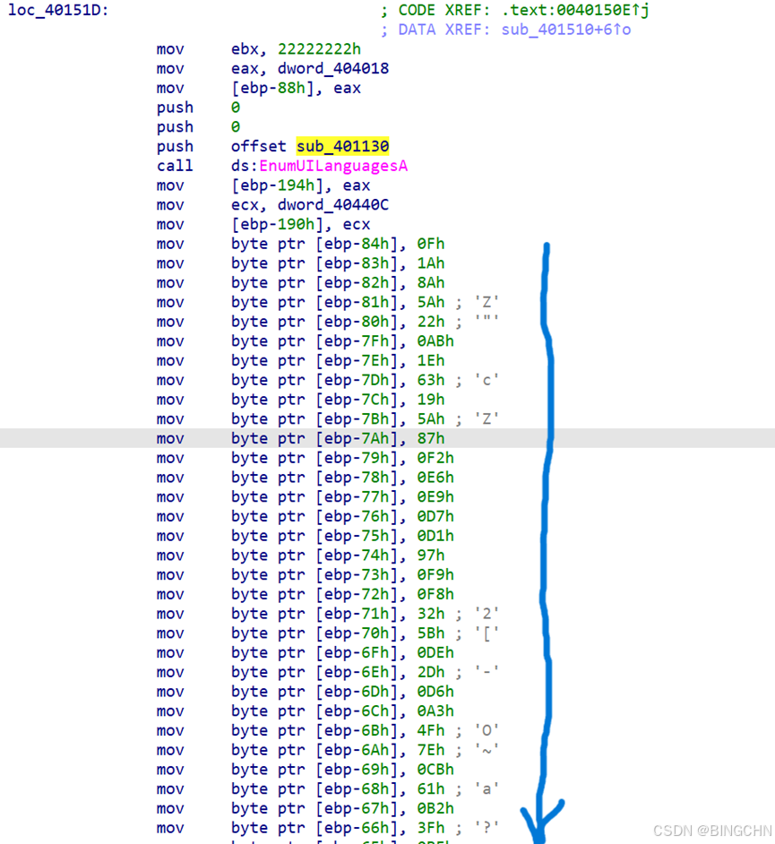
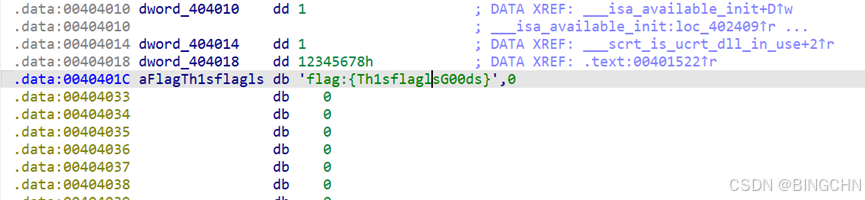
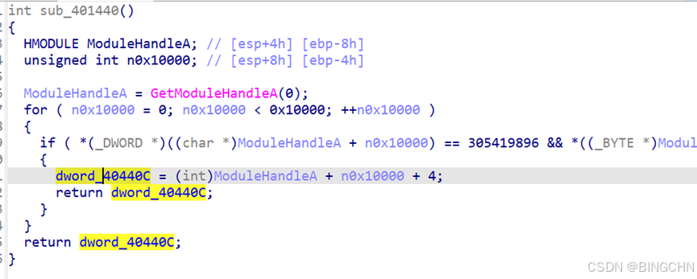
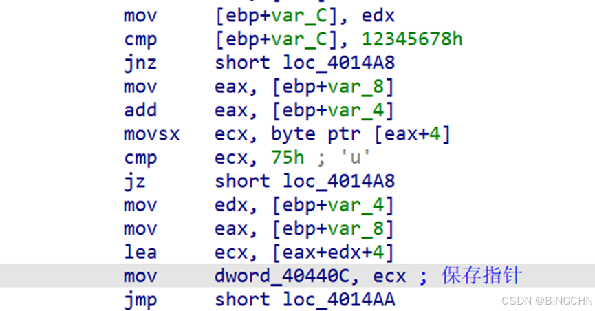
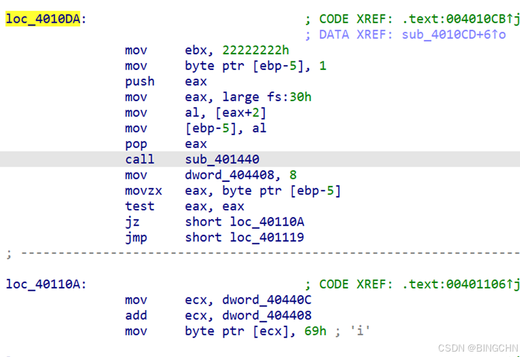
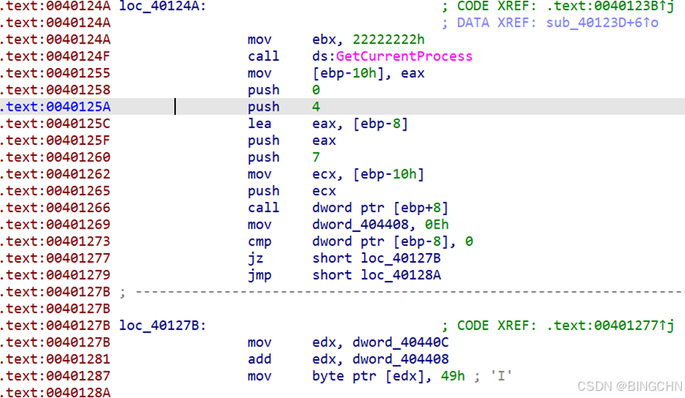
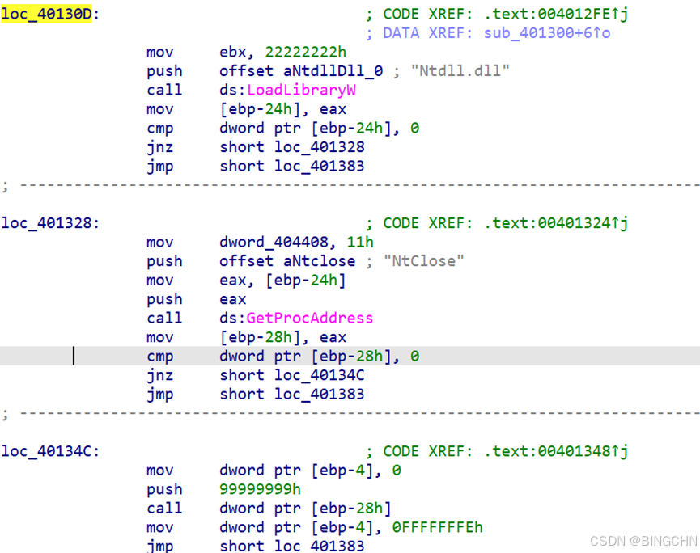
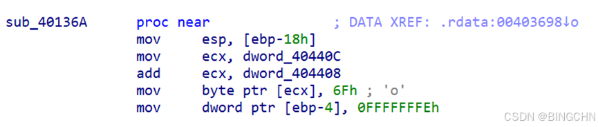
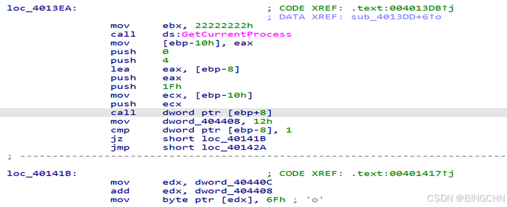

一个RC4的解密， 密钥 的部分做了动态的反调试，找到逻辑即可。

密文入栈部分，往下一共有80字节。

在data段找到错误的key

错误的key:flag:{ Th1sflaglsG00ds}.

之后有4处反调试的地方

后面找到sub\_401440函数

在汇编部分找到dword\_40440c指向flag:{ Th1sflaglsG00ds}.的起始地址部分

4个反调试的地方

这里会将key的第8个字节改成i

如果（Debug == 0）：

在隐藏缓冲区（dword\_40440C 指向的地方）偏移 0x0E 的位置写入 'I'；

第三处

这里是一个修改，NtClose（0x99999999）正常触发异常，其中的sub\_40136A是异常处理函数。这里将key的第11字节部分改成‘o’

第四处

将G00ds第二个’0’改成’o’

所以最后真正的key是flag:{ThisflagIsGoods}

RC4解密即可。

RAW\_KEY = b"flag:{ThisflagIsGoods}"

KEY\_SIZE = 0x80

padding = KEY\_SIZE - len(RAW\_KEY)

RC4\_KEY = bytes(list(RAW\_KEY) + \[0\] \* padding)

CIPHERTEXT = bytes(\[

    0x0f, 0x1a, 0x8a, 0x5a, 0x22, 0xab, 0x1e, 0x63,

    0x19, 0x5a, 0x87, 0xf2, 0xe6, 0xe9, 0xd7, 0xd1,

    0x97, 0xf9, 0xf8, 0x32, 0x5b, 0xde, 0x2d, 0xd6,

    0xa3, 0x4f, 0x7e, 0xcb, 0x61, 0xb2, 0x3f, 0xbf,

    0xb7, 0x1b, 0x0a, 0x84, 0xb3, 0xb4, 0xde, 0x03,

    0x46, 0x7b, 0x83, 0x2a, 0x51, 0x73, 0xe0, 0x7c,

    0x93, 0x27, 0x44, 0x9c, 0x56, 0x8f, 0x75, 0xfa,

    0xa0, 0x79, 0x26, 0xda, 0x08, 0x01, 0x85, 0x66,

    0x7d, 0xbb, 0xee, 0x0f, 0x89, 0x59, 0xd4, 0x5f,

    0xac, 0x18, 0xae, 0x0b, 0x4e, 0xf0, 0xb7, 0xdd,

    0xdd, 0x55, 0x4b, 0xea, 0x07, 0x92, 0x5c, 0x8a,

    0x53, 0xf3, 0xff, 0xf7, 0xa7, 0xdd, 0x2e, 0xe6,

    0xed, 0x0f, 0x77, 0x2c, 0x4a, 0x22, 0xf1, 0x36,

    0x4f, 0xa7, 0x55, 0x5e, 0x3e, 0x93, 0xa4, 0x34,

    0x29, 0x67, 0xfc, 0x23, 0x79, 0x19, 0xd8, 0xc9,

    0x2b, 0xcf,

\])

def init\_rc4\_state(key\_bytes: bytes):

    box = list(range(256))

    j = 0

    klen = len(key\_bytes)

    for i in range(256):

        j = (j + box\[i\] + key\_bytes\[i % klen\]) & 0xFF

        box\[i\], box\[j\] = box\[j\], box\[i\]

    return box

def rc4\_transform(state, data: bytes) -> bytes:

    i = 0

    j = 0

    result = \[\]

    for idx in range(len(data)):

        i = (i + 1) & 0xFF

        j = (j + state\[i\]) & 0xFF

        state\[i\], state\[j\] = state\[j\], state\[i\]

        k = state\[(state\[i\] + state\[j\]) & 0xFF\]

        result.append(data\[idx\] ^ k)

    return bytes(result)

if \_\_name\_\_ == "\_\_main\_\_":

    s = init\_rc4\_state(RC4\_KEY)

    plaintext = rc4\_transform(s, CIPHERTEXT)

    print(plaintext)

Flag；RCTF{AntiDbg\_Reversing\_2025\_v2.0\_Ch4llenge}
