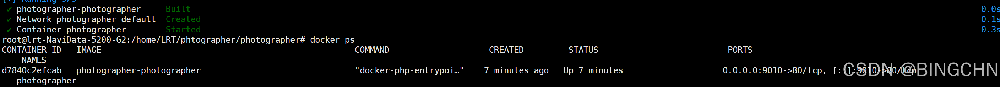
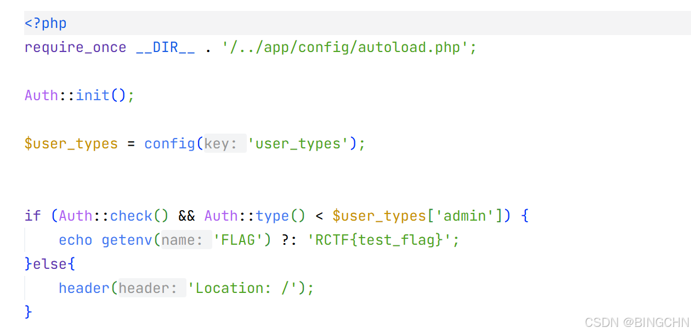
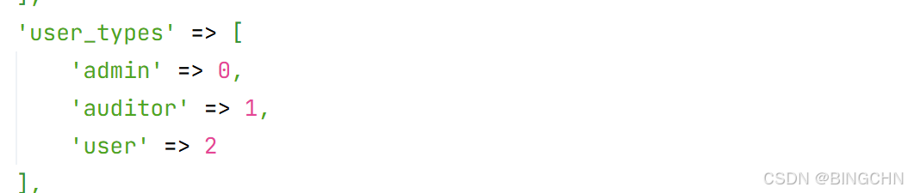
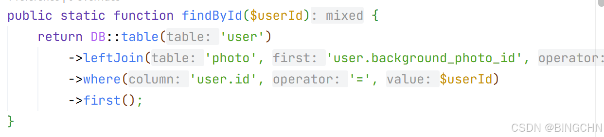
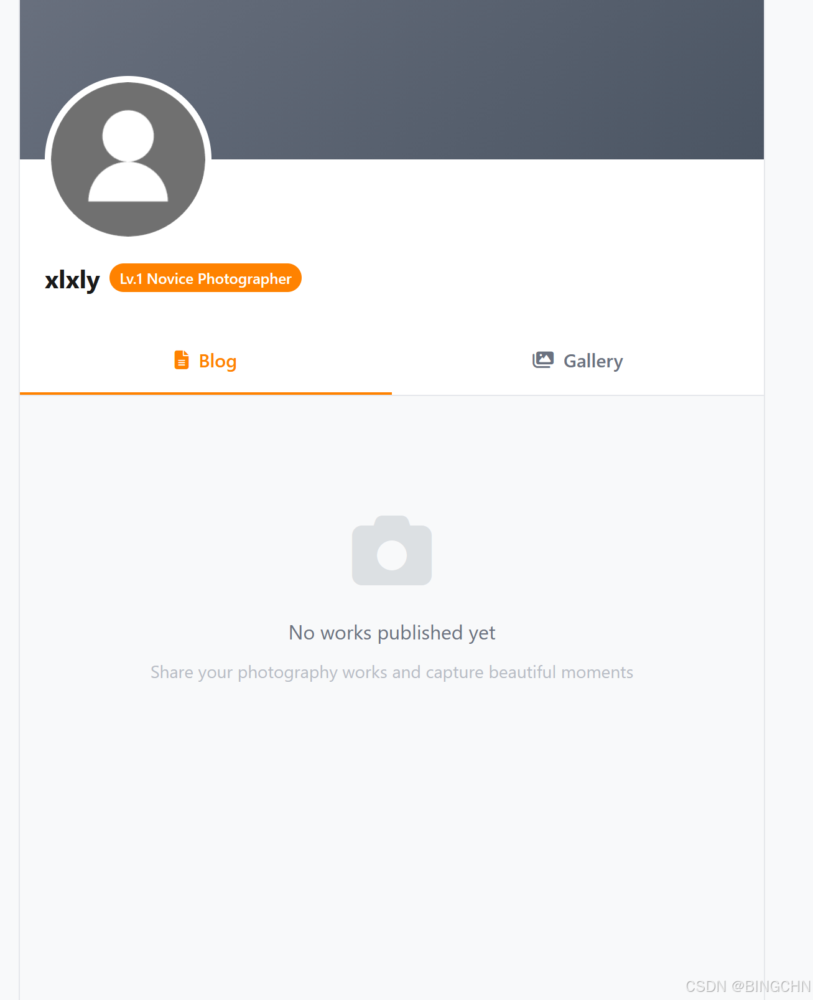
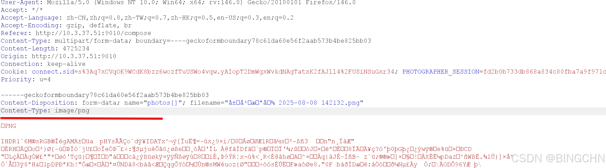
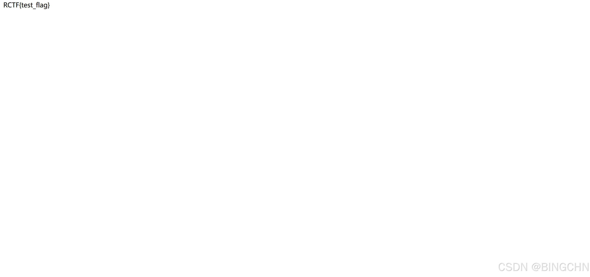

## 一、环境搭建

依旧是 docker compose up -d 直接在工作区执行；端口一般也没有冲突；外部是9010；

太简单，没什么注意点就不多说了师傅们。

## 二、开始做题

我们还是从 src 入手，依旧追踪flag。

看到了这个条件是这个 type 要小于admin的type。

然后我们在 config .php可以找到这儿

说明只要user\_type为负数就可以了呗，但是user\_type不可控；这道题叫photographer，让人联想到要么是传exif进行xss拿 cookie 绕要么就是upload，那我们就看看和图片相关的文件呗；

最后找到个这个，可以看到它使用了leftjoin连表查询，也就是说把photo和user表连一起查；

[一分钟搞明白Join、Left Join、Right Join的区别\_join left join right join-CSDN博客](https://blog.csdn.net/qq_41171409/article/details/125255204 "一分钟搞明白Join、Left Join、Right Join的区别_join left join right join-CSDN博客")不理解的可以看看这一篇。发现photo和user这两个类都有type属性；看到DB.php可以知道图片的type属性会覆盖掉user的type属性，那么思路就很清晰了。图片的type属性是可控的。

接下来直接开始操作。

1.先注册一个普通用户

2.发布文章时传图片然后bp抓包改 content \-type

然后把这张图片设置为背景。接着访问/superadmin.php。

## 三、总结

这道题总的来说还是比较简单，当时比赛的时候就出了，现在复现了一下理一理思路。还是要去学习sql的知识点。不然还得看半天。看了下其他大佬的WP还有用 AI 一把梭的，太强了，可惜经济不允许了。
