## 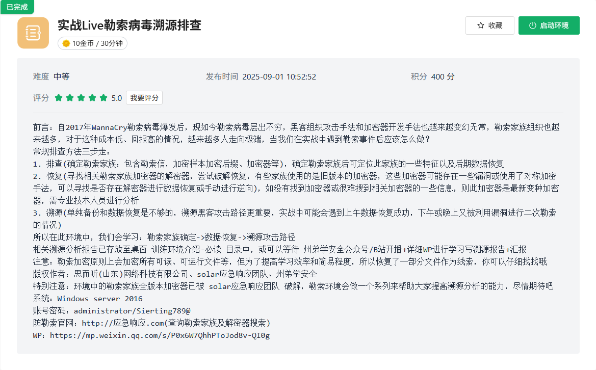

##  **前言**

## **题目**

### **1.上机排查提交病毒家族的名称，可访问应急响应.com确定家族名称，以flag{xxx}提交(大小写敏感)**

发现加密文件特征以.LIVE结尾，结合信息收集：

```cobol
LIVE2.0勒索病毒是LIVE家族的第二代恶意软件，该恶意软件会加密受害者的文件，并且将受害者的ID、文件名称和文件名称的长度写入到加密文件的末尾，最后会将文件名重命名成带.LIVE的文件 ，尤其是针对较重要的文本类文件会采用全部数据加密的方式。此外，它还会提供给受害者一封“FILE RECOVERY_ID_+受害者ID.txt”的勒索信。
```

flag{LIVE}

### 2.提交勒索病毒预留的ID，以flag{xxxxxx}进行提交

根据信息收集，该勒索家族，会给受害者提供一封“FILE RECOVERY\_ID\_+受害者ID.txt”的勒索信。

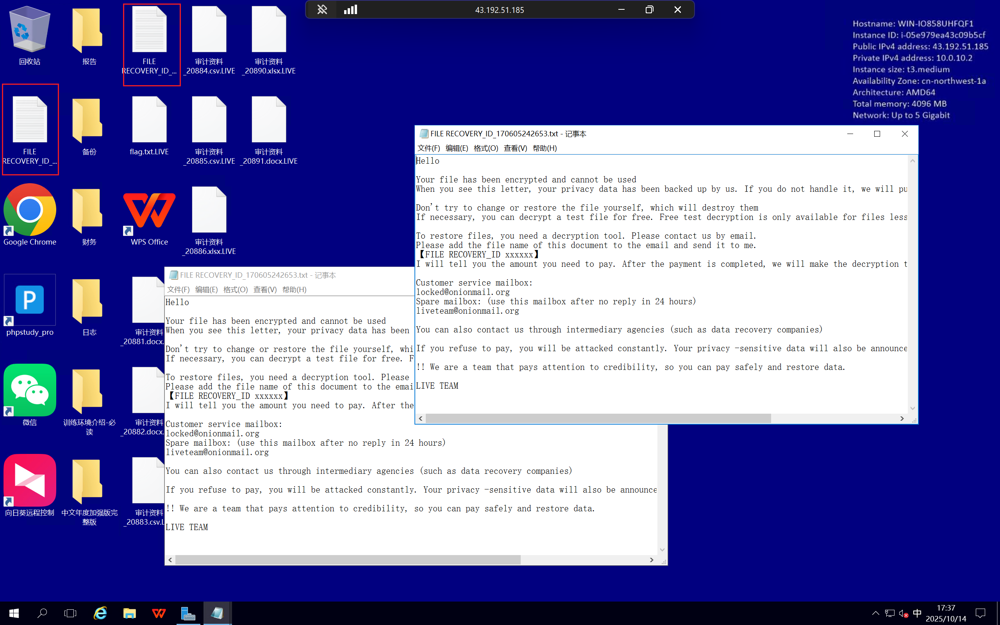

找到：FILE RECOVERY\_ID\_170605242653与FILE RECOVERY\_ID\_170605242653
flag{170605242653}

### 3.解密并提交桌面中flag.txt.LIVE的flag，以flag{xxxx}提交

寻找 LIVE 勒索病毒家族解密工具：[Solar Security Tools](https://www.solarsecurity.cn/tools?page=1&keyword=live)


解密密码：solarsecurity
放入在线环境，直接运行
LIVE\_Decrypto.exe -path=C:\\Users\\Administrator\\Desktop\\flag.txt.LIVE

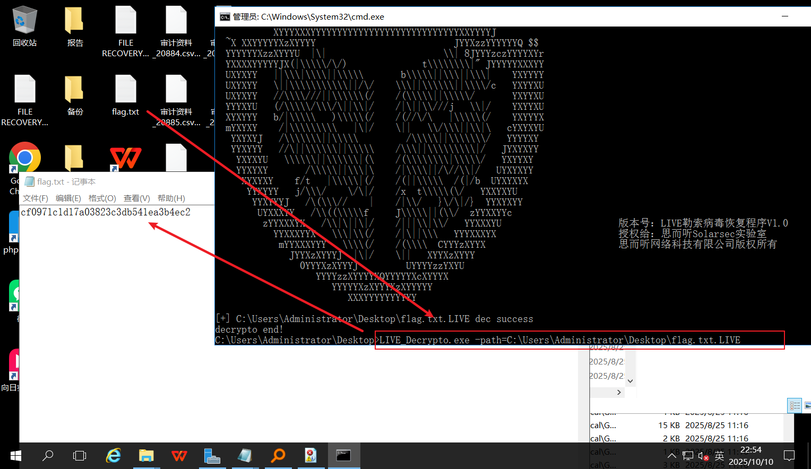

flag{cf0971c1d17a03823c3db541ea3b4ec2}

### 4.提交Windows Defender删除攻击者C2的时间，以flag{2025.1.1\_1:10}格式提交

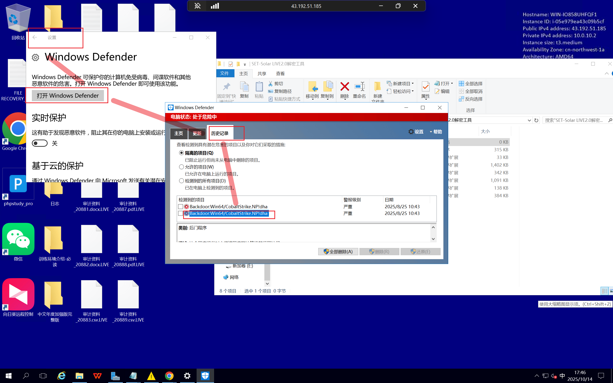

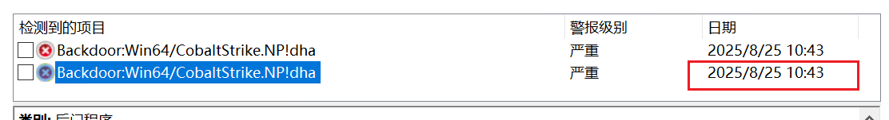

可以看出时间是2025.8.25\_10:43

flag{2025.8.25\_10:43}

### 5.提交攻击者关闭Windows Defender的时间，以flag{2025.1.1\_1:10}格式提交

使用工具fulleventlogview
关闭Windows defender的时间，Windows默认是记录的，其事件id为**5001**会记录开启和关闭的日志

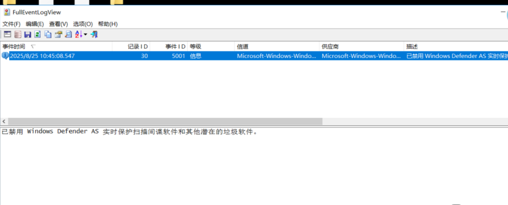

flag{2025.8.25\_10:45}

### 6.提交攻击者上传C2的绝对路径，格式以flag{C:\\xxx\\xxx}提交

在文件夹中寻找，根据经验，查发现，发现exer文件

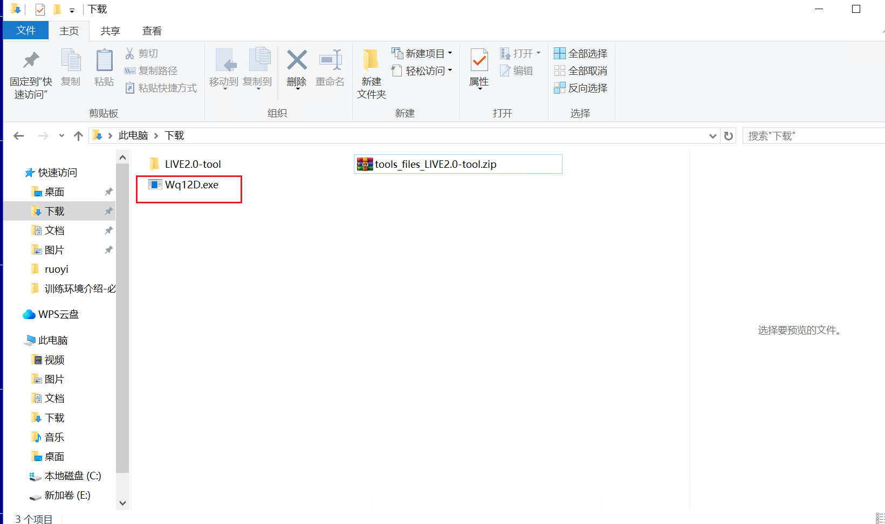

flag{C:\\Users\\Administrator\\Downloads\\Wq12D.exe}

### 7.提交攻击者C2的IP外联地址，格式以flag{xx.x.x.x}提交

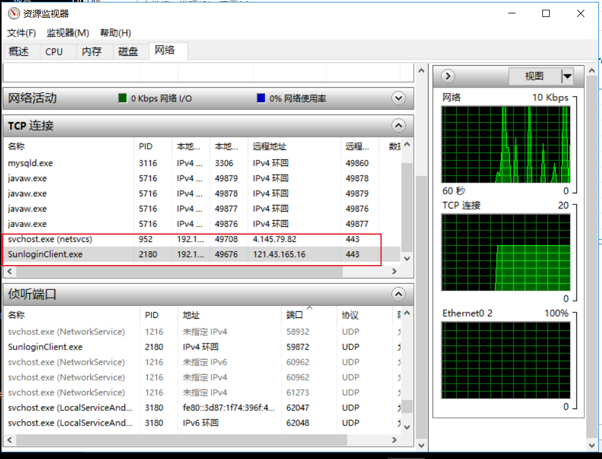

不是网络连接的这两个。是上一个flag找到的恶意C2的上线 payload 得到：

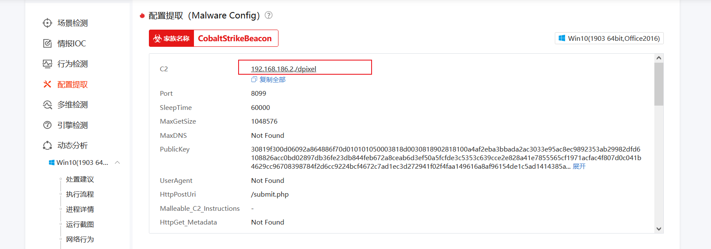

flag{192.168.186.2}

### 8.提交攻击者加密器绝对路径，格式以flag{C:\\xxx\\xxx}提交

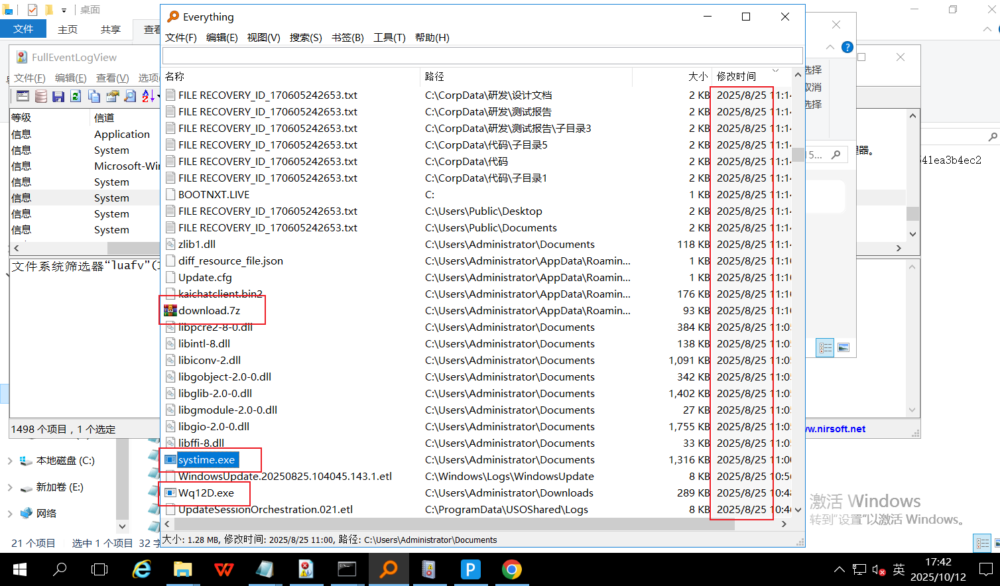

思路：根据8.25时间以及C2payload分析附近时间点的文件情况，寻找加密器。上线时间点确定了加密器出现时间的起始，加密文件的出现点确定了加密器出现时间的结尾。
download.7z是可疑，排查后发现是systime.exe。
flag{C:\\Users\\Administrator\\Documents\\systime.exe}

### 9.溯源黑客攻击路径，利用的哪个漏洞并推测验证，提交此业务运行文件的绝对路径，如：flag{C:\\xxx\\xxx\\xxx} 注：此处需具备一些渗透思维和文件特征识别能力

因为肯定是远程渗透进入的，这台靶机windows上远程可以访问的服务:3389、 小皮 (nginx、apache、ftp)、 若依 。依次排查入侵点
看一下3389登录失败日志：4625

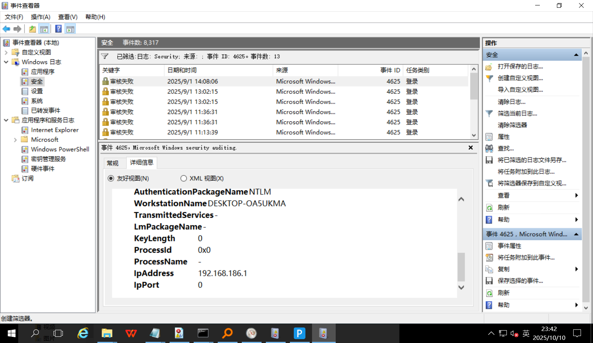

结合之前获得的C2信息，未找到192.168.186.2的登录信息。
注意到有小皮，找对应的PbootCMS-3.2.12漏洞，未发现nday，Nginx版本发现存在解析漏洞：
[https://blog.csdn.net/weixin\_43606134/article/details/108652890](https://blog.csdn.net/weixin_43606134/article/details/108652890 "https://blog.csdn.net/weixin_43606134/article/details/108652890")
进一步打开小皮打开nginx日志进行排查，在error.log处发现可疑日志信息：

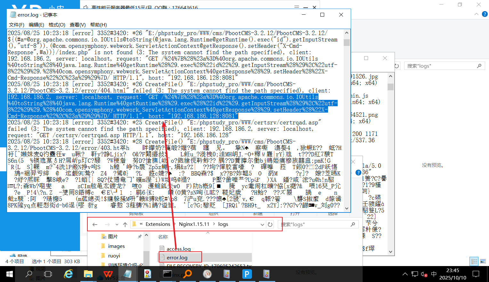

解码：

```typescript
GET /${(#a=@org.apache.commons.io.IOUtils@toString(@java.lang.Runtime@getRuntime().exec("id").getInputStream(),"utf-8")).(@com.opensymphony.webwork.ServletActionContext@getResponse().setHeader("X-Cmd-Response",#a))}/
```

显然使用的payload为java语言，且开启nginx并尝试复现解析漏洞，失败。
在E:\\找到若依框架，版本为4.7.1，信息收集存在nday：
[https://blog.csdn.net/lza20001103/article/details/142638979](https://blog.csdn.net/lza20001103/article/details/142638979 "https://blog.csdn.net/lza20001103/article/details/142638979")
尝试复现，没有能够登录的账密，还原若依文件后，在 sql文件 中找到了加密的账密：'29c67a30398638269fe600f73a054934','111111'。
尝试利用无果(暂时没爆破出来)。
查看日志记录，发现框架spring和spring boot继而寻找框架漏洞，

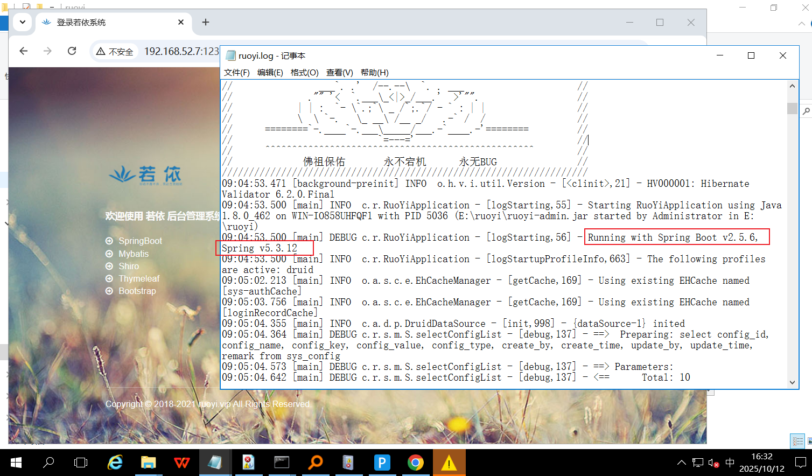

使用框架漏洞扫描工具发现框架存在信息泄露：

[http://192.168.52.7:9988/actuator/heapdump](http://192.168.52.7:9988/actuator/heapdump "http://192.168.52.7:9988/actuator/heapdump") 下载heapdump解密进行利用，根据信息收集利用方式依次排查：
[https://blog.csdn.net/WangsuSecurity/article/details/140873359](https://blog.csdn.net/WangsuSecurity/article/details/140873359 "https://blog.csdn.net/WangsuSecurity/article/details/140873359")
[https://cloud.tencent.com/developer/article/1630225](https://cloud.tencent.com/developer/article/1630225 "https://cloud.tencent.com/developer/article/1630225")
最后尝试利用shiro\_key，解密工具如下
[https://github.com/wyzxxz/heapdump\_tool](https://github.com/wyzxxz/heapdump_tool "https://github.com/wyzxxz/heapdump_tool")

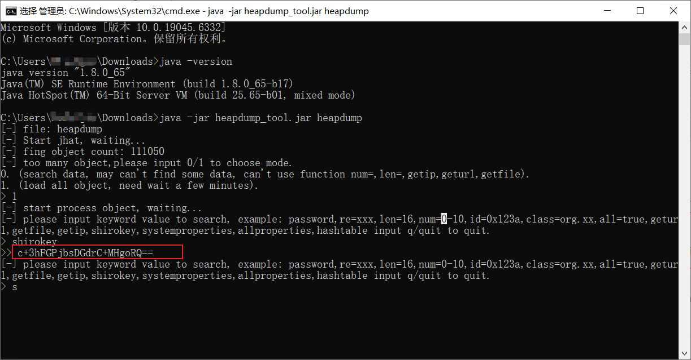

找到shirokey但是利用显示错误：

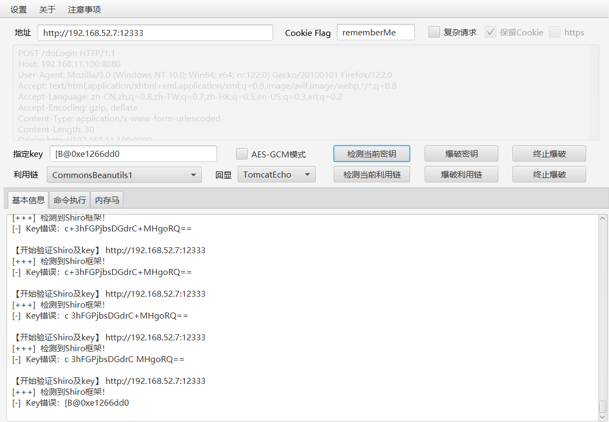

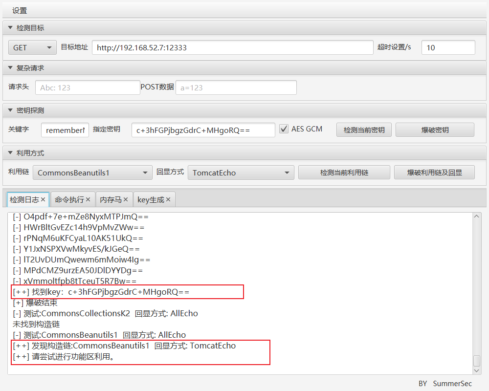

总结：若依系统的漏洞未彻底测试，至少spring框架存在信息泄露，导致了shiro\_key的泄露。
flag{E:\\ruoyi\\ruoyi-admin.jar}

学习内容：

```cobol
勒索病毒分析处置：
1、判断勒索病毒：
	1. 更改文件扩展名(部分勒索家族会将文件重命名如加密或编码)
	2. 预留勒索信(目的为了告知其联系方式与威胁信息)
	3. 加密器(截至目前，大部分勒索家族会在触发加密器后，待文件加密完毕后自删除加密器，防止逆向分析)
	4. 预留勒索id(id一般唯一，用于后期数据恢复的凭证)。一般勒索id会存放在以下位置:
		(1)勒索信
		(2)被加密后的文件名
		(3)勒索信文件名
2、了解此勒索家族惯用攻击手法，如一些家族喜欢rdp爆破，一些家族喜欢攻击OA等，后期溯源就可以优先侧重于此处排查，此家族之前有无被破解的解密器，是否可以使用被破解的解密器进行恢复。
3、在正常排查过程中，大部分勒索家族会在加密完毕后做痕迹清理和加密器自删除，给溯源排查增加难度，更有甚者会删除Windows事件日志，这个时候更考验蓝队工程师对于环境中的应用服务排查能力以及渗透能力，因为当日志被清理后，需要判断哪些服务对外开放且存在漏洞最后给出合理的报告。
```

转载自原文：[玄机蓝队靶场\_应急响应\_198:实战Live勒索病毒溯源排查 - 如此蹉跎 - 博客园](https://www.cnblogs.com/blue-red/p/19139653 "玄机蓝队靶场_应急响应_198:实战Live勒索病毒溯源排查 - 如此蹉跎 - 博客园")
